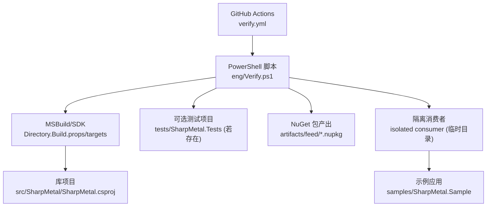
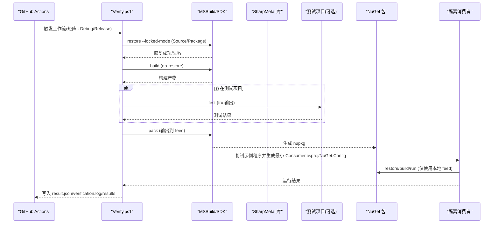
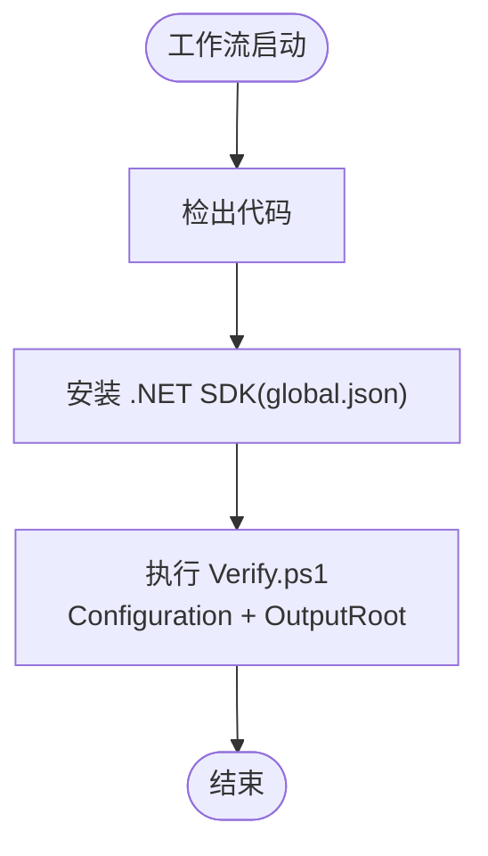
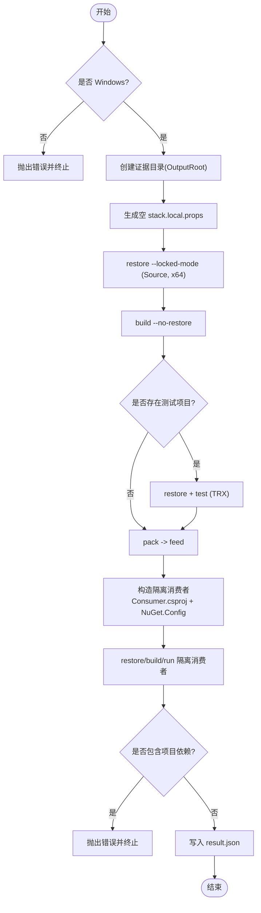
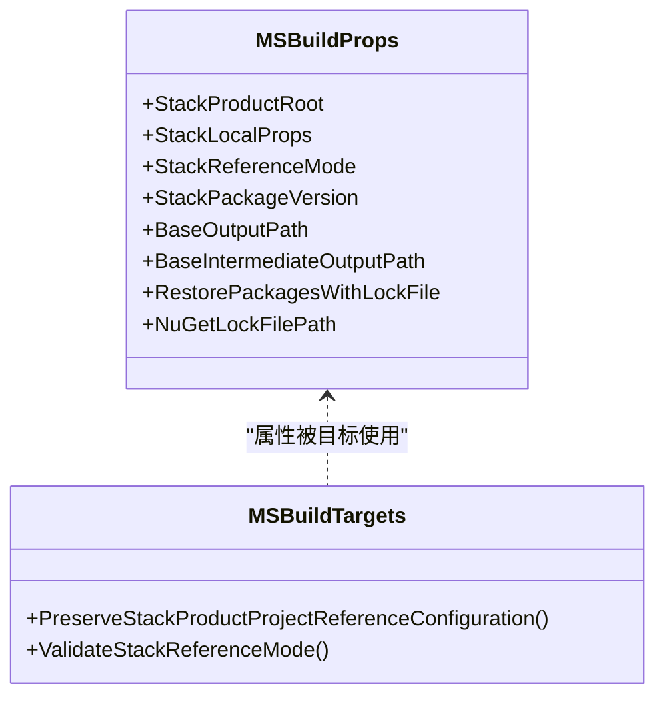
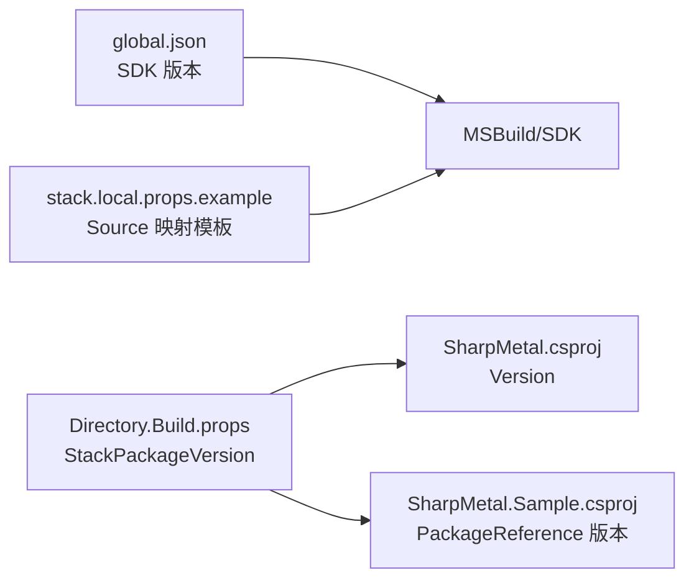
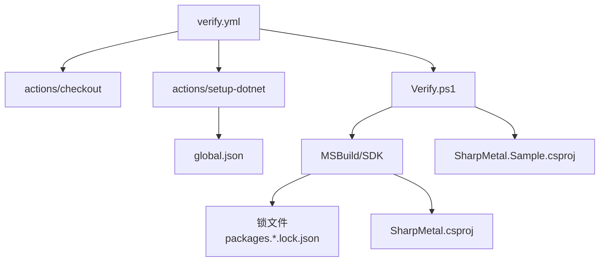

# CI/CD 流水线

<cite>
**本文引用的文件**
- [verify.yml](file://.github/workflows/verify.yml)
- [Verify.ps1](file://eng/Verify.ps1)
- [VERIFICATION.md](file://docs/VERIFICATION.md)
- [Directory.Build.props](file://Directory.Build.props)
- [Directory.Build.targets](file://Directory.Build.targets)
- [SharpMetal.product.props](file://SharpMetal.product.props)
- [global.json](file://global.json)
- [stack.local.props.example](file://stack.local.props.example)
- [SharpMetal.csproj](file://src/SharpMetal/SharpMetal.csproj)
- [SharpMetal.Sample.csproj](file://samples/SharpMetal.Sample/SharpMetal.Sample.csproj)
- [README.md](file://README.md)
</cite>

## 目录
1. [简介](#简介)
2. [项目结构](#项目结构)
3. [核心组件](#核心组件)
4. [架构总览](#架构总览)
5. [详细组件分析](#详细组件分析)
6. [依赖关系分析](#依赖关系分析)
7. [性能考虑](#性能考虑)
8. [故障排除指南](#故障排除指南)
9. [结论](#结论)
10. [附录](#附录)

## 简介
本仓库的 CI/CD 以 GitHub Actions 工作流为核心，结合工程脚本 eng/Verify.ps1，实现 Windows x64 平台上的受控构建、打包与隔离消费验证。当前流水线聚焦于托管端（Managed）验证：锁定源或包模式恢复、构建库、运行可选测试、生成 NuGet 包，并在隔离环境中消费该包以验证其可引用性与可执行性。原生 Metal 执行需要 Apple 主机与系统框架，因此本机/CI 中会显式标记为平台受限。

## 项目结构
- .github/workflows/verify.yml：定义在 push、pull_request、workflow_dispatch 时触发的工作流，使用 windows-latest 运行器，矩阵化 Debug/Release 配置，调用 eng/Verify.ps1 完成验证。
- eng/Verify.ps1：产品本地 CI 入口脚本，负责创建证据目录、设置属性、执行 restore/build/test/pack、构造隔离消费者并运行。
- Directory.Build.props/targets：统一 MSBuild 行为，包括输出路径、锁文件、Source/Package 模式校验、项目引用属性传递等。
- src/SharpMetal/SharpMetal.csproj：库项目，目标 net10.0，支持 x64/ARM64，版本来自 StackPackageVersion。
- samples/SharpMetal.Sample/SharpMetal.Sample.csproj：示例应用，根据 StackReferenceMode 引用源码或包。
- docs/VERIFICATION.md：权威构建/测试/打包命令与本地验证说明，解释 Source/Package 模式与证据保留策略。
- global.json：固定 .NET SDK 版本。
- stack.local.props.example：本地开发映射模板，用于 Source 模式下指向相邻仓库。

图表来源
- [verify.yml:1-26](file://.github/workflows/verify.yml#L1-L26)
- [Verify.ps1:1-67](file://eng/Verify.ps1#L1-L67)
- [Directory.Build.props:1-25](file://Directory.Build.props#L1-L25)
- [Directory.Build.targets:1-40](file://Directory.Build.targets#L1-L40)
- [SharpMetal.csproj:1-47](file://src/SharpMetal/SharpMetal.csproj#L1-L47)
- [SharpMetal.Sample.csproj:1-6](file://samples/SharpMetal.Sample/SharpMetal.Sample.csproj#L1-L6)

章节来源
- [verify.yml:1-26](file://.github/workflows/verify.yml#L1-L26)
- [Verify.ps1:1-67](file://eng/Verify.ps1#L1-L67)
- [Directory.Build.props:1-25](file://Directory.Build.props#L1-L25)
- [Directory.Build.targets:1-40](file://Directory.Build.targets#L1-L40)
- [SharpMetal.csproj:1-47](file://src/SharpMetal/SharpMetal.csproj#L1-L47)
- [SharpMetal.Sample.csproj:1-6](file://samples/SharpMetal.Sample/SharpMetal.Sample.csproj#L1-L6)
- [VERIFICATION.md:1-103](file://docs/VERIFICATION.md#L1-L103)

## 核心组件
- GitHub Actions 工作流：触发条件、运行环境、矩阵配置、权限与步骤编排。
- 验证脚本 Verify.ps1：参数解析、错误处理、日志记录、dotnet 命令封装、产物与证据管理、隔离消费验证。
- MSBuild 全局属性与目标：统一输出路径、锁文件、Source/Package 模式校验、项目引用属性透传。
- 项目文件：库与示例项目的目标框架、平台、版本与引用策略。
- 文档与模板：VERIFICATION.md 提供权威命令；stack.local.props.example 提供本地映射模板。

章节来源
- [verify.yml:1-26](file://.github/workflows/verify.yml#L1-L26)
- [Verify.ps1:1-67](file://eng/Verify.ps1#L1-L67)
- [Directory.Build.props:1-25](file://Directory.Build.props#L1-L25)
- [Directory.Build.targets:1-40](file://Directory.Build.targets#L1-L40)
- [SharpMetal.csproj:1-47](file://src/SharpMetal/SharpMetal.csproj#L1-L47)
- [SharpMetal.Sample.csproj:1-6](file://samples/SharpMetal.Sample/SharpMetal.Sample.csproj#L1-L6)
- [VERIFICATION.md:1-103](file://docs/VERIFICATION.md#L1-L103)

## 架构总览
下图展示从代码提交到验证产物的端到端流程，包括构建、测试、打包与隔离消费验证。

图表来源
- [verify.yml:1-26](file://.github/workflows/verify.yml#L1-L26)
- [Verify.ps1:1-67](file://eng/Verify.ps1#L1-L67)
- [Directory.Build.props:1-25](file://Directory.Build.props#L1-L25)
- [Directory.Build.targets:1-40](file://Directory.Build.targets#L1-L40)
- [SharpMetal.csproj:1-47](file://src/SharpMetal/SharpMetal.csproj#L1-L47)
- [SharpMetal.Sample.csproj:1-6](file://samples/SharpMetal.Sample/SharpMetal.Sample.csproj#L1-L6)

## 详细组件分析

### GitHub Actions 工作流 verify.yml
- 触发：push、pull_request、workflow_dispatch。
- 运行环境：windows-latest，超时 20 分钟。
- 矩阵：Debug、Release 两种配置并行执行。
- 步骤：
  - 检出代码（不持久化凭据）。
  - 使用 global.json 指定 .NET SDK。
  - 调用 eng/Verify.ps1，传入 Configuration 与 OutputRoot。

图表来源
- [verify.yml:1-26](file://.github/workflows/verify.yml#L1-L26)

章节来源
- [verify.yml:1-26](file://.github/workflows/verify.yml#L1-L26)

### 验证脚本 Verify.ps1
- 参数：Configuration（Debug/Release）、OutputRoot（必填）。
- 前置检查：仅 Windows 平台；确保 OutputRoot 不存在后创建。
- 日志：启用 Transcript 输出至 verification.log。
- 关键步骤：
  - 生成空映射文件 stack.local.props，避免 Source 模式缺失导致失败。
  - 设置属性：StackReferenceMode=Source、Platform=x64、StackLocalProps、StackProductRoot、禁用静态图评估、并行恢复、禁用非增量恢复。
  - 对库项目执行 restore（--locked-mode）与 build（--no-restore）。
  - 若存在 tests/SharpMetal.Tests，则对其执行 restore、test（输出 TRX 到 results）。
  - 对库执行 pack，输出到 feed。
  - 构造隔离消费者：复制 Program.cs，生成空的 Directory.Build.props/targets，生成 Consumer.csproj 引用刚打包的版本，生成 NuGet.Config 仅包含本地 feed。
  - 在隔离环境下 restore/build 并运行二进制，同时校验未引入项目依赖。
  - 输出 result.json（包含 product、configuration、managedBuildAndPackageConsumer、nativeMetal、packageSha256）。
  - 清理 Transcript。

图表来源
- [Verify.ps1:1-67](file://eng/Verify.ps1#L1-L67)

章节来源
- [Verify.ps1:1-67](file://eng/Verify.ps1#L1-L67)

### MSBuild 全局属性与目标
- Directory.Build.props：
  - 统一输出路径 BaseOutputPath/BaseIntermediateOutputPath，按 StackReferenceMode/Platform/RID 组织。
  - 强制使用锁文件 RestorePackagesWithLockFile=true，并定位 packages.<StackReferenceMode>.<RID-or-portable>.lock.json。
  - 默认 StackReferenceMode=Package，StackPackageVersion=0.4.0-preview.1，Deterministic=true，CI 下开启 ContinuousIntegrationBuild。
- Directory.Build.targets：
  - 将 Configuration/Platform/RuntimeIdentifier/Stack* 属性通过 AdditionalProperties 传递给项目引用。
  - PreserveStackProductProjectReferenceConfiguration：在解决方案构建时保留这些属性。
  - ValidateStackReferenceMode：校验 Source/Package 模式一致性，禁止在 Package 模式下激活 Source 项目引用，要求 Source 模式下存在对应 checkout 与 product.props，且不允许回退到包。
  - 在 Source 模式下屏蔽冲突的 Sharp* 包引用。

图表来源
- [Directory.Build.props:1-25](file://Directory.Build.props#L1-L25)
- [Directory.Build.targets:1-40](file://Directory.Build.targets#L1-L40)

章节来源
- [Directory.Build.props:1-25](file://Directory.Build.props#L1-L25)
- [Directory.Build.targets:1-40](file://Directory.Build.targets#L1-L40)

### 项目文件与版本管理
- SharpMetal.csproj：
  - 目标 net10.0，允许不安全块，支持 x64/ARM64。
  - Version 来源于 StackPackageVersion（由 Directory.Build.props 提供）。
  - 打包时包含 LICENSE、README.md 与第三方许可证。
- SharpMetal.Sample.csproj：
  - 根据 StackReferenceMode 选择 ProjectReference（Source）或 PackageReference（Package），版本同样来自 StackPackageVersion。
- global.json：
  - 固定 .NET SDK 版本为 10.0.100，rollForward=latestFeature，allowPrerelease=false。
- stack.local.props.example：
  - 提供 Source 模式下相邻仓库映射模板，便于本地开发与 CI 一致。

图表来源
- [global.json:1-8](file://global.json#L1-L8)
- [Directory.Build.props:1-25](file://Directory.Build.props#L1-L25)
- [SharpMetal.csproj:1-47](file://src/SharpMetal/SharpMetal.csproj#L1-L47)
- [SharpMetal.Sample.csproj:1-6](file://samples/SharpMetal.Sample/SharpMetal.Sample.csproj#L1-L6)
- [stack.local.props.example:1-12](file://stack.local.props.example#L1-L12)

章节来源
- [global.json:1-8](file://global.json#L1-L8)
- [Directory.Build.props:1-25](file://Directory.Build.props#L1-L25)
- [SharpMetal.csproj:1-47](file://src/SharpMetal/SharpMetal.csproj#L1-L47)
- [SharpMetal.Sample.csproj:1-6](file://samples/SharpMetal.Sample/SharpMetal.Sample.csproj#L1-L6)
- [stack.local.props.example:1-12](file://stack.local.props.example#L1-L12)

### 自动化测试流程
- 测试发现：脚本检测 tests/SharpMetal.Tests 是否存在。若存在，则执行 restore 与 test，输出 TRX 到 results 目录。
- 当前仓库未见测试项目，因此 CI 主要验证托管构建与包消费；若有测试，将在同一证据目录下生成 TRX 报告。

章节来源
- [Verify.ps1:31-37](file://eng/Verify.ps1#L31-L37)
- [VERIFICATION.md:72-98](file://docs/VERIFICATION.md#L72-L98)

### 发布流程与版本管理自动化
- 版本来源：StackPackageVersion（Directory.Build.props 中定义为 0.4.0-preview.1），库与示例均使用该值。
- 打包：eng/Verify.ps1 在执行 pack 后将产物输出到 feed 目录，并基于文件名提取版本号。
- 隔离消费：在临时目录中创建最小化的消费者项目，仅引用本地 feed 中的包，确保包可被独立消费且不混入项目依赖。
- 当前流水线不上传包到任何远程仓库，也不触发发布；如需发布，可在工作流中增加 publish 步骤或使用外部工具。

章节来源
- [Directory.Build.props:1-25](file://Directory.Build.props#L1-L25)
- [Verify.ps1:38-64](file://eng/Verify.ps1#L38-L64)
- [SharpMetal.csproj:34-45](file://src/SharpMetal/SharpMetal.csproj#L34-L45)
- [SharpMetal.Sample.csproj:1-6](file://samples/SharpMetal.Sample/SharpMetal.Sample.csproj#L1-L6)

### 本地开发环境的验证方法与调试技巧
- 使用 .NET 10 SDK（由 global.json 指定）。
- Source 模式：
  - 复制 stack.local.props.example 到 stack.local.props，调整相邻仓库路径。
  - 参考 docs/VERIFICATION.md 的命令进行构建、运行示例与打包。
- Package 模式：
  - 使用 StackReferenceMode=Package 并显式指定 feed，避免依赖历史缓存。
- 调试建议：
  - 查看 verification.log 获取完整命令与输出。
  - 检查 result.json 中的 packageSha256 与 managedBuildAndPackageConsumer 状态。
  - 若出现 Source/Package 冲突，依据 Directory.Build.targets 的错误信息修正配置。
  - 在隔离消费者目录中单独运行 Consumer.dll 以复现问题。

章节来源
- [VERIFICATION.md:1-103](file://docs/VERIFICATION.md#L1-L103)
- [Directory.Build.targets:27-37](file://Directory.Build.targets#L27-L37)
- [Verify.ps1:20-66](file://eng/Verify.ps1#L20-L66)

## 依赖关系分析
- 工作流依赖：
  - actions/checkout@v4：代码检出。
  - actions/setup-dotnet@v4：基于 global.json 安装 SDK。
- 构建依赖：
  - MSBuild/SDK：执行 restore/build/test/pack。
  - 锁文件：packages.Source.portable.lock.json / packages.Package.portable.lock.json（由 Directory.Build.props 定位）。
- 运行时依赖：
  - 示例应用依赖 SharpMetal 包或源码（取决于 StackReferenceMode）。
  - 原生 Metal 执行需要 Apple 主机与系统框架（当前 CI 为 Windows，故标记为平台受限）。

图表来源
- [verify.yml:1-26](file://.github/workflows/verify.yml#L1-L26)
- [global.json:1-8](file://global.json#L1-L8)
- [Directory.Build.props:1-25](file://Directory.Build.props#L1-L25)
- [SharpMetal.csproj:1-47](file://src/SharpMetal/SharpMetal.csproj#L1-L47)
- [SharpMetal.Sample.csproj:1-6](file://samples/SharpMetal.Sample/SharpMetal.Sample.csproj#L1-L6)

章节来源
- [verify.yml:1-26](file://.github/workflows/verify.yml#L1-L26)
- [Directory.Build.props:1-25](file://Directory.Build.props#L1-L25)
- [global.json:1-8](file://global.json#L1-L8)

## 性能考虑
- 使用 --locked-mode 与锁文件减少网络请求与不确定性，提升可重复性。
- 禁用静态图评估 RestoreUseStaticGraphEvaluation=false 与并行恢复 -m:1、-nr:false 可根据环境调优；当前脚本已关闭非增量恢复以确保确定性。
- 隔离消费者仅在临时目录中操作，避免污染全局缓存。
- 建议在大型项目中启用增量构建与缓存 artifacts（如 bin/obj、package cache）以减少 CI 时间。

[本节为通用指导，不直接分析具体文件]

## 故障排除指南
- 平台限制：
  - 脚本在非 Windows 环境会直接报错；需在 Windows 上运行或在 CI 中使用 windows-latest。
- 证据目录冲突：
  - 若 OutputRoot 已存在，脚本会拒绝继续；请清理或更换输出路径。
- Source/Package 模式冲突：
  - 当 StackReferenceMode=Package 却存在 Source 项目引用时会报错；需修正 stack.local.props 或切换模式。
- 锁文件不一致：
  - 新增 RID 或依赖变更需更新对应锁文件；否则 restore 可能失败。
- 隔离消费者异常：
  - 若消费者意外包含项目依赖，脚本会报错；检查 Consumer.csproj 与 NuGet.Config 是否正确仅引用本地 feed。
- 原生执行失败：
  - 在 Windows 上无法执行 Metal 原生逻辑；这是预期行为，应关注托管 ABI 与包消费结果。

章节来源
- [Verify.ps1:8-13](file://eng/Verify.ps1#L8-L13)
- [Directory.Build.targets:27-37](file://Directory.Build.targets#L27-L37)
- [VERIFICATION.md:72-98](file://docs/VERIFICATION.md#L72-L98)

## 结论
本仓库的 CI/CD 围绕 Windows 托管验证展开，通过 GitHub Actions 与 eng/Verify.ps1 实现了受控的构建、测试（可选）、打包与隔离消费验证。版本管理集中由 Directory.Build.props 的 StackPackageVersion 控制，Source/Package 模式通过 MSBuild 目标严格校验。当前流水线不包含发布步骤；如需发布，可在工作流中扩展。对于原生 Metal 执行，应在 Apple 主机上进行额外验证。

[本节为总结，不直接分析具体文件]

## 附录
- 快速本地验证命令（参考 docs/VERIFICATION.md）：
  - 构建与运行示例（Source 模式）：
    - dotnet build src/SharpMetal/SharpMetal.csproj -c Debug -p:Platform=x64 @sourceProps
    - dotnet build src/SharpMetal/SharpMetal.csproj -c Release -p:Platform=x64 @sourceProps
    - dotnet run --project samples/SharpMetal.Sample/SharpMetal.Sample.csproj -c Release -p:Platform=x64 @sourceProps
  - 打包与隔离消费（Package 模式）：
    - dotnet pack src/SharpMetal/SharpMetal.csproj -c Release -p:Platform=x64 -o artifacts/verification-r12/packages @sourceProps
    - 使用 StackReferenceMode=Package 与显式 feed 运行示例。

章节来源
- [VERIFICATION.md:13-55](file://docs/VERIFICATION.md#L13-L55)