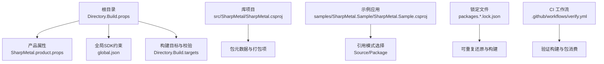
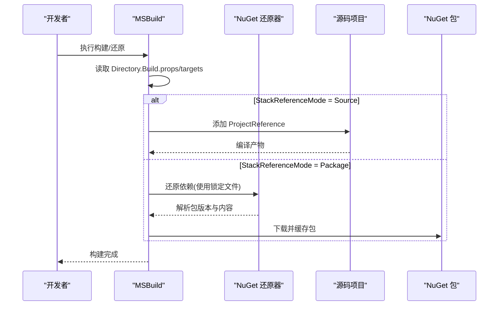
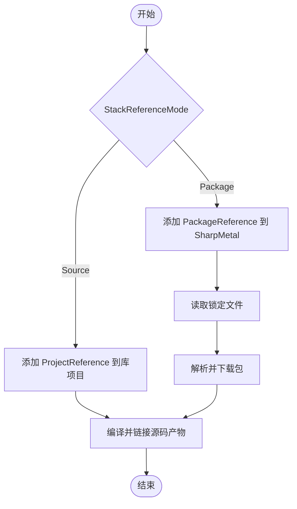

# 包管理

<cite>
**本文引用的文件**
- [Directory.Build.props](file://Directory.Build.props)
- [Directory.Build.targets](file://Directory.Build.targets)
- [SharpMetal.product.props](file://SharpMetal.product.props)
- [global.json](file://global.json)
- [src/SharpMetal/SharpMetal.csproj](file://src/SharpMetal/SharpMetal.csproj)
- [samples/SharpMetal.Sample/SharpMetal.Sample.csproj](file://samples/SharpMetal.Sample/SharpMetal.Sample.csproj)
- [src/SharpMetal/packages.Package.portable.lock.json](file://src/SharpMetal/packages.Package.portable.lock.json)
- [samples/SharpMetal.Sample/packages.Package.portable.lock.json](file://samples/SharpMetal.Sample/packages.Package.portable.lock.json)
- [stack.local.props.example](file://stack.local.props.example)
- [.github/workflows/verify.yml](file://.github/workflows/verify.yml)
</cite>

## 目录
1. [简介](#简介)
2. [项目结构](#项目结构)
3. [核心组件](#核心组件)
4. [架构总览](#架构总览)
5. [详细组件分析](#详细组件分析)
6. [依赖关系分析](#依赖关系分析)
7. [性能考虑](#性能考虑)
8. [故障排除指南](#故障排除指南)
9. [结论](#结论)
10. [附录](#附录)

## 简介
本指南聚焦于 SharpMetal 项目的 NuGet 包管理与发布流程，覆盖以下主题：
- 包配置与依赖管理策略（源引用 vs 包引用）
- 版本控制、锁定文件的作用与更新策略
- 包的发布流程、版本号管理与元数据配置
- 私有包源的创建与管理建议
- 包安装、更新与故障排除的最佳实践
- 多项目环境下的包管理策略

该仓库通过集中式 MSBuild 属性与目标文件统一了构建与还原行为，配合锁定文件确保可重复构建，并通过 CI 工作流验证“从源码引用”和“从包引用”两种模式的一致性。

## 项目结构
下图展示了与包管理相关的核心文件及其职责：

**图表来源**
- [Directory.Build.props:1-25](file://Directory.Build.props#L1-L25)
- [Directory.Build.targets:1-40](file://Directory.Build.targets#L1-L40)
- [SharpMetal.product.props:1-2](file://SharpMetal.product.props#L1-L2)
- [global.json:1-8](file://global.json#L1-L8)
- [src/SharpMetal/SharpMetal.csproj:1-47](file://src/SharpMetal/SharpMetal.csproj#L1-L47)
- [samples/SharpMetal.Sample/SharpMetal.Sample.csproj:1-6](file://samples/SharpMetal.Sample/SharpMetal.Sample.csproj#L1-L6)
- [.github/workflows/verify.yml:1-26](file://.github/workflows/verify.yml#L1-L26)

**章节来源**
- [Directory.Build.props:1-25](file://Directory.Build.props#L1-L25)
- [Directory.Build.targets:1-40](file://Directory.Build.targets#L1-L40)
- [SharpMetal.product.props:1-2](file://SharpMetal.product.props#L1-L2)
- [global.json:1-8](file://global.json#L1-L8)
- [src/SharpMetal/SharpMetal.csproj:1-47](file://src/SharpMetal/SharpMetal.csproj#L1-L47)
- [samples/SharpMetal.Sample/SharpMetal.Sample.csproj:1-6](file://samples/SharpMetal.Sample/SharpMetal.Sample.csproj#L1-L6)
- [.github/workflows/verify.yml:1-26](file://.github/workflows/verify.yml#L1-L26)

## 核心组件
- 集中式构建属性与路径
  - 统一设置输出路径、中间输出路径、平台与配置默认值、确定性构建、CI 标志等。
  - 启用锁定还原并定义锁文件路径模板，使不同参考模式与运行时标识生成独立的锁定文件。
- 构建目标与校验
  - 在收集包引用前校验 StackReferenceMode 的合法性，并在源码模式下检查映射与存在性，防止混用源码与包引用导致的不一致。
- 包元数据与打包项
  - 库项目声明包 ID、描述、许可证与说明文档，并将必要文件纳入包内容。
- 引用模式切换
  - 示例项目根据 StackReferenceMode 动态选择源码引用或包引用，便于本地开发与 CI 验证。
- SDK 版本约束
  - global.json 固定 SDK 版本与回滚策略，保证跨机器一致性。

**章节来源**
- [Directory.Build.props:1-25](file://Directory.Build.props#L1-L25)
- [Directory.Build.targets:1-40](file://Directory.Build.targets#L1-L40)
- [src/SharpMetal/SharpMetal.csproj:1-47](file://src/SharpMetal/SharpMetal.csproj#L1-L47)
- [samples/SharpMetal.Sample/SharpMetal.Sample.csproj:1-6](file://samples/SharpMetal.Sample/SharpMetal.Sample.csproj#L1-L6)
- [global.json:1-8](file://global.json#L1-L8)

## 架构总览
下图展示“源码引用”与“包引用”两种模式在构建时的差异，以及锁定文件如何保障可重复还原：

**图表来源**
- [Directory.Build.props:1-25](file://Directory.Build.props#L1-L25)
- [Directory.Build.targets:1-40](file://Directory.Build.targets#L1-L40)
- [samples/SharpMetal.Sample/SharpMetal.Sample.csproj:1-6](file://samples/SharpMetal.Sample/SharpMetal.Sample.csproj#L1-L6)
- [samples/SharpMetal.Sample/packages.Package.portable.lock.json:1-13](file://samples/SharpMetal.Sample/packages.Package.portable.lock.json#L1-L13)

## 详细组件分析

### 包配置与依赖管理策略
- 统一入口
  - 根级 Directory.Build.props 导入产品属性，并集中定义 StackReferenceMode、StackPackageVersion、输出路径、锁定还原开关与锁文件路径模板。
- 模式选择
  - 示例项目通过条件 ItemGroup 在“源码引用”与“包引用”之间切换，便于本地调试与 CI 验证。
- 锁定还原
  - 启用 RestorePackagesWithLockFile=true，并基于 StackReferenceMode 与 _StackOutputRid 生成独立锁定文件，避免不同模式互相污染。
- 版本来源
  - 版本号由 StackPackageVersion 提供，库项目将其作为 Version；示例项目在包模式下以该变量注入版本。

最佳实践
- 始终开启锁定还原，并将锁定文件纳入版本控制。
- 在团队中统一 StackReferenceMode，避免混用源码与包引用。
- 将 StackPackageVersion 集中在集中式属性中管理，便于批量升级。

**章节来源**
- [Directory.Build.props:1-25](file://Directory.Build.props#L1-L25)
- [samples/SharpMetal.Sample/SharpMetal.Sample.csproj:1-6](file://samples/SharpMetal.Sample/SharpMetal.Sample.csproj#L1-L6)
- [src/SharpMetal/SharpMetal.csproj:1-47](file://src/SharpMetal/SharpMetal.csproj#L1-L47)

### 版本控制与锁定文件
- 版本来源
  - StackPackageVersion 在集中式属性中定义，库项目直接使用该变量作为包版本。
- 锁定文件
  - 每个项目目录下存在 packages.Package.portable.lock.json，记录已解析的直接与传递依赖、请求范围与哈希，确保还原结果可重现。
- 更新策略
  - 升级依赖后重新还原以更新锁定文件；提交锁定文件变更以便审查。
  - 对关键依赖进行最小化更新，结合 CI 验证兼容性。

**章节来源**
- [Directory.Build.props:1-25](file://Directory.Build.props#L1-L25)
- [src/SharpMetal/packages.Package.portable.lock.json:1-6](file://src/SharpMetal/packages.Package.portable.lock.json#L1-L6)
- [samples/SharpMetal.Sample/packages.Package.portable.lock.json:1-13](file://samples/SharpMetal.Sample/packages.Package.portable.lock.json#L1-L13)

### 包的发布流程、版本号管理与元数据配置
- 元数据
  - 库项目声明包 ID、描述、许可证文件与说明文档，并将必要文件纳入包内容。
- 版本号
  - 通过 StackPackageVersion 统一管理；建议在发布分支或标签处提升版本后再构建。
- 构建与打包
  - 当前库项目关闭自动生成包（GeneratePackageOnBuild=false），可在发布流水线中显式调用打包任务。
- 验证
  - CI 工作流会拉取最新 SDK，执行构建与验证脚本，确保产物可用。

发布建议
- 在发布前确认 StackPackageVersion 已正确提升。
- 在 CI 中执行打包与签名（如需），并将 .nupkg 上传至托管源。
- 保留锁定文件与构建日志用于追溯。

**章节来源**
- [src/SharpMetal/SharpMetal.csproj:1-47](file://src/SharpMetal/SharpMetal.csproj#L1-L47)
- [Directory.Build.props:1-25](file://Directory.Build.props#L1-L25)
- [.github/workflows/verify.yml:1-26](file://.github/workflows/verify.yml#L1-L26)

### 私有包源的管理
仓库未内嵌私有源配置，但可通过以下方式集成：
- 用户级或机器级 nuget.config
  - 添加私有源 URL 与凭据，优先级高于公共源。
- 环境变量
  - 通过 NUGET_CREDENTIALPROVIDER_PATH 或令牌环境变量注入凭据。
- CI 安全
  - 在 CI 中通过密钥管理服务注入凭据，避免硬编码。

注意
- 若使用私有源，请确保锁定文件中的包来源与哈希一致，必要时在 CI 中清理缓存后还原。

[本节为通用指导，不直接分析具体文件]

### 包安装、更新与故障排除
- 安装与还原
  - 首次构建会自动还原依赖；若启用锁定还原，将严格匹配锁定文件中的版本。
- 更新依赖
  - 使用包管理器工具升级依赖后，重新还原以更新锁定文件并提交变更。
- 常见问题
  - 版本冲突：检查是否有多个项目引用不同版本的同一包，统一通过集中式属性或中央包管理解决。
  - 网络问题：配置代理或镜像源；在 CI 中缓存 NuGet 包目录以提升速度。
  - 锁定文件不一致：删除锁定文件后重新还原，或强制刷新缓存。

**章节来源**
- [Directory.Build.props:1-25](file://Directory.Build.props#L1-L25)
- [samples/SharpMetal.Sample/packages.Package.portable.lock.json:1-13](file://samples/SharpMetal.Sample/packages.Package.portable.lock.json#L1-L13)

### 多项目环境下的包管理策略
- 集中式属性
  - 通过 Directory.Build.props 统一版本、输出路径与还原策略，减少各项目重复配置。
- 源码与包模式
  - 使用 StackReferenceMode 在本地开发时切换到源码模式，便于调试；在 CI 中保持包模式以验证最终消费体验。
- 隔离与可重复性
  - 不同模式与运行时标识生成独立锁定文件，避免相互干扰。
- 团队协作
  - 约定统一的 StackPackageVersion 与 StackReferenceMode；在 PR 中要求更新锁定文件。

**章节来源**
- [Directory.Build.props:1-25](file://Directory.Build.props#L1-L25)
- [Directory.Build.targets:1-40](file://Directory.Build.targets#L1-L40)
- [stack.local.props.example:1-12](file://stack.local.props.example#L1-L12)

## 依赖关系分析
下图展示示例项目在不同模式下的依赖解析路径：

**图表来源**
- [samples/SharpMetal.Sample/SharpMetal.Sample.csproj:1-6](file://samples/SharpMetal.Sample/SharpMetal.Sample.csproj#L1-L6)
- [Directory.Build.props:1-25](file://Directory.Build.props#L1-L25)
- [samples/SharpMetal.Sample/packages.Package.portable.lock.json:1-13](file://samples/SharpMetal.Sample/packages.Package.portable.lock.json#L1-L13)

**章节来源**
- [samples/SharpMetal.Sample/SharpMetal.Sample.csproj:1-6](file://samples/SharpMetal.Sample/SharpMetal.Sample.csproj#L1-L6)
- [Directory.Build.props:1-25](file://Directory.Build.props#L1-L25)

## 性能考虑
- 锁定还原
  - 启用锁定还原可减少版本漂移带来的额外还原与编译开销。
- 并行还原
  - 利用 NuGet 并行还原能力，结合 CI 缓存加速构建。
- 输出路径隔离
  - 通过集中式 BaseOutputPath/BaseIntermediateOutputPath 隔离不同模式与平台的产物，避免增量构建误判。

[本节为通用指导，不直接分析具体文件]

## 故障排除指南
- 构建时报错“StackReferenceMode 必须为 Source 或 Package”
  - 检查是否设置了非法的模式值；确保在本地或 CI 中明确指定。
- 源码模式下提示缺少源仓库映射或项目不存在
  - 检查 stack.local.props 中的根路径映射是否正确；确保对应仓库已检出且包含 product.props。
- 包模式下出现“源码项目仍在激活”的冲突
  - 移除或注释掉指向源码项目的引用；确保仅使用包引用。
- 锁定文件不一致导致还原失败
  - 删除锁定文件后重新还原；或在 CI 中清理 NuGet 缓存后重试。

**章节来源**
- [Directory.Build.targets:27-37](file://Directory.Build.targets#L27-L37)
- [Directory.Build.props:1-25](file://Directory.Build.props#L1-L25)

## 结论
SharpMetal 通过集中式 MSBuild 属性与目标文件实现了统一的包管理与构建策略，结合锁定文件确保可重复构建，并通过 CI 验证源码与包两种模式的正确性。遵循本指南的版本控制、锁定文件与私有源管理实践，可以在多项目环境中稳定地发布与维护包。

[本节为总结性内容，不直接分析具体文件]

## 附录
- 快速命令参考
  - 还原与构建：dotnet restore / dotnet build
  - 切换模式：设置 StackReferenceMode=Source 或 Package
  - 升级依赖：使用包管理器工具升级后重新还原并提交锁定文件变更
- 相关配置文件
  - 集中式属性：Directory.Build.props
  - 构建目标与校验：Directory.Build.targets
  - 产品属性：SharpMetal.product.props
  - SDK 约束：global.json
  - 库项目：src/SharpMetal/SharpMetal.csproj
  - 示例项目：samples/SharpMetal.Sample/SharpMetal.Sample.csproj
  - 锁定文件：各项目下的 packages.*.lock.json
  - 本地映射示例：stack.local.props.example
  - CI 工作流：.github/workflows/verify.yml

**章节来源**
- [Directory.Build.props:1-25](file://Directory.Build.props#L1-L25)
- [Directory.Build.targets:1-40](file://Directory.Build.targets#L1-L40)
- [SharpMetal.product.props:1-2](file://SharpMetal.product.props#L1-L2)
- [global.json:1-8](file://global.json#L1-L8)
- [src/SharpMetal/SharpMetal.csproj:1-47](file://src/SharpMetal/SharpMetal.csproj#L1-L47)
- [samples/SharpMetal.Sample/SharpMetal.Sample.csproj:1-6](file://samples/SharpMetal.Sample/SharpMetal.Sample.csproj#L1-L6)
- [src/SharpMetal/packages.Package.portable.lock.json:1-6](file://src/SharpMetal/packages.Package.portable.lock.json#L1-L6)
- [samples/SharpMetal.Sample/packages.Package.portable.lock.json:1-13](file://samples/SharpMetal.Sample/packages.Package.portable.lock.json#L1-L13)
- [stack.local.props.example:1-12](file://stack.local.props.example#L1-L12)
- [.github/workflows/verify.yml:1-26](file://.github/workflows/verify.yml#L1-L26)