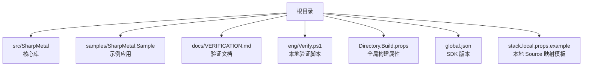
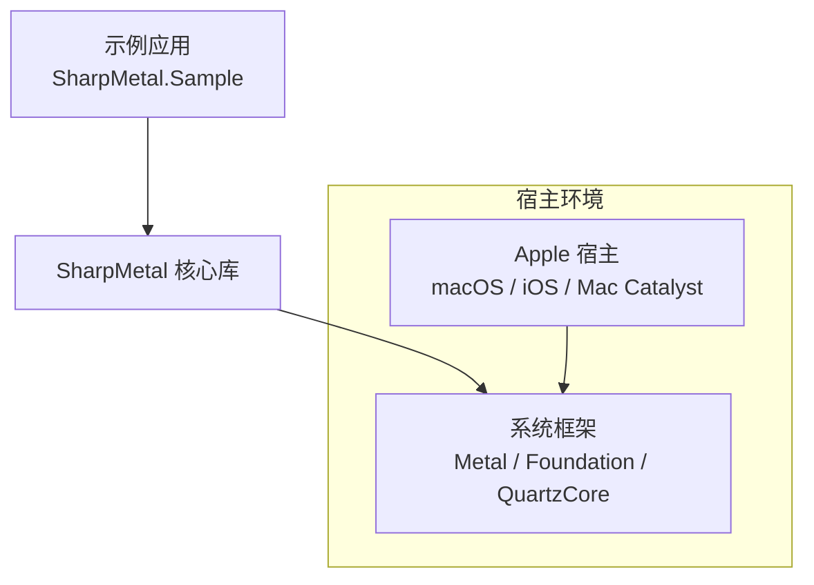
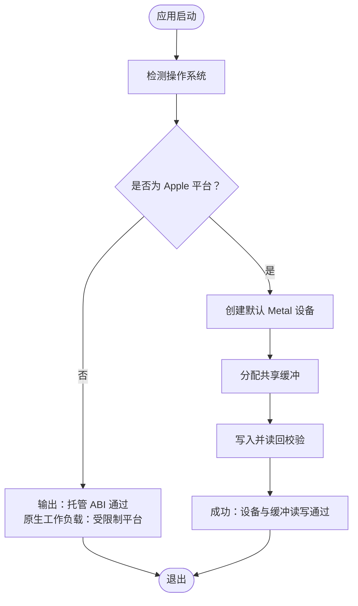
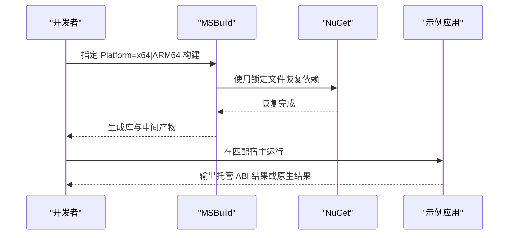
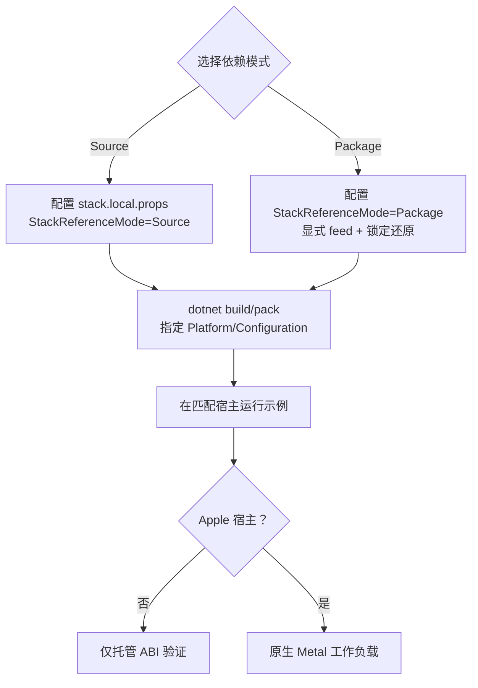
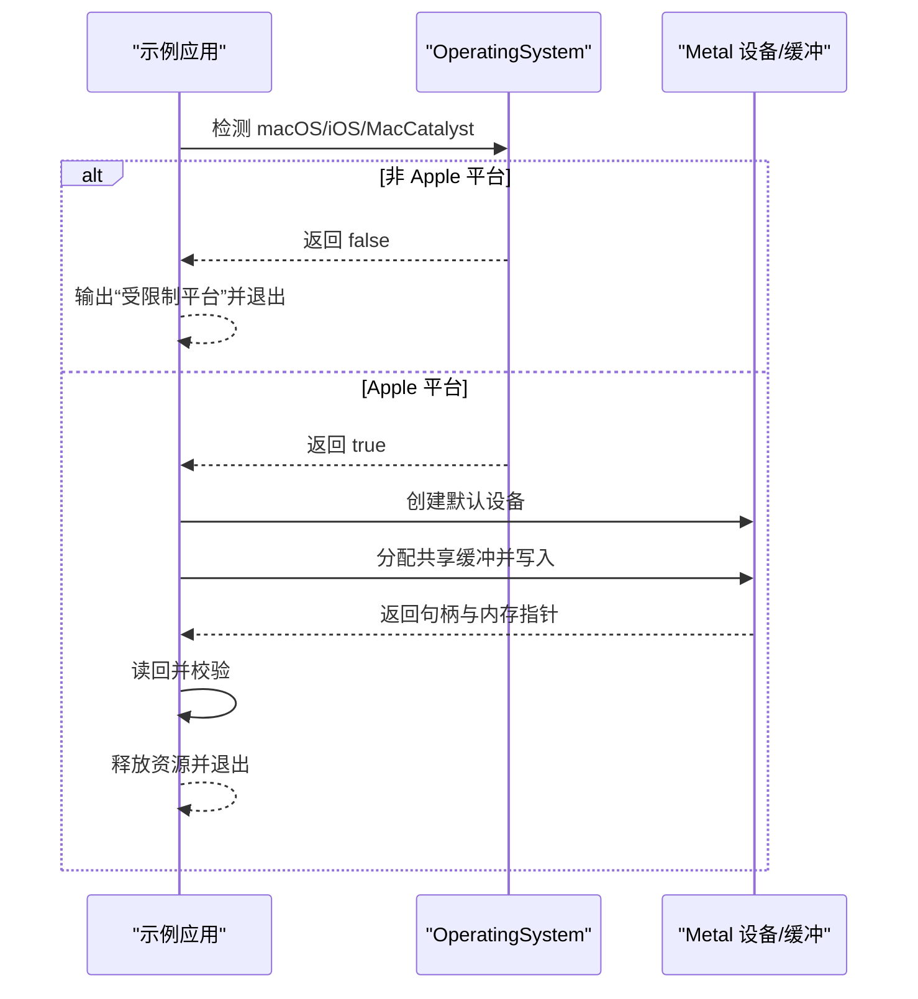
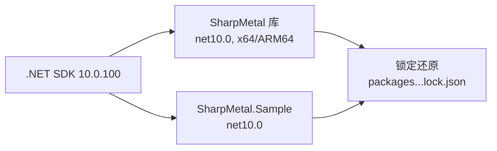

# 平台部署

<cite>
**本文引用的文件**
- [README.md](file://README.md)
- [DESIGN.md](file://DESIGN.md)
- [global.json](file://global.json)
- [Directory.Build.props](file://Directory.Build.props)
- [SharpMetal.csproj](file://src/SharpMetal/SharpMetal.csproj)
- [Program.cs](file://samples/SharpMetal.Sample/Program.cs)
- [SharpMetal.Sample.csproj](file://samples/SharpMetal.Sample/SharpMetal.Sample.csproj)
- [VERIFICATION.md](file://docs/VERIFICATION.md)
- [Verify.ps1](file://eng/Verify.ps1)
- [stack.local.props.example](file://stack.local.props.example)
</cite>

## 目录
1. [简介](#简介)
2. [项目结构](#项目结构)
3. [核心组件](#核心组件)
4. [架构总览](#架构总览)
5. [详细组件分析](#详细组件分析)
6. [依赖关系分析](#依赖关系分析)
7. [性能考虑](#性能考虑)
8. [故障排查指南](#故障排查指南)
9. [结论](#结论)
10. [附录](#附录)

## 简介
本指南面向需要在不同平台上部署 SharpMetal 的工程师与发布负责人，聚焦 x64 与 ARM64 平台的特定要求、Apple 平台（macOS、iOS、Mac Catalyst）的系统版本与运行时约束、应用内嵌库与独立包分发配置、平台检测与资源加载机制，并提供部署检查清单与常见问题解决方案。

## 项目结构
- src/SharpMetal：托管绑定与原生交互的核心库，目标框架为 .NET 10，显式支持 x64 与 ARM64 平台。
- samples/SharpMetal.Sample：示例应用，演示托管 ABI 校验与 Apple 主机上的 Metal 设备/缓冲操作。
- docs/VERIFICATION.md：构建、测试、打包与平台验证命令与说明。
- eng/Verify.ps1：Windows 上用于本地验证的脚本，执行源模式与包模式的隔离消费验证。
- Directory.Build.props：全局 MSBuild 属性，定义输出路径、RID、锁定还原等。
- global.json：固定 .NET SDK 版本为 10.0.100。
- stack.local.props.example：本地开发映射模板（Source 模式）。

**图示来源**
- [Directory.Build.props:1-25](file://Directory.Build.props#L1-L25)
- [global.json:1-8](file://global.json#L1-L8)
- [SharpMetal.csproj:1-47](file://src/SharpMetal/SharpMetal.csproj#L1-L47)
- [Program.cs:1-49](file://samples/SharpMetal.Sample/Program.cs#L1-L49)
- [VERIFICATION.md:1-103](file://docs/VERIFICATION.md#L1-L103)
- [Verify.ps1:1-67](file://eng/Verify.ps1#L1-L67)
- [stack.local.props.example:1-12](file://stack.local.props.example#L1-L12)

**章节来源**
- [README.md:1-23](file://README.md#L1-L23)
- [DESIGN.md:1-12](file://DESIGN.md#L1-L12)
- [Directory.Build.props:1-25](file://Directory.Build.props#L1-L25)
- [global.json:1-8](file://global.json#L1-L8)
- [SharpMetal.csproj:1-47](file://src/SharpMetal/SharpMetal.csproj#L1-L47)

## 核心组件
- 核心库（SharpMetal）：提供 Objective-C 与 Metal/MetalFX/QuartzCore 的低层绑定，托管布局可移植，原生执行需要 Apple 宿主与系统框架。
- 示例应用（Sample）：演示托管 ABI 校验与在 Apple 主机上创建默认设备、分配共享缓冲并读写数据。
- 构建与验证：通过全局 MSBuild 属性与锁定还原确保可重复构建；提供 Windows 本地验证脚本与跨平台验证命令。

**章节来源**
- [README.md:1-23](file://README.md#L1-L23)
- [DESIGN.md:1-12](file://DESIGN.md#L1-L12)
- [SharpMetal.csproj:1-47](file://src/SharpMetal/SharpMetal.csproj#L1-L47)
- [Program.cs:1-49](file://samples/SharpMetal.Sample/Program.cs#L1-L49)
- [VERIFICATION.md:1-103](file://docs/VERIFICATION.md#L1-L103)

## 架构总览
SharpMetal 由托管绑定层与 Apple 系统框架组成。托管代码可在任意平台编译，但调用 Metal 等原生 API 必须在匹配的 Apple 宿主上运行。示例应用通过运行时检测判断是否处于 Apple 环境，并在非 Apple 环境返回明确的“受限制平台”提示。

**图示来源**
- [Program.cs:16-45](file://samples/SharpMetal.Sample/Program.cs#L16-L45)
- [README.md:1-23](file://README.md#L1-L23)
- [DESIGN.md:1-12](file://DESIGN.md#L1-L12)

## 详细组件分析

### 平台支持与运行时要求
- 目标框架：.NET 10（由 global.json 固定）。
- 平台支持：x64 与 ARM64（由库项目显式声明）。
- 宿主要求：原生 Metal 执行需要 Apple 宿主与系统框架；在非 Apple 平台仅能验证托管 ABI。
- 运行时检测：示例使用 OperatingSystem 方法判断 macOS、iOS、Mac Catalyst，未满足时直接返回“受限制平台”。

**图示来源**
- [Program.cs:12-45](file://samples/SharpMetal.Sample/Program.cs#L12-L45)

**章节来源**
- [global.json:1-8](file://global.json#L1-L8)
- [SharpMetal.csproj:1-47](file://src/SharpMetal/SharpMetal.csproj#L1-L47)
- [Program.cs:12-45](file://samples/SharpMetal.Sample/Program.cs#L12-L45)
- [README.md:1-23](file://README.md#L1-L23)

### x64 与 ARM64 部署要求
- 构建平台：库项目同时支持 x64 与 ARM64；调试与发布配置分别针对两平台优化。
- 输出 RID：MSBuild 根据 RuntimeIdentifier 决定输出 RID；默认 portable，指定后使用具体 RID。
- 恢复与锁定：启用 NuGet 锁定还原，确保可重复构建；不同 RID 需单独锁定文件。
- 验证：Windows 本地脚本以 x64 为目标进行托管与包验证；ARM64 需在匹配宿主上运行并验证设备与缓冲。

**图示来源**
- [Directory.Build.props:1-25](file://Directory.Build.props#L1-L25)
- [SharpMetal.csproj:1-47](file://src/SharpMetal/SharpMetal.csproj#L1-L47)
- [VERIFICATION.md:13-64](file://docs/VERIFICATION.md#L13-L64)
- [Verify.ps1:23-59](file://eng/Verify.ps1#L23-L59)

**章节来源**
- [Directory.Build.props:1-25](file://Directory.Build.props#L1-L25)
- [SharpMetal.csproj:1-47](file://src/SharpMetal/SharpMetal.csproj#L1-L47)
- [VERIFICATION.md:13-64](file://docs/VERIFICATION.md#L13-L64)
- [Verify.ps1:1-67](file://eng/Verify.ps1#L1-L67)

### Apple 平台部署注意事项
- 系统版本兼容性：Metal 能力取决于宿主系统版本；设备创建失败通常表示无可用 Metal 设备或系统不支持。
- 架构支持：必须使用与宿主 CPU 架构一致的二进制（x64 或 ARM64），否则无法加载原生资源。
- 运行时要求：需要 Apple 宿主与系统框架；托管代码可跨平台编译，但原生调用仅在 Apple 上有效。
- 资源加载：示例通过系统 API 创建设备与缓冲，若失败则抛出异常；应捕获并给出明确错误信息。

**章节来源**
- [Program.cs:16-45](file://samples/SharpMetal.Sample/Program.cs#L16-L45)
- [README.md:1-23](file://README.md#L1-L23)
- [DESIGN.md:1-12](file://DESIGN.md#L1-L12)

### 部署场景与配置方法
- 应用内嵌库（Source 模式）：
  - 复制 stack.local.props.example 为 stack.local.props，设置 StackReferenceMode=Source 与相关根路径。
  - 使用 dotnet build/pack 指定 Platform 与 Configuration，输出到 artifacts 目录。
  - 适用于本地开发与集成测试，便于快速迭代。
- 独立包分发（Package 模式）：
  - 设置 StackReferenceMode=Package，并通过显式 feed 获取匹配产品版本。
  - 使用锁定还原与隔离缓存，确保消费者不引入源项目依赖。
  - 适用于发布与第三方消费，保证版本一致性与可重现性。

**图示来源**
- [stack.local.props.example:1-12](file://stack.local.props.example#L1-L12)
- [SharpMetal.Sample.csproj:1-6](file://samples/SharpMetal.Sample/SharpMetal.Sample.csproj#L1-L6)
- [VERIFICATION.md:13-64](file://docs/VERIFICATION.md#L13-L64)
- [Verify.ps1:23-59](file://eng/Verify.ps1#L23-L59)

**章节来源**
- [stack.local.props.example:1-12](file://stack.local.props.example#L1-L12)
- [SharpMetal.Sample.csproj:1-6](file://samples/SharpMetal.Sample/SharpMetal.Sample.csproj#L1-L6)
- [VERIFICATION.md:13-64](file://docs/VERIFICATION.md#L13-L64)
- [Verify.ps1:23-59](file://eng/Verify.ps1#L23-L59)

### 平台检测与资源加载机制
- 平台检测：示例在启动时检测操作系统类型，若非 Apple 平台则直接返回“受限制平台”，避免尝试原生调用。
- 资源加载：在 Apple 平台上创建默认设备与共享缓冲，并进行读写校验；失败时抛出异常以便上层处理。
- 错误边界：所有原生对象释放置于 finally 块，确保资源正确回收。

**图示来源**
- [Program.cs:12-45](file://samples/SharpMetal.Sample/Program.cs#L12-L45)

**章节来源**
- [Program.cs:12-45](file://samples/SharpMetal.Sample/Program.cs#L12-L45)

## 依赖关系分析
- 构建依赖：.NET SDK 10.0.100（global.json 固定）。
- 项目依赖：
  - 核心库：SharpMetal（目标 net10.0，平台 x64/ARM64）。
  - 示例：SharpMetal.Sample（引用核心库，Source 或 Package 模式）。
- 恢复与锁定：启用 RestorePackagesWithLockFile，按 RID 维护锁定文件；不同模式与 RID 需独立锁定。
- 输出隔离：BaseOutputPath/BaseIntermediateOutputPath 按项目、平台、RID、配置隔离。

**图示来源**
- [global.json:1-8](file://global.json#L1-L8)
- [SharpMetal.csproj:1-47](file://src/SharpMetal/SharpMetal.csproj#L1-L47)
- [SharpMetal.Sample.csproj:1-6](file://samples/SharpMetal.Sample/SharpMetal.Sample.csproj#L1-L6)
- [Directory.Build.props:1-25](file://Directory.Build.props#L1-L25)
- [DESIGN.md:1-12](file://DESIGN.md#L1-L12)

**章节来源**
- [global.json:1-8](file://global.json#L1-L8)
- [SharpMetal.csproj:1-47](file://src/SharpMetal/SharpMetal.csproj#L1-L47)
- [SharpMetal.Sample.csproj:1-6](file://samples/SharpMetal.Sample/SharpMetal.Sample.csproj#L1-L6)
- [Directory.Build.props:1-25](file://Directory.Build.props#L1-L25)
- [DESIGN.md:1-12](file://DESIGN.md#L1-L12)

## 性能考虑
- 发布优化：Release 配置启用优化；调试配置保留完整符号。
- 锁定还原：使用锁定文件减少依赖解析开销，提高构建稳定性。
- 资源管理：示例在 finally 中释放原生资源，避免泄漏与重复分配。
- 宿主匹配：确保二进制与宿主架构一致，避免加载失败导致的额外重试与错误路径。

[本节为通用指导，无需特定文件来源]

## 故障排查指南
- 非 Apple 平台运行：
  - 现象：输出“托管 ABI 通过；原生工作负载：受限制平台”。
  - 原因：未在 Apple 宿主上运行。
  - 解决：在 macOS、iOS 或 Mac Catalyst 上运行；或在 CI 中配置匹配宿主。
- 无 Metal 设备：
  - 现象：创建默认设备失败。
  - 原因：系统不支持 Metal 或无可用 GPU。
  - 解决：升级系统或更换硬件；检查驱动与系统版本。
- 共享缓冲分配失败：
  - 现象：分配或 Contents 指针为空。
  - 原因：内存不足或权限问题。
  - 解决：降低缓冲区大小；检查进程权限与系统资源。
- 包模式依赖冲突：
  - 现象：消费者意外包含源项目依赖。
  - 原因：未使用隔离缓存或 feed 配置不当。
  - 解决：使用 Verify.ps1 提供的隔离消费者流程；确保 NuGet.Config 指向新鲜 feed。
- 锁定还原失败：
  - 现象：restore 报错或锁文件不一致。
  - 原因：RID 或模式变化导致锁失效。
  - 解决：为新增 RID 生成新锁；使用 RestoreLockedMode=true 并比较哈希。

**章节来源**
- [Program.cs:12-45](file://samples/SharpMetal.Sample/Program.cs#L12-L45)
- [VERIFICATION.md:13-64](file://docs/VERIFICATION.md#L13-L64)
- [Verify.ps1:23-59](file://eng/Verify.ps1#L23-L59)

## 结论
SharpMetal 提供 .NET 10 下的低层 Objective-C 与 Metal 绑定，托管代码可移植，原生执行需 Apple 宿主。x64 与 ARM64 均受支持，构建与恢复通过锁定文件确保可重复性。推荐在 Apple 宿主上验证原生工作负载，并使用 Source 或 Package 模式进行开发与发布。遵循本指南的平台检测、资源管理与故障排查步骤，可显著提升部署成功率与稳定性。

[本节为总结，无需特定文件来源]

## 附录
- 快速开始（Windows 本地验证）：
  - 使用 eng/Verify.ps1 执行 Debug/Release 验证，生成隔离消费者与包证据。
- 跨平台验证：
  - 参考 docs/VERIFICATION.md 中的命令，分别在 x64 与 ARM64 宿主上运行示例。
- 本地 Source 映射：
  - 复制 stack.local.props.example 为 stack.local.props，设置 StackReferenceMode=Source 与相关根路径。

**章节来源**
- [Verify.ps1:1-67](file://eng/Verify.ps1#L1-L67)
- [VERIFICATION.md:13-64](file://docs/VERIFICATION.md#L13-L64)
- [stack.local.props.example:1-12](file://stack.local.props.example#L1-L12)