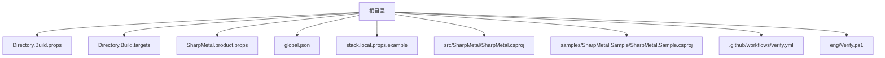
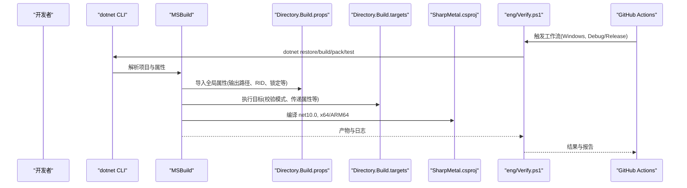
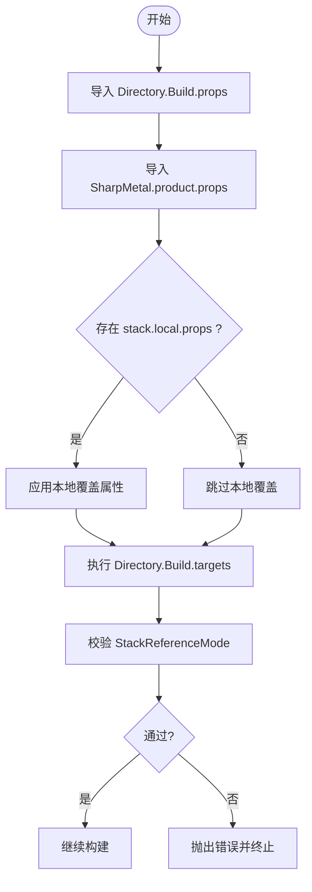
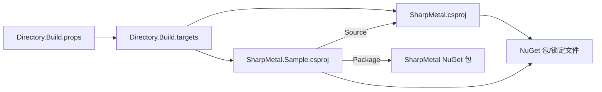

# 构建配置

<cite>
**本文引用的文件**
- [Directory.Build.props](file://Directory.Build.props)
- [Directory.Build.targets](file://Directory.Build.targets)
- [SharpMetal.product.props](file://SharpMetal.product.props)
- [global.json](file://global.json)
- [stack.local.props.example](file://stack.local.props.example)
- [src/SharpMetal/SharpMetal.csproj](file://src/SharpMetal/SharpMetal.csproj)
- [samples/SharpMetal.Sample/SharpMetal.Sample.csproj](file://samples/SharpMetal.Sample/SharpMetal.Sample.csproj)
- [.github/workflows/verify.yml](file://.github/workflows/verify.yml)
- [eng/Verify.ps1](file://eng/Verify.ps1)
</cite>

## 目录
1. [简介](#简介)
2. [项目结构](#项目结构)
3. [核心组件](#核心组件)
4. [架构总览](#架构总览)
5. [详细组件分析](#详细组件分析)
6. [依赖关系分析](#依赖关系分析)
7. [性能考虑](#性能考虑)
8. [故障排查指南](#故障排查指南)
9. [结论](#结论)
10. [附录：环境与示例](#附录：环境与示例)

## 简介
本文件聚焦于 SharpMetal 项目的构建配置，系统性说明目标框架、平台支持、编译选项、调试与发布差异、共享构建属性机制、自定义构建参数以及在不同环境下的构建示例。目标是帮助开发者快速理解并正确配置本地与 CI 的构建流程，确保可重复、可验证的产物输出。

## 项目结构
该仓库采用 MSBuild 多项目结构，通过根级共享文件集中管理构建行为，各子项目仅声明最小化差异。关键位置如下：
- 根级共享属性与目标：Directory.Build.props、Directory.Build.targets
- 产品级属性：SharpMetal.product.props
- SDK 版本锁定：global.json
- 本地覆盖示例：stack.local.props.example
- 库项目：src/SharpMetal/SharpMetal.csproj
- 示例应用：samples/SharpMetal.Sample/SharpMetal.Sample.csproj
- CI 工作流与验证脚本：.github/workflows/verify.yml、eng/Verify.ps1

**图表来源**
- [Directory.Build.props:1-25](file://Directory.Build.props#L1-L25)
- [Directory.Build.targets:1-40](file://Directory.Build.targets#L1-L40)
- [SharpMetal.product.props:1-2](file://SharpMetal.product.props#L1-L2)
- [global.json:1-8](file://global.json#L1-L8)
- [stack.local.props.example:1-12](file://stack.local.props.example#L1-L12)
- [src/SharpMetal/SharpMetal.csproj:1-47](file://src/SharpMetal/SharpMetal.csproj#L1-L47)
- [samples/SharpMetal.Sample/SharpMetal.Sample.csproj:1-6](file://samples/SharpMetal.Sample/SharpMetal.Sample.csproj#L1-L6)
- [.github/workflows/verify.yml:1-26](file://.github/workflows/verify.yml#L1-L26)
- [eng/Verify.ps1:1-67](file://eng/Verify.ps1#L1-L67)

**章节来源**
- [Directory.Build.props:1-25](file://Directory.Build.props#L1-L25)
- [Directory.Build.targets:1-40](file://Directory.Build.targets#L1-L40)
- [global.json:1-8](file://global.json#L1-L8)

## 核心组件
- 目标框架与平台
  - 目标框架：net10.0（库与示例均使用）
  - 平台：x64、ARM64（库项目显式声明）
- 编译开关
  - 确定性构建：开启
  - 隐式 using：开启
  - 可空引用类型：开启
  - 允许不安全代码：开启（库与示例）
- 包与版本
  - 版本号来自共享属性 StackPackageVersion
  - 包元数据在库项目中定义
- 输出路径与中间目录
  - 统一输出到 artifacts/bin 与 artifacts/obj，按 Platform 与 RuntimeIdentifier 组织
- 恢复与锁定
  - 启用 NuGet 锁定文件恢复，锁文件路径由 StackReferenceMode 与 _StackOutputRid 决定

**章节来源**
- [src/SharpMetal/SharpMetal.csproj:1-47](file://src/SharpMetal/SharpMetal.csproj#L1-L47)
- [samples/SharpMetal.Sample/SharpMetal.Sample.csproj:1-6](file://samples/SharpMetal.Sample/SharpMetal.Sample.csproj#L1-L6)
- [Directory.Build.props:1-25](file://Directory.Build.props#L1-L25)

## 架构总览
构建系统以 MSBuild 为核心，通过 Directory.Build.props/targets 注入全局行为，结合 global.json 锁定 SDK 版本，并通过 stack.local.props 实现本地覆盖。CI 使用 GitHub Actions 调用 eng/Verify.ps1 对 Debug/Release 两种配置进行端到端验证（包含打包与隔离消费）。

**图表来源**
- [.github/workflows/verify.yml:1-26](file://.github/workflows/verify.yml#L1-L26)
- [eng/Verify.ps1:1-67](file://eng/Verify.ps1#L1-L67)
- [Directory.Build.props:1-25](file://Directory.Build.props#L1-L25)
- [Directory.Build.targets:1-40](file://Directory.Build.targets#L1-L40)
- [src/SharpMetal/SharpMetal.csproj:1-47](file://src/SharpMetal/SharpMetal.csproj#L1-L47)

## 详细组件分析

### 目标框架与平台支持
- 目标框架：net10.0
  - 库与示例均指定 TargetFramework=net10.0
- 平台：x64、ARM64
  - 库项目显式设置 Platforms=x64;ARM64
  - 默认 Platform 为 AnyCPU，但实际构建通常显式指定 x64 或 ARM64
- 运行时标识符（RID）
  - 未指定 RuntimeIdentifier 时输出 portable；指定时使用其值
  - 影响输出目录结构与包还原策略

**章节来源**
- [src/SharpMetal/SharpMetal.csproj:1-47](file://src/SharpMetal/SharpMetal.csproj#L1-L47)
- [Directory.Build.props:1-25](file://Directory.Build.props#L1-L25)

### 编译选项与优化
- 通用选项
  - Deterministic=true：确保可重复构建
  - ImplicitUsings=enable：简化 using
  - Nullable=enable：启用可空引用检查
  - AllowUnsafeBlocks=True：允许不安全代码（库）
- 配置差异化
  - Debug|x64 / Debug|ARM64：生成完整调试符号(DebugType=full)，关闭优化
  - Release|x64 / Release|ARM64：开启优化，不强制调试符号
- 其他
  - RestorePackagesWithLockFile=true：使用锁定文件恢复
  - 输出路径按 Platform 与 RID 分层，便于区分不同构建

**章节来源**
- [src/SharpMetal/SharpMetal.csproj:1-47](file://src/SharpMetal/SharpMetal.csproj#L1-L47)
- [Directory.Build.props:1-25](file://Directory.Build.props#L1-L25)

### 调试与发布配置的差异
- 调试配置
  - 生成完整调试信息（DebugSymbols=true, DebugType=full）
  - 关闭优化（Optimize=false），便于断点与诊断
- 发布配置
  - 开启优化（Optimize=true）
  - 不强制生成调试符号，适合分发与性能测试
- 适用场景
  - 开发调试：使用 Debug 配置
  - 性能评估与交付：使用 Release 配置

**章节来源**
- [src/SharpMetal/SharpMetal.csproj:14-32](file://src/SharpMetal/SharpMetal.csproj#L14-L32)

### 共享构建属性的作用与使用方法
- 全局属性入口
  - Directory.Build.props：导入产品属性、设置输出路径、RID、锁定文件路径、默认 Configuration/Platform 等
  - Directory.Build.targets：向项目引用传递全局属性、校验 StackReferenceMode、处理 Source/Package 模式冲突
- 产品属性
  - SharpMetal.product.props：定义 StackProductName
- 本地覆盖
  - stack.local.props：可选文件，用于本地覆盖 StackReferenceMode、指向本地源码树等
  - stack.local.props.example：提供模板，展示如何设置多个产品的根路径

**图表来源**
- [Directory.Build.props:1-25](file://Directory.Build.props#L1-L25)
- [Directory.Build.targets:1-40](file://Directory.Build.targets#L1-L40)
- [stack.local.props.example:1-12](file://stack.local.props.example#L1-L12)

**章节来源**
- [Directory.Build.props:1-25](file://Directory.Build.props#L1-L25)
- [Directory.Build.targets:1-40](file://Directory.Build.targets#L1-L40)
- [SharpMetal.product.props:1-2](file://SharpMetal.product.props#L1-L2)
- [stack.local.props.example:1-12](file://stack.local.props.example#L1-L12)

### 自定义构建参数的配置方法与最佳实践
- 常用参数
  - Configuration：Debug 或 Release
  - Platform：x64 或 ARM64（推荐显式指定）
  - RuntimeIdentifier：控制输出 RID（默认 portable）
  - StackReferenceMode：Source 或 Package（切换源码引用与 NuGet 包引用）
  - StackLocalProps：指向本地覆盖文件路径
  - StackProductRoot：产品根目录（用于输出与映射）
- 最佳实践
  - 始终使用 global.json 锁定 SDK 版本，保证一致性
  - 使用锁定文件恢复（RestorePackagesWithLockFile=true）
  - 在 CI 中固定矩阵（如 Debug/Release、x64/ARM64）
  - 本地开发使用 stack.local.props 切换 Source 模式，避免误用包
  - 保持输出目录隔离（artifacts/bin/...），避免污染源码树

**章节来源**
- [Directory.Build.props:1-25](file://Directory.Build.props#L1-L25)
- [Directory.Build.targets:1-40](file://Directory.Build.targets#L1-L40)
- [global.json:1-8](file://global.json#L1-L8)
- [eng/Verify.ps1:1-67](file://eng/Verify.ps1#L1-L67)

### 不同环境下的构建配置示例
- 本地开发（Windows x64，Debug）
  - 使用 dotnet build 指定 Configuration=Debug、Platform=x64
  - 如需源码模式，创建 stack.local.props 并设置 StackReferenceMode=Source
- 本地开发（Windows ARM64，Release）
  - 指定 Platform=ARM64、Configuration=Release
- CI（GitHub Actions）
  - 工作流矩阵包含 Debug 与 Release
  - 调用 eng/Verify.ps1 完成 restore/build/pack/test（Windows 托管）
- 跨平台注意事项
  - 当前验证脚本限定 Windows；其他平台需使用匹配的宿主门控

**章节来源**
- [.github/workflows/verify.yml:1-26](file://.github/workflows/verify.yml#L1-L26)
- [eng/Verify.ps1:1-67](file://eng/Verify.ps1#L1-L67)

## 依赖关系分析
- 项目间依赖
  - 示例项目根据 StackReferenceMode 引用库项目或 NuGet 包
- 构建阶段依赖
  - Directory.Build.props 先于项目加载，定义全局属性
  - Directory.Build.targets 在项目构建前执行校验与属性传递
- 外部依赖
  - .NET SDK 版本由 global.json 锁定
  - NuGet 包恢复受锁定文件约束

**图表来源**
- [Directory.Build.props:1-25](file://Directory.Build.props#L1-L25)
- [Directory.Build.targets:1-40](file://Directory.Build.targets#L1-L40)
- [src/SharpMetal/SharpMetal.csproj:1-47](file://src/SharpMetal/SharpMetal.csproj#L1-L47)
- [samples/SharpMetal.Sample/SharpMetal.Sample.csproj:1-6](file://samples/SharpMetal.Sample/SharpMetal.Sample.csproj#L1-L6)

**章节来源**
- [Directory.Build.props:1-25](file://Directory.Build.props#L1-L25)
- [Directory.Build.targets:1-40](file://Directory.Build.targets#L1-L40)
- [samples/SharpMetal.Sample/SharpMetal.Sample.csproj:1-6](file://samples/SharpMetal.Sample/SharpMetal.Sample.csproj#L1-L6)

## 性能考虑
- 使用 Release 配置以获得优化后的二进制
- 利用确定性构建提升缓存命中与可重现性
- 合理选择 Platform（x64/ARM64）匹配运行环境
- 在 CI 中使用并行与无还原构建减少耗时（参考验证脚本）

[本节为通用指导，无需特定文件引用]

## 故障排查指南
- 常见错误与定位
  - StackReferenceMode 必须为 Source 或 Package：检查是否设置了错误的模式
  - Source 模式下存在包冲突：移除与源码模式冲突的包引用
  - 缺少源码检出映射：配置 stack.local.props 中的 Root 路径
  - 源项目缺失：确认路径与 Identity 正确
- 建议步骤
  - 清理 artifacts 目录后重试
  - 使用 --no-restore 与锁定文件加速构建
  - 查看 eng/Verify.ps1 生成的 verification.log 与 result.json

**章节来源**
- [Directory.Build.targets:27-37](file://Directory.Build.targets#L27-L37)
- [eng/Verify.ps1:1-67](file://eng/Verify.ps1#L1-L67)

## 结论
SharpMetal 的构建体系通过共享属性与目标实现了高度一致的构建体验，明确的目标框架与平台支持、清晰的调试/发布差异、灵活的本地覆盖机制以及完善的 CI 验证流程，确保了从开发到交付的全链路可控性与可重复性。遵循本文的配置与最佳实践，可在不同环境下稳定地构建与验证项目。

[本节为总结，无需特定文件引用]

## 附录：环境与示例
- 环境变量与工具链
  - 使用 global.json 锁定 .NET SDK 版本
  - CI 使用 Windows 宿主机进行托管验证
- 典型命令（概念性描述）
  - 本地构建：指定 Configuration 与 Platform
  - 打包：生成 NuGet 包到指定输出目录
  - 隔离消费：使用临时目录与独立 NuGet.Config 验证包可用性
- 参考脚本与工作流
  - 工作流矩阵：Debug/Release
  - 验证脚本：restore/build/pack/test 全流程

**章节来源**
- [global.json:1-8](file://global.json#L1-L8)
- [.github/workflows/verify.yml:1-26](file://.github/workflows/verify.yml#L1-L26)
- [eng/Verify.ps1:1-67](file://eng/Verify.ps1#L1-L67)