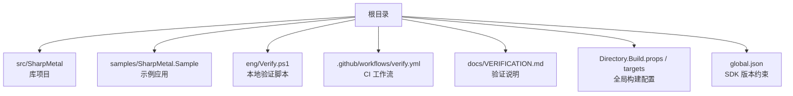
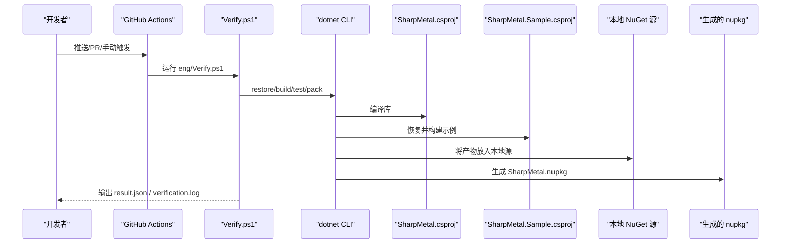
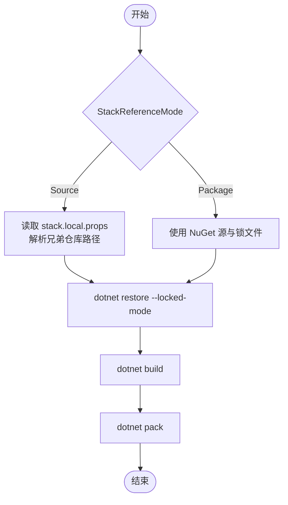

# 部署和分发

<cite>
**本文引用的文件**
- [README.md](file://README.md)
- [global.json](file://global.json)
- [Directory.Build.props](file://Directory.Build.props)
- [Directory.Build.targets](file://Directory.Build.targets)
- [SharpMetal.product.props](file://SharpMetal.product.props)
- [src/SharpMetal/SharpMetal.csproj](file://src/SharpMetal/SharpMetal.csproj)
- [samples/SharpMetal.Sample/SharpMetal.Sample.csproj](file://samples/SharpMetal.Sample/SharpMetal.Sample.csproj)
- [stack.local.props.example](file://stack.local.props.example)
- [eng/Verify.ps1](file://eng/Verify.ps1)
- [.github/workflows/verify.yml](file://.github/workflows/verify.yml)
- [docs/VERIFICATION.md](file://docs/VERIFICATION.md)
- [src/SharpMetal/packages.Package.portable.lock.json](file://src/SharpMetal/packages.Package.portable.lock.json)
- [samples/SharpMetal.Sample/packages.Package.portable.lock.json](file://samples/SharpMetal.Sample/packages.Package.portable.lock.json)
</cite>

## 目录
1. [简介](#简介)
2. [项目结构](#项目结构)
3. [核心组件](#核心组件)
4. [架构总览](#架构总览)
5. [详细组件分析](#详细组件分析)
6. [依赖与版本管理](#依赖与版本管理)
7. [构建配置选项](#构建配置选项)
8. [发布流程与打包策略](#发布流程与打包策略)
9. [平台特定部署注意事项](#平台特定部署注意事项)
10. [CI/CD 流水线与自动化测试](#cicd-流水线与自动化测试)
11. [性能与可维护性建议](#性能与可维护性建议)
12. [故障排除与常见问题](#故障排除与常见问题)
13. [结论](#结论)

## 简介
本指南面向需要部署、分发和集成 SharpMetal 的工程师，覆盖包管理配置、目标框架设置、平台特定部署要求、构建配置选项、依赖管理与版本兼容性、发布流程与打包策略、不同平台的部署注意事项与最佳实践、CI/CD 流水线配置与自动化测试，以及故障排除与常见问题解决方案。

SharpMetal 提供 .NET 10 下的 Objective-C 与 Metal 绑定，包含 Foundation、Metal、MetalFX 与 QuartzCore。原生资源采用显式所有权模型；托管布局检查是跨平台的，但原生执行需要 Apple 主机与系统框架。

**章节来源**
- [README.md:1-10](file://README.md#L1-L10)

## 项目结构
仓库采用分层组织：
- src/SharpMetal：运行时库与绑定实现
- samples/SharpMetal.Sample：示例应用，用于验证源模式与包模式
- eng/：本地验证脚本（Windows）
- .github/workflows：GitHub Actions 工作流
- docs：设计说明与验证文档
- 根级 MSBuild 全局属性与目标：统一构建行为、产物路径、锁定还原等

**图表来源**
- [Directory.Build.props:1-24](file://Directory.Build.props#L1-L24)
- [Directory.Build.targets:1-39](file://Directory.Build.targets#L1-L39)
- [global.json:1-8](file://global.json#L1-L8)
- [eng/Verify.ps1:1-67](file://eng/Verify.ps1#L1-L67)
- [.github/workflows/verify.yml:1-26](file://.github/workflows/verify.yml#L1-L26)
- [docs/VERIFICATION.md:1-103](file://docs/VERIFICATION.md#L1-L103)

**章节来源**
- [README.md:12-17](file://README.md#L12-L17)
- [Directory.Build.props:1-24](file://Directory.Build.props#L1-L24)
- [Directory.Build.targets:1-39](file://Directory.Build.targets#L1-L39)
- [global.json:1-8](file://global.json#L1-L8)

## 核心组件
- 库项目：src/SharpMetal/SharpMetal.csproj，输出为 net10.0 库，支持 x64 与 ARM64 平台，启用不安全代码，使用 StackPackageVersion 作为版本号，并附带许可证与说明文件到包中。
- 示例项目：samples/SharpMetal.Sample/SharpMetal.Sample.csproj，根据 StackReferenceMode 切换引用方式（Source 或 Package）。
- 全局构建属性：Directory.Build.props 定义输出路径、锁文件路径、默认配置/平台、确定性构建、CI 标志等。
- 全局构建目标：Directory.Build.targets 校验 StackReferenceMode、传播配置到子项目、防止 Source/Package 冲突、导入上游目标等。
- 产品属性：SharpMetal.product.props 定义产品名称。
- SDK 约束：global.json 固定 .NET SDK 版本与回滚策略。

**章节来源**
- [src/SharpMetal/SharpMetal.csproj:1-47](file://src/SharpMetal/SharpMetal.csproj#L1-L47)
- [samples/SharpMetal.Sample/SharpMetal.Sample.csproj:1-6](file://samples/SharpMetal.Sample/SharpMetal.Sample.csproj#L1-L6)
- [Directory.Build.props:1-24](file://Directory.Build.props#L1-L24)
- [Directory.Build.targets:1-39](file://Directory.Build.targets#L1-L39)
- [SharpMetal.product.props:1-2](file://SharpMetal.product.props#L1-L2)
- [global.json:1-8](file://global.json#L1-L8)

## 架构总览
下图展示了从 CI 到本地验证再到最终包产物的关键交互关系。

**图表来源**
- [.github/workflows/verify.yml:1-26](file://.github/workflows/verify.yml#L1-L26)
- [eng/Verify.ps1:1-67](file://eng/Verify.ps1#L1-L67)
- [src/SharpMetal/SharpMetal.csproj:1-47](file://src/SharpMetal/SharpMetal.csproj#L1-L47)
- [samples/SharpMetal.Sample/SharpMetal.Sample.csproj:1-6](file://samples/SharpMetal.Sample/SharpMetal.Sample.csproj#L1-L6)

## 详细组件分析

### 构建系统与全局属性
- 输出与中间目录：BaseOutputPath/BaseIntermediateOutputPath 基于 StackProductRoot、StackReferenceMode、Platform、RuntimeIdentifier 组织，便于隔离多配置与多 RID 产物。
- 锁文件：RestorePackagesWithLockFile=true，NuGetLockFilePath 指向 packages.<StackReferenceMode>.<RID-or-portable>.lock.json，确保可重复还原。
- 默认值：Configuration=Debug，Platform=AnyCPU，_StackOutputRid 默认 portable，CI 下 ContinuousIntegrationBuild=true。
- 排除项：artifacts/**、bin/**、obj/** 默认排除在默认项之外。

**章节来源**
- [Directory.Build.props:1-24](file://Directory.Build.props#L1-L24)

### 构建目标与模式校验
- 传播属性：ProjectReference 会继承 Configuration、Platform、RuntimeIdentifier、StackReferenceMode、StackLocalProps、StackProductRoot。
- 保留配置：PreserveStackProductProjectReferenceConfiguration 目标避免 Solution 构建时丢失配置。
- 模式校验：ValidateStackReferenceMode 强制 StackReferenceMode 为 Source 或 Package，禁止在 Package 模式下出现 Source 引用，并在 Source 模式下阻止同名 Stack 包冲突。
- 上游目标：在 Source 模式下尝试导入 SharpGPU.targets。

**章节来源**
- [Directory.Build.targets:1-39](file://Directory.Build.targets#L1-L39)

### 库项目与包元数据
- 目标框架：net10.0
- 平台：x64;ARM64
- 不安全代码：允许
- 版本：来自 StackPackageVersion（由根属性提供）
- 包元数据：PackageId、Description、License、Readme，并将 LICENSE、README.md、第三方许可证纳入包内容。

**章节来源**
- [src/SharpMetal/SharpMetal.csproj:1-47](file://src/SharpMetal/SharpMetal.csproj#L1-L47)
- [SharpMetal.product.props:1-2](file://SharpMetal.product.props#L1-L2)

### 示例项目与引用模式
- 示例应用根据 StackReferenceMode 选择 ProjectReference（Source）或 PackageReference（Package），版本取自 StackPackageVersion。
- 该机制使同一份示例可同时验证源码引用与包消费两种场景。

**章节来源**
- [samples/SharpMetal.Sample/SharpMetal.Sample.csproj:1-6](file://samples/SharpMetal.Sample/SharpMetal.Sample.csproj#L1-L6)

### 本地验证脚本（Windows）
- 入口：eng/Verify.ps1
- 功能：
  - 仅 Windows 环境运行
  - 创建隔离证据目录，拒绝已存在目录
  - 以 Source 模式恢复并构建库
  - 可选运行测试（若存在）
  - 打包产物到 feed
  - 构造一个“隔离消费者”项目，仅引用本地 feed，验证无项目依赖泄漏
  - 运行消费者二进制
  - 输出 result.json（含包 SHA-256）、verification.log

**章节来源**
- [eng/Verify.ps1:1-67](file://eng/Verify.ps1#L1-L67)

### CI 工作流
- 触发：push、pull_request、workflow_dispatch
- 矩阵：Debug、Release
- 步骤：checkout、setup-dotnet（使用 global.json）、调用 Verify.ps1 完成构建、测试与打包

**章节来源**
- [.github/workflows/verify.yml:1-26](file://.github/workflows/verify.yml#L1-L26)

## 依赖与版本管理
- SDK 版本：global.json 指定 .NET SDK 10.0.100，rollForward=latestFeature，不允许预发行版。
- 包锁定：
  - 根属性启用 RestorePackagesWithLockFile=true
  - 锁文件路径：packages.<StackReferenceMode>.<RID-or-portable>.lock.json
  - 当前库无外部依赖（空依赖表），示例在 Package 模式下锁定 SharpMetal 版本范围与哈希
- 模式隔离：
  - Source 模式：通过 stack.local.props 映射兄弟仓库路径
  - Package 模式：通过 NuGet 源与锁文件消费已发布的包
- 版本来源：StackPackageVersion 由根属性提供，库版本由此决定

**图表来源**
- [Directory.Build.props:1-24](file://Directory.Build.props#L1-L24)
- [stack.local.props.example:1-12](file://stack.local.props.example#L1-L12)
- [src/SharpMetal/packages.Package.portable.lock.json:1-6](file://src/SharpMetal/packages.Package.portable.lock.json#L1-L6)
- [samples/SharpMetal.Sample/packages.Package.portable.lock.json:1-13](file://samples/SharpMetal.Sample/packages.Package.portable.lock.json#L1-L13)

**章节来源**
- [global.json:1-8](file://global.json#L1-L8)
- [Directory.Build.props:1-24](file://Directory.Build.props#L1-L24)
- [stack.local.props.example:1-12](file://stack.local.props.example#L1-L12)
- [src/SharpMetal/packages.Package.portable.lock.json:1-6](file://src/SharpMetal/packages.Package.portable.lock.json#L1-L6)
- [samples/SharpMetal.Sample/packages.Package.portable.lock.json:1-13](file://samples/SharpMetal.Sample/packages.Package.portable.lock.json#L1-L13)

## 构建配置选项
- 目标框架：net10.0（库与示例均使用）
- 平台：x64;ARM64（库）；示例按 Platform 参数传递
- 配置：Debug/Release（调试符号、优化开关在项目内条件组中设置）
- 运行时标识符：默认 portable，可通过 RuntimeIdentifier 覆盖
- 确定性构建：Deterministic=true
- CI 构建：当环境变量 CI=true 时启用
- 锁文件还原：RestorePackagesWithLockFile=true，配合 NuGetLockFilePath
- 输出路径：BaseOutputPath/BaseIntermediateOutputPath 基于 StackProductRoot、StackReferenceMode、Platform、RuntimeIdentifier
- 参考模式：StackReferenceMode=Source 或 Package（必须二选一）
- 本地映射：stack.local.props 用于 Source 模式下的仓库路径映射

**章节来源**
- [src/SharpMetal/SharpMetal.csproj:1-47](file://src/SharpMetal/SharpMetal.csproj#L1-L47)
- [samples/SharpMetal.Sample/SharpMetal.Sample.csproj:1-6](file://samples/SharpMetal.Sample/SharpMetal.Sample.csproj#L1-L6)
- [Directory.Build.props:1-24](file://Directory.Build.props#L1-L24)
- [Directory.Build.targets:1-39](file://Directory.Build.targets#L1-L39)
- [stack.local.props.example:1-12](file://stack.local.props.example#L1-L12)

## 发布流程与打包策略
- 包产物：dotnet pack 生成 SharpMetal.<version>.nupkg，版本来自 StackPackageVersion
- 包内容：包含 LICENSE、README.md、第三方许可证文件
- 隔离验证：Verify.ps1 会创建一个最小化消费者项目，仅引用本地 feed，确保包可被独立消费且不含项目依赖泄漏
- 证据输出：result.json 包含包 SHA-256；verification.log 记录完整命令与输出；results 目录保存 TRX（如有测试）
- 发布建议：
  - 先构建 Release 并验证
  - 使用隔离消费者复现安装与运行
  - 将 nupkg 推送到正式 NuGet 源前，再次校验 SHA-256 与依赖图
  - 保持锁文件受控提交，避免 CI 重新生成掩盖差异

**章节来源**
- [eng/Verify.ps1:1-67](file://eng/Verify.ps1#L1-L67)
- [src/SharpMetal/SharpMetal.csproj:1-47](file://src/SharpMetal/SharpMetal.csproj#L1-L47)
- [docs/VERIFICATION.md:72-99](file://docs/VERIFICATION.md#L72-L99)

## 平台特定部署注意事项
- 托管层：Windows 上可完成托管构建、测试与打包验证
- 原生层：Metal 原生执行需要 Apple 主机与系统框架；在 Windows 上会返回平台受限结果
- macOS ARM64：需要在具备 Metal 系统框架的机器上运行 Release 源与包样本，验证设备创建、共享缓冲区映射、资源所有权与释放
- 其他平台：Linux、Android、iOS 的原生资格标注为待验证
- 建议：
  - 在目标平台上准备匹配的 SDK 与运行时
  - 使用相同的 StackReferenceMode 与 Platform 进行本地验证
  - 对每个 RID 单独维护锁文件并进行匹配主机验证

**章节来源**
- [docs/VERIFICATION.md:9-11](file://docs/VERIFICATION.md#L9-L11)
- [docs/VERIFICATION.md:57-64](file://docs/VERIFICATION.md#L57-L64)
- [eng/Verify.ps1:8-8](file://eng/Verify.ps1#L8-L8)

## CI/CD 流水线与自动化测试
- 工作流：.github/workflows/verify.yml 在 push、pull_request、workflow_dispatch 时触发
- 矩阵：同时运行 Debug 与 Release
- 环境：windows-latest，使用 global.json 指定的 SDK
- 步骤：
  - checkout
  - setup-dotnet
  - 调用 eng/Verify.ps1 完成构建、测试（如存在）与打包
- 注意：
  - 当前工作流未上传或发布包
  - 远程 CI 的 GPU/Apple 原生能力暂不可用，仅做托管与包验证
  - 锁文件需保持绿色，避免 CI 重新生成导致差异

**章节来源**
- [.github/workflows/verify.yml:1-26](file://.github/workflows/verify.yml#L1-L26)
- [docs/VERIFICATION.md:72-99](file://docs/VERIFICATION.md#L72-L99)

## 性能与可维护性建议
- 使用 Release 配置进行发布构建，启用优化
- 保持 Deterministic=true 以获得可重复构建
- 使用隔离的消费者项目验证包的可移植性与依赖正确性
- 在 Source 模式下，尽量复用兄弟仓库的构建缓存，减少冷启动时间
- 对每个 RID 维护独立的锁文件，避免跨平台兼容性问题

[本节为通用建议，不直接分析具体文件]

## 故障排除与常见问题
- 错误：StackReferenceMode 必须为 Source 或 Package
  - 原因：未设置或设置了非法值
  - 解决：在命令行或 props 中明确设置 StackReferenceMode
- 错误：Package 模式下存在 Source 引用
  - 原因：混用了 ProjectReference 与 PackageReference
  - 解决：切换到正确的模式或使用示例项目的条件引用
- 错误：Source 模式下缺少 Stack 仓库映射
  - 原因：stack.local.props 未配置或路径不正确
  - 解决：复制 stack.local.props.example 并调整路径
- 错误：隔离消费者包含项目依赖
  - 原因：NuGet.Config 或源配置不当
  - 解决：确保仅引用本地 feed，并清空 fallbackPackageFolders
- 错误：证据目录已存在
  - 原因：Verify.ps1 拒绝覆盖已有证据
  - 解决：删除或更换 OutputRoot
- 无法在 Windows 上运行原生 Metal
  - 原因：需要 Apple 主机
  - 解决：在 macOS 上运行对应命令进行原生验证

**章节来源**
- [Directory.Build.targets:27-37](file://Directory.Build.targets#L27-L37)
- [eng/Verify.ps1:12-12](file://eng/Verify.ps1#L12-L12)
- [eng/Verify.ps1:44-56](file://eng/Verify.ps1#L44-L56)
- [docs/VERIFICATION.md:57-64](file://docs/VERIFICATION.md#L57-L64)

## 结论
SharpMetal 提供了清晰的构建与发布体系：通过全局属性与目标统一构建行为，利用锁文件与模式隔离保证可重复性与一致性；通过本地验证脚本与 GitHub Actions 形成闭环的自动化验证。对于生产发布，建议在目标平台（尤其是 Apple 主机）上进行完整的原生验证，并使用隔离消费者复现包消费流程，确保依赖与行为符合预期。

[本节为总结，不直接分析具体文件]