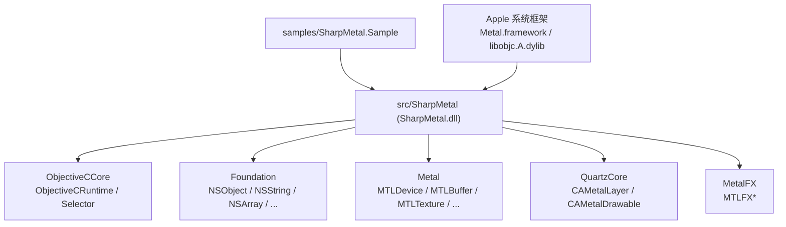
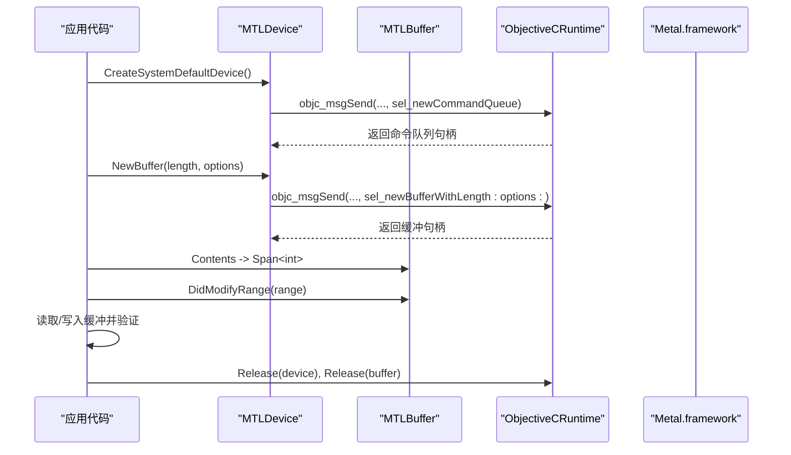
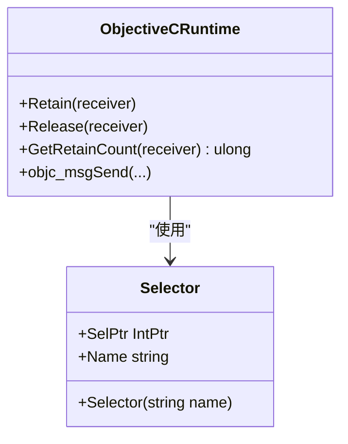
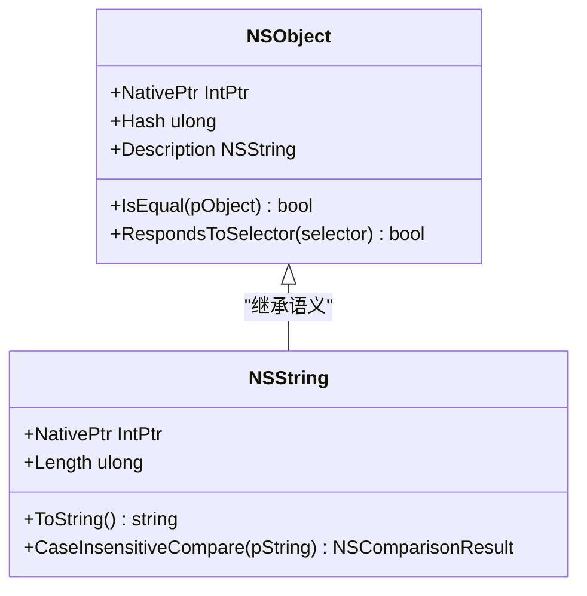
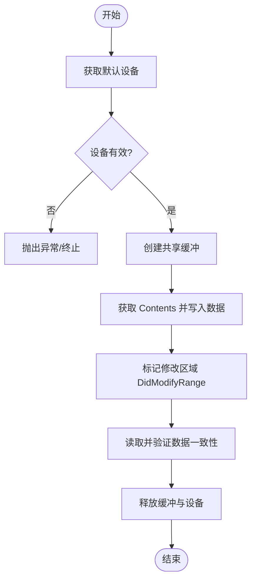
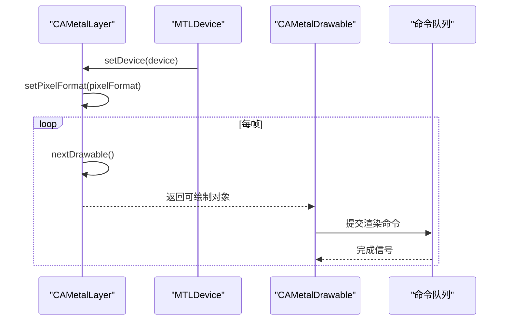
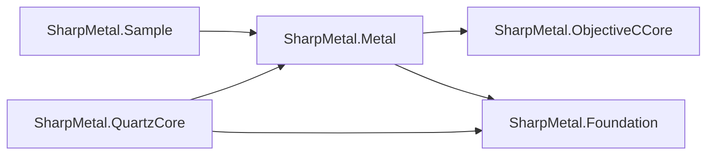
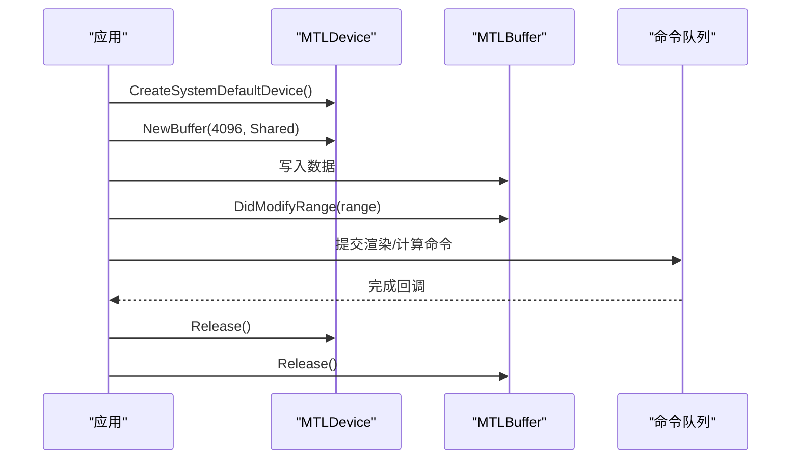

# 项目概述

<cite>
**本文引用的文件**
- [README.md](file://README.md)
- [DESIGN.md](file://DESIGN.md)
- [AGENTS.md](file://AGENTS.md)
- [global.json](file://global.json)
- [SharpMetal.csproj](file://src/SharpMetal/SharpMetal.csproj)
- [Program.cs](file://samples/SharpMetal.Sample/Program.cs)
- [ObjectiveCRuntime.cs](file://src/SharpMetal/ObjectiveCCore/ObjectiveCRuntime.cs)
- [Selector.cs](file://src/SharpMetal/ObjectiveCCore/Selector.cs)
- [NSObject.cs](file://src/SharpMetal/Foundation/NSObject.cs)
- [NSString.cs](file://src/SharpMetal/Foundation/NSString.cs)
- [MTLDevice.cs](file://src/SharpMetal/Metal/MTLDevice.cs)
- [MTLBuffer.cs](file://src/SharpMetal/Metal/MTLBuffer.cs)
- [CAMetalLayer.cs](file://src/SharpMetal/QuartzCore/CAMetalLayer.cs)
- [MTLTypes.cs](file://src/SharpMetal/Metal/MTLTypes.cs)
</cite>

## 目录
1. [简介](#简介)
2. [项目结构](#项目结构)
3. [核心组件](#核心组件)
4. [架构总览](#架构总览)
5. [详细组件分析](#详细组件分析)
6. [依赖关系分析](#依赖关系分析)
7. [性能与资源管理](#性能与资源管理)
8. [故障排查指南](#故障排查指南)
9. [结论](#结论)
10. [附录：使用场景与示例](#附录使用场景与示例)

## 简介
SharpMetal 是一个为 .NET 10 提供 Apple 平台底层图形编程绑定的框架，覆盖 Objective-C 运行时、Foundation、Metal、MetalFX 与 QuartzCore。其设计目标是让 .NET 应用能够直接调用 Apple 系统框架中的 Metal 图形 API 与相关系统能力，并通过显式原生资源管理确保内存与句柄生命周期可控。该框架在托管层提供可移植的布局检查，而原生执行需要 Apple 主机与系统框架支持。

- 目标平台与运行时：.NET 10（SDK 版本由 global.json 锁定），编译产物支持 x64 与 ARM64。
- 绑定范围：Objective-C 运行时消息分发、Foundation 基础类型、Metal 设备/命令/缓冲/纹理/管线等、QuartzCore 显示层桥接、MetalFX 缩放能力。
- 设计理念：显式原生所有权（Retain/Release）、平台边界清晰、不隐藏不支持的能力、避免静默降级。

**章节来源**
- [README.md:1-23](file://README.md#L1-L23)
- [DESIGN.md:1-12](file://DESIGN.md#L1-L12)
- [AGENTS.md:9-18](file://AGENTS.md#L9-L18)

## 项目结构
仓库采用分层组织：
- src/SharpMetal：运行时绑定库，按功能域划分 Foundation、ObjectiveCCore、Metal、QuartzCore、MetalFX。
- samples/SharpMetal.Sample：最小可运行示例，演示设备获取、缓冲分配与读写验证。
- docs/：设计与验证文档、来源记录。
- eng/：构建与验证脚本。
- 根级配置：global.json 指定 .NET SDK；各 csproj 定义目标框架、平台、打包元数据。

**图表来源**
- [SharpMetal.csproj:1-47](file://src/SharpMetal/SharpMetal.csproj#L1-L47)
- [ObjectiveCRuntime.cs:33-80](file://src/SharpMetal/ObjectiveCCore/ObjectiveCRuntime.cs#L33-L80)
- [MTLDevice.cs:187-320](file://src/SharpMetal/Metal/MTLDevice.cs#L187-L320)
- [CAMetalLayer.cs:7-136](file://src/SharpMetal/QuartzCore/CAMetalLayer.cs#L7-L136)

**章节来源**
- [README.md:12-17](file://README.md#L12-L17)
- [SharpMetal.csproj:1-47](file://src/SharpMetal/SharpMetal.csproj#L1-L47)

## 核心组件
- ObjectiveC 运行时桥接：通过 LibraryImport 直接调用 libobjc.A.dylib，暴露 objc_msgSend 重载族、选择器封装、类/方法/属性反射与 Retain/Release 控制。
- Foundation 基础类型：NSObject、NSString、NSArray、NSDictionary、NSError、NSRange 等，作为所有 ObjC 对象的基座与通用数据结构。
- Metal 绑定：MTLDevice、MTLBuffer、MTLTexture、MTLCommandQueue、MTLRenderPipelineState、MTLComputePipelineState 等，完整映射 Metal API 并暴露创建、查询、同步与资源管理能力。
- QuartzCore 集成：CAMetalLayer 将 Metal 渲染结果输出到屏幕，提供像素格式、帧缓冲、可绘制对象与驻留集等能力。
- MetalFX：空间与时序缩放接口，用于高性能图像缩放与超分。

这些组件共同构成“托管类型 → 选择器 → 原生对象”的调用链，保证对 Apple 系统能力的低开销访问。

**章节来源**
- [ObjectiveCRuntime.cs:33-80](file://src/SharpMetal/ObjectiveCCore/ObjectiveCRuntime.cs#L33-L80)
- [NSObject.cs:48-90](file://src/SharpMetal/Foundation/NSObject.cs#L48-L90)
- [MTLDevice.cs:187-320](file://src/SharpMetal/Metal/MTLDevice.cs#L187-L320)
- [CAMetalLayer.cs:17-87](file://src/SharpMetal/QuartzCore/CAMetalLayer.cs#L17-L87)

## 架构总览
SharpMetal 的架构分为三层：
- 托管层（C#）：以 struct/enum/descriptor 等形式暴露 Metal/Foundation/QuartzCore 能力，保持零拷贝或最小拷贝的数据布局。
- 运行时桥接层：ObjectiveCRuntime 负责消息派发、选择器解析、类型转换与引用计数。
- 原生层：Apple 系统框架（Metal.framework、libobjc.A.dylib 等）实现具体 GPU/系统能力。

**图表来源**
- [MTLDevice.cs:305-369](file://src/SharpMetal/Metal/MTLDevice.cs#L305-L369)
- [ObjectiveCRuntime.cs:118-180](file://src/SharpMetal/ObjectiveCCore/ObjectiveCRuntime.cs#L118-L180)
- [MTLBuffer.cs:18-63](file://src/SharpMetal/Metal/MTLBuffer.cs#L18-L63)

## 详细组件分析

### ObjectiveC 运行时与选择器
- 作用：封装 Objective-C 的消息发送机制，提供大量 objc_msgSend 重载以匹配不同参数与返回值类型；封装 Selector 以便安全地缓存与复用选择器。
- 关键点：
  - 通过 LibraryImport 直接链接到 /usr/lib/libobjc.A.dylib。
  - 提供 Retain/Release/GetRetainCount 进行显式引用计数管理。
  - 提供 NSPoint/NSRect 等基础几何类型与跨语言类型转换。
- 复杂度：消息派发为 O(1)，但频繁调用会带来 P/Invoke 与装箱/拆箱成本；建议缓存选择器并批量操作。

**图表来源**
- [ObjectiveCRuntime.cs:769-800](file://src/SharpMetal/ObjectiveCCore/ObjectiveCRuntime.cs#L769-L800)
- [Selector.cs:5-43](file://src/SharpMetal/ObjectiveCCore/Selector.cs#L5-L43)

**章节来源**
- [ObjectiveCRuntime.cs:33-80](file://src/SharpMetal/ObjectiveCCore/ObjectiveCRuntime.cs#L33-L80)
- [Selector.cs:5-43](file://src/SharpMetal/ObjectiveCCore/Selector.cs#L5-L43)

### Foundation 基础类型
- NSObject：所有 ObjC 对象的基座，提供哈希、描述、相等性判断与响应选择器检查。
- NSString：字符串包装，支持 UTF8/UTF16 编码互转、比较、查找与追加等操作。
- 其他集合与错误类型：NSArray、NSDictionary、NSError、NSRange 等，贯穿 Metal/FX 与 QuartzCore 的参数传递。

**图表来源**
- [NSObject.cs:48-90](file://src/SharpMetal/Foundation/NSObject.cs#L48-L90)
- [NSString.cs:64-186](file://src/SharpMetal/Foundation/NSString.cs#L64-L186)

**章节来源**
- [NSObject.cs:48-90](file://src/SharpMetal/Foundation/NSObject.cs#L48-L90)
- [NSString.cs:64-186](file://src/SharpMetal/Foundation/NSString.cs#L64-L186)

### Metal 设备与资源
- MTLDevice：设备入口，提供命令队列、缓冲、纹理、管线、动态库、归档、加速结构等创建与查询能力；内部通过 LibraryImport 直接调用 Metal.framework。
- MTLBuffer：GPU/CPU 共享或独占缓冲，支持长度、存储模式、CPU 缓存模式、内容指针、修改区域通知、远程视图等。
- 关键流程：
  - 获取默认设备：CreateSystemDefaultDevice。
  - 创建缓冲：NewBuffer(length, options)。
  - 访问内容：Contents 指向 CPU 可见内存（取决于存储模式）。
  - 通知修改：DidModifyRange 告知 GPU 数据更新。
  - 释放资源：通过 ObjectiveCRuntime.Release 显式释放。

**图表来源**
- [MTLDevice.cs:305-369](file://src/SharpMetal/Metal/MTLDevice.cs#L305-L369)
- [MTLBuffer.cs:18-63](file://src/SharpMetal/Metal/MTLBuffer.cs#L18-L63)
- [Program.cs:21-45](file://samples/SharpMetal.Sample/Program.cs#L21-L45)

**章节来源**
- [MTLDevice.cs:187-369](file://src/SharpMetal/Metal/MTLDevice.cs#L187-L369)
- [MTLBuffer.cs:1-115](file://src/SharpMetal/Metal/MTLBuffer.cs#L1-L115)

### QuartzCore 显示层
- CAMetalLayer：将 Metal 渲染输出到屏幕的关键层，提供像素格式、帧缓冲、最大可绘制数量、显示同步、下一帧获取与驻留集等能力。
- 典型用法：设置设备与像素格式，循环获取 NextDrawable 并在其上渲染后呈现。

**图表来源**
- [CAMetalLayer.cs:17-87](file://src/SharpMetal/QuartzCore/CAMetalLayer.cs#L17-L87)
- [MTLDevice.cs:326-339](file://src/SharpMetal/Metal/MTLDevice.cs#L326-L339)

**章节来源**
- [CAMetalLayer.cs:7-136](file://src/SharpMetal/QuartzCore/CAMetalLayer.cs#L7-L136)

### 类型与布局
- MTLTypes：定义 CGSize、CGRect、MTLOrigin、MTLSize、MTLRegion、MTLSamplePosition、MTLResourceID 等与原生 ABI 对齐的结构体，确保跨语言数据传递正确。
- 重要性：任何尺寸、区域、采样位置等参数都需严格遵循原生布局，否则会导致未定义行为。

**章节来源**
- [MTLTypes.cs:1-109](file://src/SharpMetal/Metal/MTLTypes.cs#L1-L109)

## 依赖关系分析
- 运行时依赖：
  - libobjc.A.dylib：Objective-C 运行时消息与对象模型。
  - Metal.framework：GPU 设备、命令、资源、管线、着色器等。
  - QuartzCore.framework：显示层与可绘制对象。
  - Foundation.framework：基础类型与集合。
- 项目内依赖：
  - Metal 模块依赖 Foundation 与 ObjectiveCCore。
  - QuartzCore 模块依赖 Metal 与 Foundation。
  - 示例程序依赖 Metal 与 ObjectiveCCore。

**图表来源**
- [SharpMetal.csproj:1-47](file://src/SharpMetal/SharpMetal.csproj#L1-L47)
- [Program.cs:1-10](file://samples/SharpMetal.Sample/Program.cs#L1-L10)

**章节来源**
- [SharpMetal.csproj:1-47](file://src/SharpMetal/SharpMetal.csproj#L1-L47)
- [Program.cs:1-10](file://samples/SharpMetal.Sample/Program.cs#L1-L10)

## 性能与资源管理
- 显式所有权：所有原生对象必须通过 ObjectiveCRuntime.Retain/Release 管理生命周期，避免泄漏或悬垂指针。
- 平台检查：非 Apple 平台应提前退出或提示 BLOCKED_PLATFORM，避免无效调用。
- 缓冲优化：
  - 选择合适的存储模式（共享/私有/内存池）以减少拷贝。
  - 使用 DidModifyRange 精确通知修改区域，降低同步开销。
  - 合理使用命令队列与缓冲区池，减少频繁分配。
- 布局与 ABI：
  - 使用 MTLTypes 中定义的顺序布局结构体，确保与原生 ABI 一致。
  - 示例中对 MTLSize 大小进行断言，防止 ABI 不匹配。

**章节来源**
- [Program.cs:10-20](file://samples/SharpMetal.Sample/Program.cs#L10-L20)
- [MTLBuffer.cs:18-63](file://src/SharpMetal/Metal/MTLBuffer.cs#L18-L63)
- [ObjectiveCRuntime.cs:769-782](file://src/SharpMetal/ObjectiveCCore/ObjectiveCRuntime.cs#L769-L782)

## 故障排查指南
- 平台限制：
  - 在非 macOS/iOS/Mac Catalyst 环境会阻止原生 Metal 工作负载，应检测并优雅降级。
- 设备与缓冲：
  - 若设备句柄为空，表示无可用 Metal 设备。
  - 若缓冲 Contents 为空或读回不一致，检查存储模式与 DidModifyRange 调用。
- 引用计数：
  - 忘记 Release 会导致内存泄漏；重复 Release 可能导致崩溃。
  - 建议在 finally 块中统一释放。
- 选择器与消息：
  - 选择器名称错误或对象不支持该方法会导致运行时异常；可使用 RespondsToSelector 进行防护。

**章节来源**
- [Program.cs:16-45](file://samples/SharpMetal.Sample/Program.cs#L16-L45)
- [NSObject.cs:70-79](file://src/SharpMetal/Foundation/NSObject.cs#L70-L79)
- [ObjectiveCRuntime.cs:769-782](file://src/SharpMetal/ObjectiveCCore/ObjectiveCRuntime.cs#L769-L782)

## 结论
SharpMetal 提供了面向 .NET 10 的 Apple 平台底层图形编程绑定，覆盖从 Objective-C 运行时到 Metal 图形 API 的完整链路。其设计强调显式原生资源管理、清晰的平台边界与严格的 ABI 对齐，适合高性能图形与计算任务。通过 Foundation 与 QuartzCore 的集成，开发者可以在 .NET 应用中直接使用 Metal 设备进行渲染与计算，并以最小的开销与最高的可控性管理原生资源。

## 附录：使用场景与示例
- 基本设备与缓冲读写：
  - 获取默认设备，创建共享缓冲，写入数据并验证一致性，最后显式释放。
- 渲染管线：
  - 使用 CAMetalLayer 获取可绘制对象，配置像素格式与帧缓冲，提交渲染命令并呈现。
- 计算任务：
  - 通过 MTLDevice 创建命令队列与计算管线，向缓冲写入输入数据并提交计算任务。

**图表来源**
- [Program.cs:21-45](file://samples/SharpMetal.Sample/Program.cs#L21-L45)
- [MTLDevice.cs:305-369](file://src/SharpMetal/Metal/MTLDevice.cs#L305-L369)
- [MTLBuffer.cs:18-63](file://src/SharpMetal/Metal/MTLBuffer.cs#L18-L63)