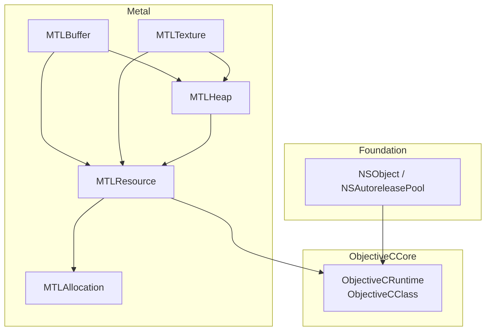
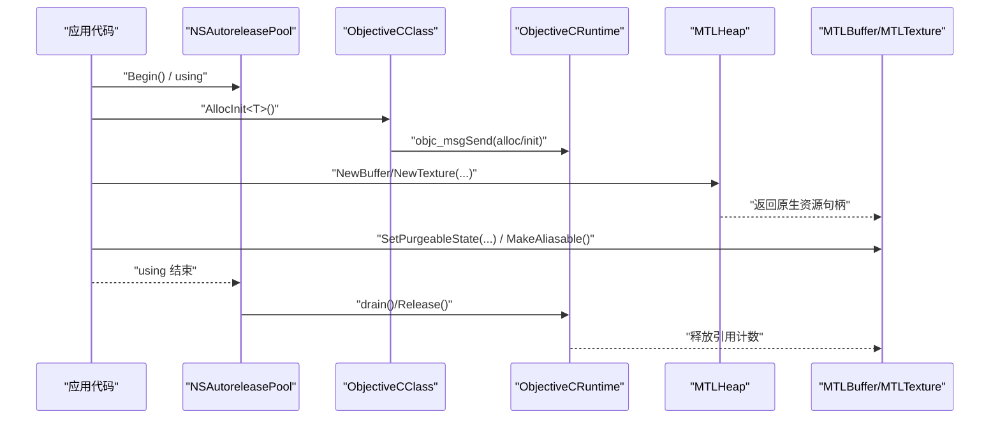
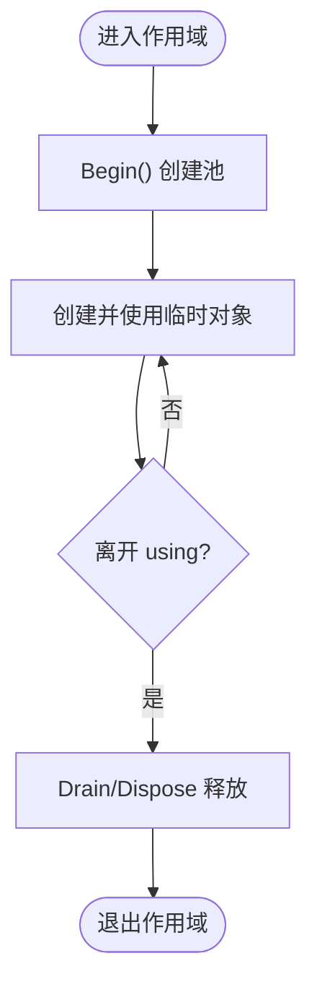
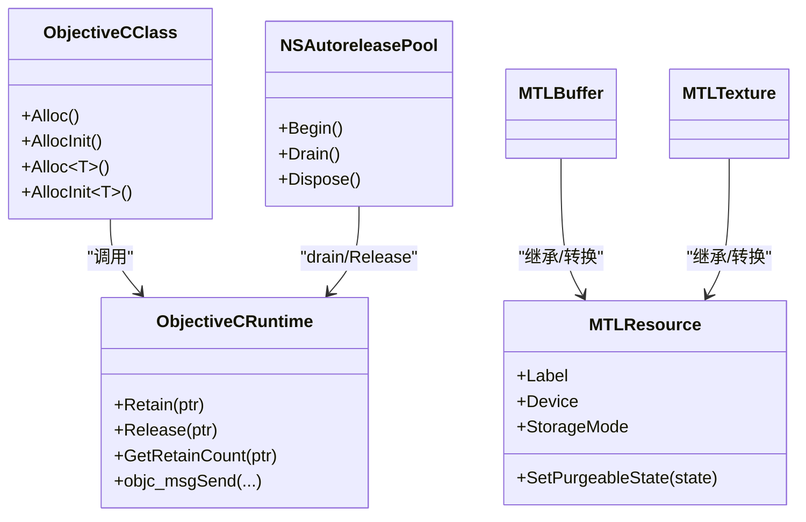
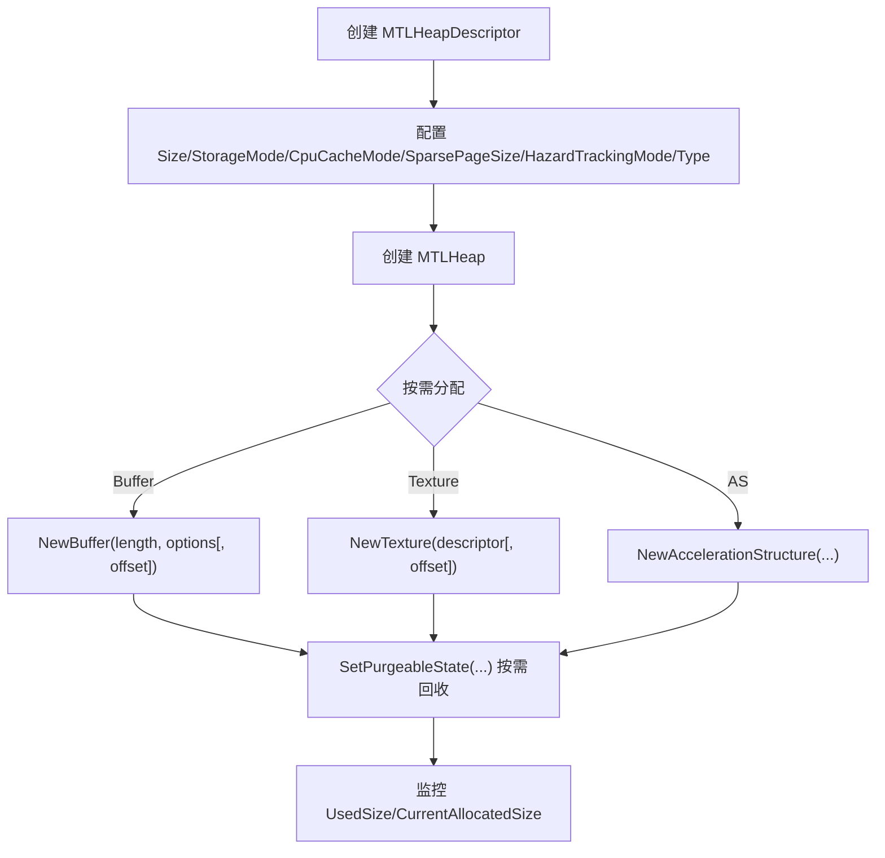
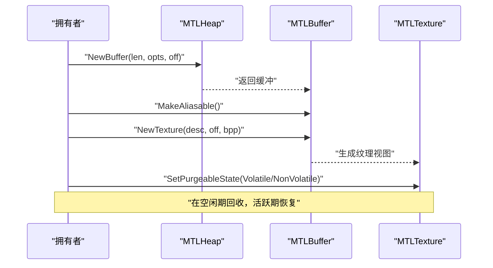
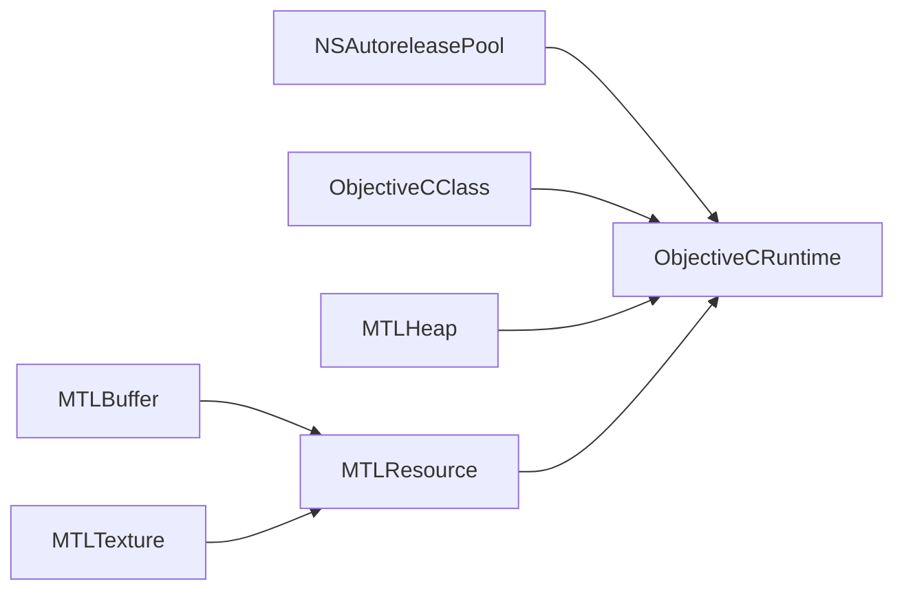

# 内存管理最佳实践

<cite>
**本文引用的文件**
- [README.md](file://README.md)
- [DESIGN.md](file://DESIGN.md)
- [NSObject.cs](file://src/SharpMetal/Foundation/NSObject.cs)
- [NSAutoreleasePool.cs](file://src/SharpMetal/Foundation/NSAutoreleasePool.cs)
- [ObjectiveCRuntime.cs](file://src/SharpMetal/ObjectiveCCore/ObjectiveCRuntime.cs)
- [ObjectiveCClass.cs](file://src/SharpMetal/ObjectiveCCore/ObjectiveCClass.cs)
- [MTLResource.cs](file://src/SharpMetal/Metal/MTLResource.cs)
- [MTLBuffer.cs](file://src/SharpMetal/Metal/MTLBuffer.cs)
- [MTLTexture.cs](file://src/SharpMetal/Metal/MTLTexture.cs)
- [MTLHeap.cs](file://src/SharpMetal/Metal/MTLHeap.cs)
- [MTLAllocation.cs](file://src/SharpMetal/Metal/MTLAllocation.cs)
</cite>

## 目录
1. [简介](#简介)
2. [项目结构](#项目结构)
3. [核心组件](#核心组件)
4. [架构总览](#架构总览)
5. [详细组件分析](#详细组件分析)
6. [依赖关系分析](#依赖关系分析)
7. [性能考量](#性能考量)
8. [故障排查指南](#故障排查指南)
9. [结论](#结论)
10. [附录](#附录)

## 简介
本文件面向在 SharpMetal 中进行 GPU/原生资源管理的开发者，系统性阐述 RAII 模式在本项目中的实现原理与使用方法，覆盖：
- 原生资源的所有权模型与生命周期控制
- Objective-C 对象与托管对象的映射关系
- 内存泄漏检测与预防策略
- GPU 内存分配策略、堆内存管理与资源重用模式
- 内存使用监控工具与调试技巧
- 常见内存问题的诊断与解决方案

SharpMetal 提供对 Foundation、Metal、MetalFX、QuartzCore 的低层绑定，强调“显式所有权”的托管语义，便于在 .NET 中安全地管理 Objective-C 与 Metal 原生资源。

**章节来源**
- [README.md:1-23](file://README.md#L1-L23)

## 项目结构
SharpMetal 将内存管理相关能力分层组织：
- Foundation：基础运行时与自动释放池（NSAutoreleasePool）
- ObjectiveCCore：Objective-C 运行时桥接（消息发送、retain/release、类创建等）
- Metal：GPU 资源抽象（MTLResource、MTLBuffer、MTLTexture、MTLHeap、MTLAllocation）
- QuartzCore：与显示相关的可绘制对象（CAMetalDrawable 等）

**图表来源**
- [NSAutoreleasePool.cs:5-39](file://src/SharpMetal/Foundation/NSAutoreleasePool.cs#L5-L39)
- [ObjectiveCRuntime.cs:33-800](file://src/SharpMetal/ObjectiveCCore/ObjectiveCRuntime.cs#L33-L800)
- [MTLResource.cs:63-119](file://src/SharpMetal/Metal/MTLResource.cs#L63-L119)
- [MTLBuffer.cs:6-113](file://src/SharpMetal/Metal/MTLBuffer.cs#L6-L113)
- [MTLTexture.cs:242-438](file://src/SharpMetal/Metal/MTLTexture.cs#L242-L438)
- [MTLHeap.cs:86-192](file://src/SharpMetal/Metal/MTLHeap.cs#L86-L192)
- [MTLAllocation.cs:5-17](file://src/SharpMetal/Metal/MTLAllocation.cs#L5-L17)

**章节来源**
- [README.md:12-16](file://README.md#L12-L16)

## 核心组件
- ObjectiveCRuntime：封装 Objective-C 运行时调用，提供 retain/release/retainCount、objc_msgSend 重载族、类型转换与结构体封送。
- ObjectiveCClass：用于获取/创建 Objective-C 类实例，并提供 Alloc/AllocInit 等便捷方法。
- NSAutoreleasePool：实现 IDisposable，封装自动释放池的 Begin/Drain/Dispose 生命周期，配合托管代码的 using 模式实现 RAII。
- MTLResource：所有 Metal 资源的基抽象，暴露存储模式、缓存模式、危险跟踪模式、可回收状态等。
- MTLBuffer/MTLTexture：具体 GPU 资源类型，支持别名化、远程视图、可回收状态、从 Buffer 创建 Texture 等。
- MTLHeap：集中式 GPU 内存堆，支持按对齐分配、批量创建 Buffer/Texture/AccelerationStructure，并支持可回收状态。
- MTLAllocation：轻量句柄，用于统一表达“已分配的原生内存块”。

这些组件共同构成 SharpMetal 的内存管理骨架：通过 ObjectiveCClass 创建对象，通过 ObjectiveCRuntime 进行引用计数与消息转发，通过 NSAutoreleasePool 管理短期临时对象，通过 MTLHeap 集中管理 GPU 内存，并通过 MTLResource 的统一接口进行生命周期控制。

**章节来源**
- [ObjectiveCRuntime.cs:769-836](file://src/SharpMetal/ObjectiveCCore/ObjectiveCRuntime.cs#L769-L836)
- [ObjectiveCClass.cs:54-78](file://src/SharpMetal/ObjectiveCCore/ObjectiveCClass.cs#L54-L78)
- [NSAutoreleasePool.cs:5-39](file://src/SharpMetal/Foundation/NSAutoreleasePool.cs#L5-L39)
- [MTLResource.cs:63-119](file://src/SharpMetal/Metal/MTLResource.cs#L63-L119)
- [MTLBuffer.cs:6-113](file://src/SharpMetal/Metal/MTLBuffer.cs#L6-L113)
- [MTLTexture.cs:242-438](file://src/SharpMetal/Metal/MTLTexture.cs#L242-L438)
- [MTLHeap.cs:86-192](file://src/SharpMetal/Metal/MTLHeap.cs#L86-L192)
- [MTLAllocation.cs:5-17](file://src/SharpMetal/Metal/MTLAllocation.cs#L5-L17)

## 架构总览
下图展示了从托管侧到 Objective-C 与 Metal 的资源创建与释放路径，以及自动释放池的作用点。

**图表来源**
- [NSAutoreleasePool.cs:11-26](file://src/SharpMetal/Foundation/NSAutoreleasePool.cs#L11-L26)
- [ObjectiveCClass.cs:60-78](file://src/SharpMetal/ObjectiveCCore/ObjectiveCClass.cs#L60-L78)
- [ObjectiveCRuntime.cs:769-782](file://src/SharpMetal/ObjectiveCCore/ObjectiveCRuntime.cs#L769-L782)
- [MTLHeap.cs:124-147](file://src/SharpMetal/Metal/MTLHeap.cs#L124-L147)
- [MTLBuffer.cs:50-63](file://src/SharpMetal/Metal/MTLBuffer.cs#L50-L63)
- [MTLTexture.cs:337-345](file://src/SharpMetal/Metal/MTLTexture.cs#L337-L345)

## 详细组件分析

### RAII 与自动释放池（NSAutoreleasePool）
- 设计要点
  - NSAutoreleasePool 实现 IDisposable，结合 C# using 语句形成 RAII 语义，确保作用域结束时执行 drain/Release。
  - 通过 AddObject 可将临时对象加入池，由池统一管理释放时机，避免手动 retain/release 错误。
- 使用建议
  - 在短生命周期内频繁创建 Objective-C 或 Metal 描述符时，包裹于 using 块中，减少手动释放负担。
  - 避免跨线程共享同一池；每个线程应维护自己的池。
- 风险与注意
  - 不要对非池管理对象重复 Drain。
  - 长时间运行的任务需定期创建新池，防止池膨胀。

**图表来源**
- [NSAutoreleasePool.cs:11-26](file://src/SharpMetal/Foundation/NSAutoreleasePool.cs#L11-L26)

**章节来源**
- [NSAutoreleasePool.cs:5-39](file://src/SharpMetal/Foundation/NSAutoreleasePool.cs#L5-L39)

### Objective-C 对象与托管对象的映射
- 映射方式
  - 各结构体（如 NSObject、MTLResource、MTLBuffer、MTLTexture）以 NativePtr 持有底层 Objective-C/Metal 指针，并通过隐式转换与 ObjectiveCRuntime 的消息发送机制访问属性与方法。
  - ObjectiveCClass 提供 Alloc/AllocInit 等方法，直接调用 Objective-C 的 alloc/init 流程。
- 引用计数
  - ObjectiveCRuntime 暴露 Retain/Release/GetRetainCount，供需要精确控制生命周期的场景使用。
- 注意事项
  - 避免裸用 NativePtr 绕过 API；优先通过强类型包装访问，以获得编译期检查与更好的可维护性。
  - 跨边界传递结构体时需遵循值语义与封送约定。

**图表来源**
- [ObjectiveCClass.cs:54-78](file://src/SharpMetal/ObjectiveCCore/ObjectiveCClass.cs#L54-L78)
- [ObjectiveCRuntime.cs:769-836](file://src/SharpMetal/ObjectiveCCore/ObjectiveCRuntime.cs#L769-L836)
- [MTLResource.cs:63-119](file://src/SharpMetal/Metal/MTLResource.cs#L63-L119)
- [MTLBuffer.cs:6-113](file://src/SharpMetal/Metal/MTLBuffer.cs#L6-L113)
- [MTLTexture.cs:242-438](file://src/SharpMetal/Metal/MTLTexture.cs#L242-L438)
- [NSAutoreleasePool.cs:5-39](file://src/SharpMetal/Foundation/NSAutoreleasePool.cs#L5-L39)

**章节来源**
- [NSObject.cs:48-90](file://src/SharpMetal/Foundation/NSObject.cs#L48-L90)
- [ObjectiveCClass.cs:18-89](file://src/SharpMetal/ObjectiveCCore/ObjectiveCClass.cs#L18-L89)
- [ObjectiveCRuntime.cs:33-800](file://src/SharpMetal/ObjectiveCCore/ObjectiveCRuntime.cs#L33-L800)

### GPU 内存分配策略与堆内存管理
- 存储模式与缓存模式
  - MTLResource 暴露 StorageMode（Shared/Managed/Private/Memoryless）与 CpuCacheMode（DefaultCache/WriteCombined），影响数据在 CPU/GPU 间的可见性与拷贝行为。
- 可回收状态
  - SetPurgeableState 允许在内存紧张时将资源标记为可回收，系统可在必要时驱逐内容，使用时再恢复。
- 堆（MTLHeap）
  - 通过 MTLHeapDescriptor 配置 Size、StorageMode、CpuCacheMode、SparsePageSize、HazardTrackingMode、Type 等。
  - 使用 NewBuffer/NewTexture/NewAccelerationStructure 在堆上分配，支持带 offset 的重叠分配，提升复用率与碎片控制。
  - 通过 UsedSize/CurrentAllocatedSize 监控堆使用情况。
- 资源别名
  - MTLBuffer/MTLTexture 支持 MakeAliasable，使多个视图共享底层内存，降低复制开销。

**图表来源**
- [MTLHeap.cs:13-84](file://src/SharpMetal/Metal/MTLHeap.cs#L13-L84)
- [MTLHeap.cs:119-167](file://src/SharpMetal/Metal/MTLHeap.cs#L119-L167)
- [MTLResource.cs:6-48](file://src/SharpMetal/Metal/MTLResource.cs#L6-L48)
- [MTLBuffer.cs:50-63](file://src/SharpMetal/Metal/MTLBuffer.cs#L50-L63)
- [MTLTexture.cs:337-345](file://src/SharpMetal/Metal/MTLTexture.cs#L337-L345)

**章节来源**
- [MTLHeap.cs:13-192](file://src/SharpMetal/Metal/MTLHeap.cs#L13-L192)
- [MTLResource.cs:63-119](file://src/SharpMetal/Metal/MTLResource.cs#L63-L119)
- [MTLBuffer.cs:6-113](file://src/SharpMetal/Metal/MTLBuffer.cs#L6-L113)
- [MTLTexture.cs:242-438](file://src/SharpMetal/Metal/MTLTexture.cs#L242-L438)

### 资源重用模式与生命周期控制
- 资源重用
  - 使用 MTLHeap 集中分配，通过 offset 复用大块内存，减少频繁分配/释放。
  - 使用 MakeAliasable 创建多重视图，避免复制。
  - 利用纹理视图（NewTextureView）在不同像素格式/维度间复用底层数据。
- 生命周期控制
  - 短期对象：使用 NSAutoreleasePool 包裹，自动释放。
  - 长期对象：明确拥有者负责释放；必要时结合 Retain/Release 精细控制。
  - 可回收资源：在空闲阶段设置可回收状态，节省内存峰值。

**图表来源**
- [MTLHeap.cs:124-147](file://src/SharpMetal/Metal/MTLHeap.cs#L124-L147)
- [MTLBuffer.cs:65-68](file://src/SharpMetal/Metal/MTLBuffer.cs#L65-L68)
- [MTLBuffer.cs:55-63](file://src/SharpMetal/Metal/MTLBuffer.cs#L55-L63)
- [MTLTexture.cs:367-385](file://src/SharpMetal/Metal/MTLTexture.cs#L367-L385)
- [MTLTexture.cs:337-345](file://src/SharpMetal/Metal/MTLTexture.cs#L337-L345)

**章节来源**
- [MTLBuffer.cs:6-113](file://src/SharpMetal/Metal/MTLBuffer.cs#L6-L113)
- [MTLTexture.cs:242-438](file://src/SharpMetal/Metal/MTLTexture.cs#L242-L438)
- [MTLHeap.cs:86-192](file://src/SharpMetal/Metal/MTLHeap.cs#L86-L192)

### 内存使用监控与调试技巧
- 堆使用监控
  - 通过 MTLHeap.UsedSize/CurrentAllocatedSize 观察堆占用与当前分配量，辅助定位增长趋势。
- 资源信息
  - MTLResource.AllocatedSize 查看单个资源实际占用大小。
  - MTLBuffer/MTLTexture 的 Label 可用于区分不同用途的资源，便于日志与工具识别。
- 危险跟踪
  - 通过 HazardTrackingMode 启用危险跟踪，帮助发现读写竞争导致的未定义行为。
- 可回收状态
  - 在渲染间隙或后台阶段设置 SetPurgeableState，降低峰值内存；再次使用前确保状态正确。
- 自动释放池
  - 在热点循环中使用 NSAutoreleasePool 包裹临时对象，减少频繁 retain/release 的开销与遗漏风险。

**章节来源**
- [MTLHeap.cs:111-117](file://src/SharpMetal/Metal/MTLHeap.cs#L111-L117)
- [MTLResource.cs:72-99](file://src/SharpMetal/Metal/MTLResource.cs#L72-L99)
- [MTLBuffer.cs:18-49](file://src/SharpMetal/Metal/MTLBuffer.cs#L18-L49)
- [MTLTexture.cs:253-335](file://src/SharpMetal/Metal/MTLTexture.cs#L253-L335)
- [NSAutoreleasePool.cs:11-26](file://src/SharpMetal/Foundation/NSAutoreleasePool.cs#L11-L26)

## 依赖关系分析
- 松耦合设计
  - 各资源类型通过 MTLResource 抽象统一访问，降低耦合度。
  - ObjectiveCRuntime 作为底层桥接，被 Foundation 与 Metal 模块共用，职责单一。
- 关键依赖链
  - NSAutoreleasePool → ObjectiveCRuntime（drain/Release）
  - MTLHeap → ObjectiveCRuntime（创建/查询）
  - MTLBuffer/MTLTexture → MTLResource（属性/行为）
  - ObjectiveCClass → ObjectiveCRuntime（alloc/init）

**图表来源**
- [NSAutoreleasePool.cs:11-26](file://src/SharpMetal/Foundation/NSAutoreleasePool.cs#L11-L26)
- [ObjectiveCClass.cs:54-78](file://src/SharpMetal/ObjectiveCCore/ObjectiveCClass.cs#L54-L78)
- [MTLHeap.cs:119-167](file://src/SharpMetal/Metal/MTLHeap.cs#L119-L167)
- [MTLBuffer.cs:6-113](file://src/SharpMetal/Metal/MTLBuffer.cs#L6-L113)
- [MTLTexture.cs:242-438](file://src/SharpMetal/Metal/MTLTexture.cs#L242-L438)
- [MTLResource.cs:63-119](file://src/SharpMetal/Metal/MTLResource.cs#L63-L119)
- [ObjectiveCRuntime.cs:769-836](file://src/SharpMetal/ObjectiveCCore/ObjectiveCRuntime.cs#L769-L836)

**章节来源**
- [ObjectiveCRuntime.cs:33-800](file://src/SharpMetal/ObjectiveCCore/ObjectiveCRuntime.cs#L33-L800)

## 性能考量
- 优先使用 MTLHeap 集中分配，减少碎片与分配次数。
- 合理使用 StorageMode/CpuCacheMode，避免不必要的 CPU-GPU 同步与拷贝。
- 对大对象启用可回收状态，在空闲期释放物理页，降低峰值内存。
- 使用 MakeAliasable 与纹理视图复用数据，减少复制。
- 在高频循环中使用 NSAutoreleasePool 管理临时对象，降低 GC 压力与引用计数开销。

[本节为通用指导，不直接分析具体文件]

## 故障排查指南
- 症状：内存持续增长
  - 检查是否频繁创建未放入自动释放池的对象；考虑使用 NSAutoreleasePool 包裹。
  - 检查 MTLHeap 的 UsedSize/CurrentAllocatedSize 是否持续上升，确认是否存在未释放的 Buffer/Texture。
- 症状：崩溃或不可预测行为
  - 启用 HazardTrackingMode，定位读写竞争。
  - 检查是否在资源被回收后仍在使用；确保 SetPurgeableState 的状态切换符合使用周期。
- 症状：性能抖动
  - 评估是否因频繁分配导致；改用 MTLHeap 预分配与复用。
  - 检查是否误用 Managed/Shared 模式导致额外拷贝。
- 症状：泄漏难以定位
  - 为关键资源设置 Label，结合日志与工具输出定位。
  - 使用 GetRetainCount 辅助判断引用计数异常（谨慎使用）。

**章节来源**
- [NSAutoreleasePool.cs:11-26](file://src/SharpMetal/Foundation/NSAutoreleasePool.cs#L11-L26)
- [MTLHeap.cs:111-117](file://src/SharpMetal/Metal/MTLHeap.cs#L111-L117)
- [MTLResource.cs:72-99](file://src/SharpMetal/Metal/MTLResource.cs#L72-L99)
- [ObjectiveCRuntime.cs:769-782](file://src/SharpMetal/ObjectiveCCore/ObjectiveCRuntime.cs#L769-L782)

## 结论
SharpMetal 通过清晰的层次划分与显式所有权模型，提供了可控且高效的内存管理能力：
- 使用 NSAutoreleasePool 实现 RAII 式的短期对象管理
- 通过 ObjectiveCRuntime 与 ObjectiveCClass 完成与 Objective-C 的安全交互
- 借助 MTLHeap 与 MTLResource 的统一接口，实现 GPU 内存的集中分配、复用与回收
- 结合存储模式、缓存模式、危险跟踪与可回收状态，达成性能与内存占用的平衡

遵循本文的最佳实践，可有效降低内存泄漏风险、提升稳定性与性能。

[本节为总结性内容，不直接分析具体文件]

## 附录
- 快速参考
  - 短期对象：使用 NSAutoreleasePool.Begin() 并在 using 中结束
  - 长期对象：明确拥有者负责释放，必要时使用 Retain/Release
  - GPU 内存：优先使用 MTLHeap 分配，配合 SetPurgeableState 回收
  - 资源复用：MakeAliasable 与 NewTextureView
  - 监控：MTLHeap.UsedSize/CurrentAllocatedSize、MTLResource.AllocatedSize、Label

[本节为补充说明，不直接分析具体文件]