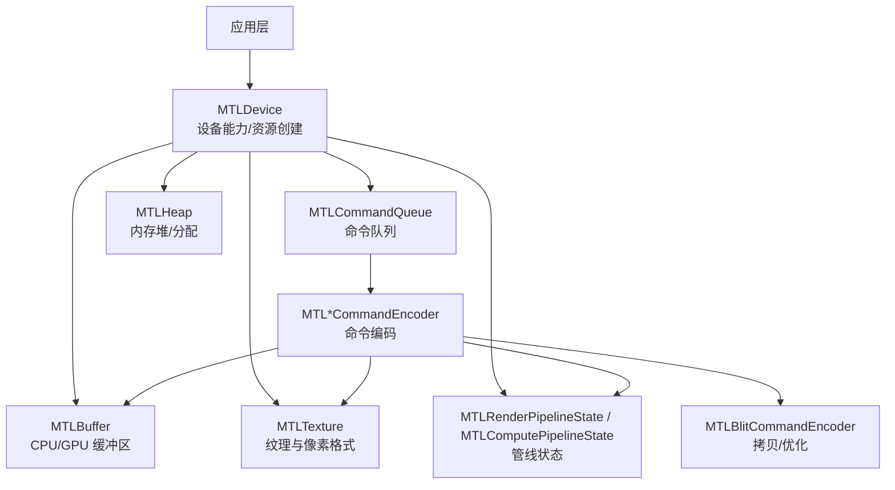
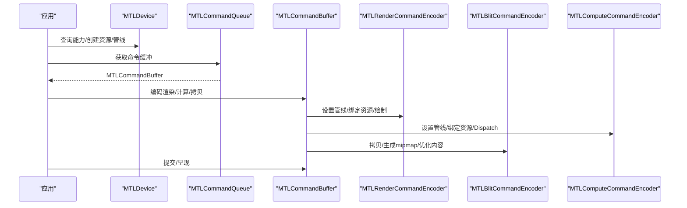
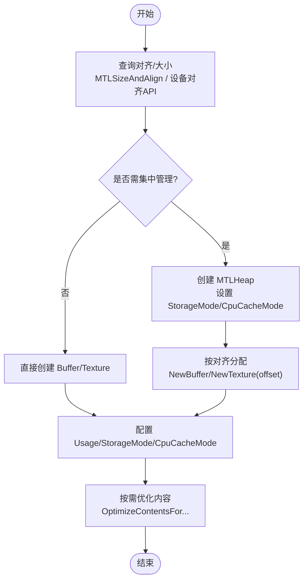
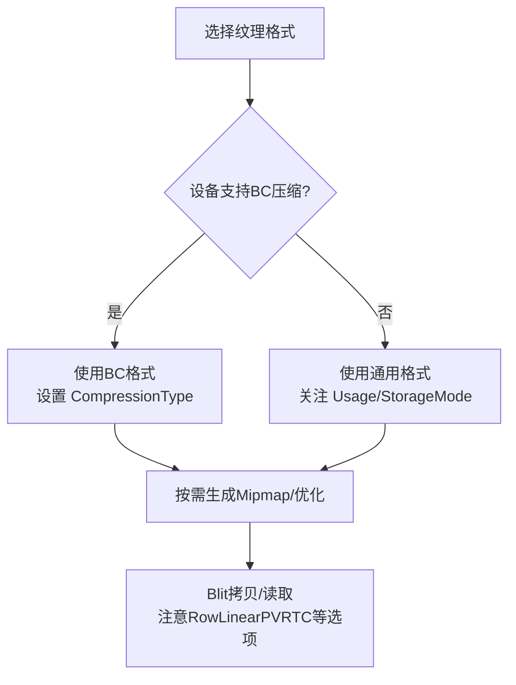
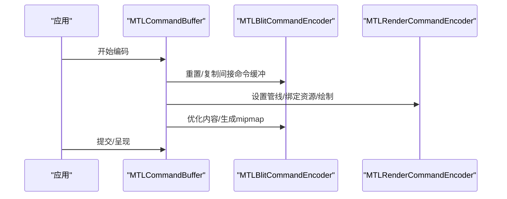
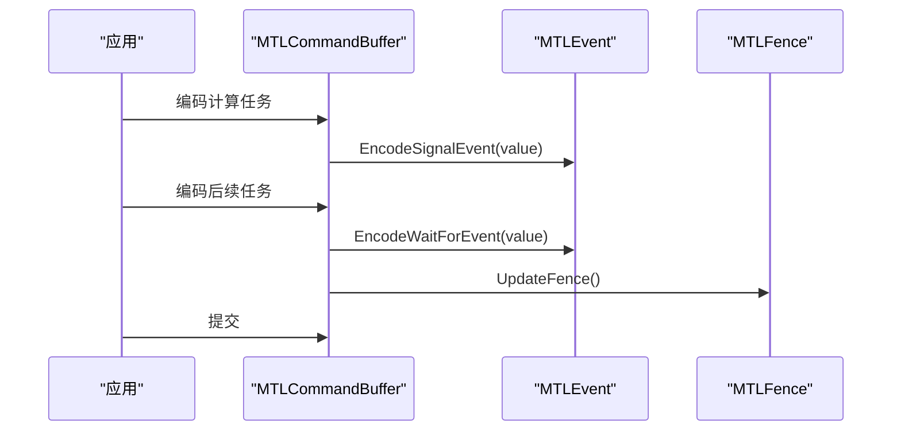
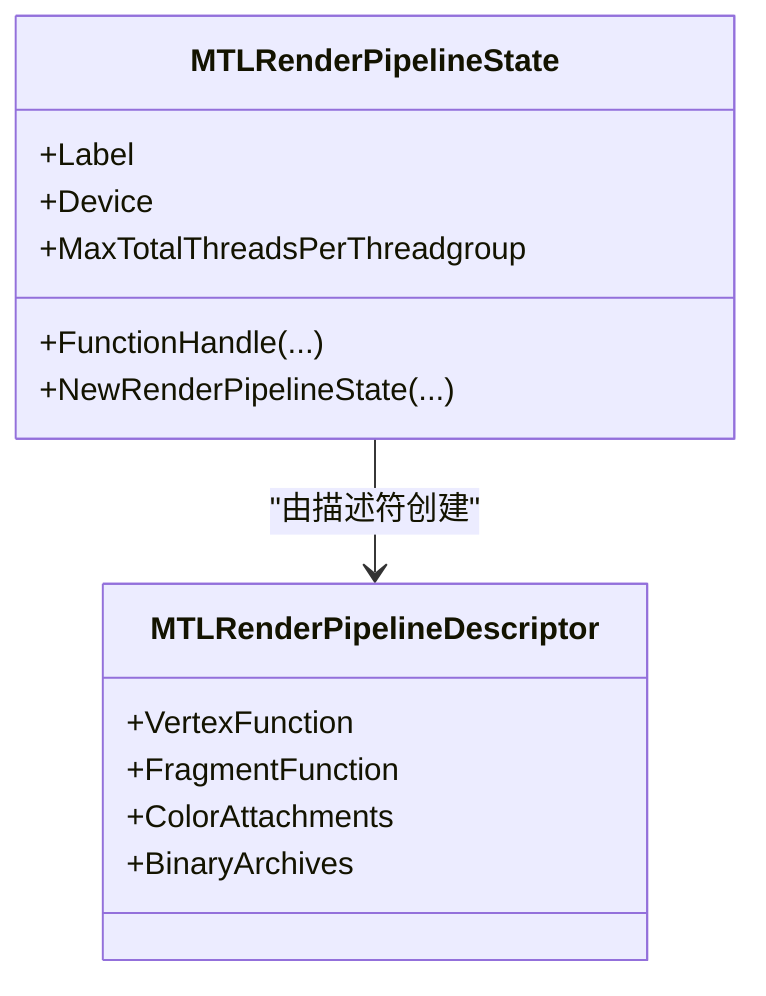
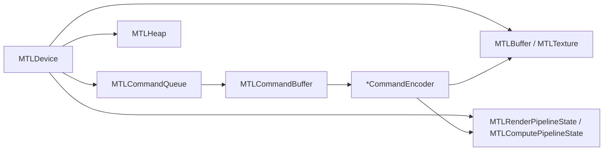

# 性能优化技巧

<cite>
**本文引用的文件**
- [README.md](file://README.md)
- [DESIGN.md](file://DESIGN.md)
- [MTLDevice.cs](file://src/SharpMetal/Metal/MTLDevice.cs)
- [MTLBuffer.cs](file://src/SharpMetal/Metal/MTLBuffer.cs)
- [MTLTexture.cs](file://src/SharpMetal/Metal/MTLTexture.cs)
- [MTLCommandBuffer.cs](file://src/SharpMetal/Metal/MTLCommandBuffer.cs)
- [MTLCommandQueue.cs](file://src/SharpMetal/Metal/MTLCommandQueue.cs)
- [MTLBlitCommandEncoder.cs](file://src/SharpMetal/Metal/MTLBlitCommandEncoder.cs)
- [MTLRenderPipeline.cs](file://src/SharpMetal/Metal/MTLRenderPipeline.cs)
- [MTLComputePipeline.cs](file://src/SharpMetal/Metal/MTLComputePipeline.cs)
- [MTLHeap.cs](file://src/SharpMetal/Metal/MTLHeap.cs)
- [MTLTypes.cs](file://src/SharpMetal/Metal/MTLTypes.cs)
</cite>

## 目录
1. [简介](#简介)
2. [项目结构](#项目结构)
3. [核心组件](#核心组件)
4. [架构总览](#架构总览)
5. [详细组件分析](#详细组件分析)
6. [依赖关系分析](#依赖关系分析)
7. [性能考量](#性能考量)
8. [故障排查指南](#故障排查指南)
9. [结论](#结论)
10. [附录](#附录)

## 简介
本文件面向使用 SharpMetal（.NET 对 Apple Metal 的低层绑定）进行图形与计算开发的工程师，聚焦于在真实代码能力范围内可落地的性能优化实践。内容覆盖：
- GPU 内存管理优化（堆、对齐、访问模式）
- 缓冲区布局与纹理格式选择
- 命令编码最佳实践（批量化、间接命令缓冲、状态切换）
- 减少 CPU-GPU 同步开销（事件、栅栏、驻留集）
- 渲染管线状态优化（管线复用、描述符重用）
- 资源池与缓存机制（纹理视图池、二进制归档）
- 基准测试方法与工具使用（计数器、时间戳、调试捕获）
- 不同硬件平台的差异与策略（GPU Family、统一内存、压缩支持）

## 项目结构
SharpMetal 将 Metal 的 Objective-C API 以 .NET struct/enum/descriptor 形式暴露，便于在 .NET 应用中直接调用系统框架。关键路径：
- src/SharpMetal/Metal：Metal 核心类型（设备、命令、资源、管线等）
- src/SharpMetal/Foundation / ObjectiveCCore / QuartzCore：运行时桥接与显示相关类型
- samples/SharpMetal.Sample：示例工程
- docs/VERIFICATION.md：构建与验证指引

图表来源
- [MTLDevice.cs:187-359](file://src/SharpMetal/Metal/MTLDevice.cs#L187-L359)
- [MTLCommandQueue.cs:44-68](file://src/SharpMetal/Metal/MTLCommandQueue.cs#L44-L68)
- [MTLBuffer.cs:6-48](file://src/SharpMetal/Metal/MTLBuffer.cs#L6-L48)
- [MTLTexture.cs:75-240](file://src/SharpMetal/Metal/MTLTexture.cs#L75-L240)
- [MTLRenderPipeline.cs:530-629](file://src/SharpMetal/Metal/MTLRenderPipeline.cs#L530-L629)
- [MTLComputePipeline.cs:151-235](file://src/SharpMetal/Metal/MTLComputePipeline.cs#L151-L235)
- [MTLHeap.cs:86-194](file://src/SharpMetal/Metal/MTLHeap.cs#L86-L194)
- [MTLBlitCommandEncoder.cs:14-217](file://src/SharpMetal/Metal/MTLBlitCommandEncoder.cs#L14-L217)

章节来源
- [README.md:1-23](file://README.md#L1-L23)
- [DESIGN.md:1-12](file://DESIGN.md#L1-L12)

## 核心组件
- 设备（MTLDevice）：提供能力查询、资源创建、管线编译入口、堆与计数器等。
- 命令队列与命令缓冲（MTLCommandQueue / MTLCommandBuffer）：组织并调度命令执行，支持回调、等待、呈现。
- 资源（MTLBuffer / MTLTexture）：数据载体，支持多种存储模式、缓存模式、压缩、稀疏页等。
- 管线（MTLRenderPipelineState / MTLComputePipelineState）：固化渲染/计算状态，减少每帧状态切换。
- 命令编码器（MTL*CommandEncoder）：记录具体操作（绘制、计算、拷贝、优化）。
- 堆（MTLHeap）：集中管理 GPU 内存，支持 Placement/Sparse 模式与对齐控制。

章节来源
- [MTLDevice.cs:187-359](file://src/SharpMetal/Metal/MTLDevice.cs#L187-L359)
- [MTLCommandBuffer.cs:116-321](file://src/SharpMetal/Metal/MTLCommandBuffer.cs#L116-L321)
- [MTLBuffer.cs:6-115](file://src/SharpMetal/Metal/MTLBuffer.cs#L6-L115)
- [MTLTexture.cs:75-440](file://src/SharpMetal/Metal/MTLTexture.cs#L75-L440)
- [MTLRenderPipeline.cs:208-629](file://src/SharpMetal/Metal/MTLRenderPipeline.cs#L208-L629)
- [MTLComputePipeline.cs:25-235](file://src/SharpMetal/Metal/MTLComputePipeline.cs#L25-L235)
- [MTLHeap.cs:13-194](file://src/SharpMetal/Metal/MTLHeap.cs#L13-L194)

## 架构总览
下图展示典型一帧的命令流：从设备获取能力，创建/复用管线，通过命令队列提交命令缓冲，编码器记录绘制/计算/拷贝等操作，必要时使用事件/栅栏同步，最终呈现可绘制对象。

图表来源
- [MTLDevice.cs:326-454](file://src/SharpMetal/Metal/MTLDevice.cs#L326-L454)
- [MTLCommandBuffer.cs:195-268](file://src/SharpMetal/Metal/MTLCommandBuffer.cs#L195-L268)
- [MTLBlitCommandEncoder.cs:52-175](file://src/SharpMetal/Metal/MTLBlitCommandEncoder.cs#L52-L175)

## 详细组件分析

### GPU 内存管理与对齐
- 堆与分配
  - 使用 MTLHeap 集中管理 GPU 内存，支持 Automatic/Placement/Sparse 三种类型，便于批量分配与释放，降低碎片化。
  - 通过 MTLSizeAndAlign 精确控制 buffer/texture 的对齐与大小，避免跨页或无效填充。
- 缓冲区与纹理
  - MTLBuffer 支持 CPU 缓存模式、存储模式、危险跟踪、别名化、远程视图等；合理设置可减少 CPU-GPU 同步与带宽浪费。
  - MTLTexture 支持多种用途（ShaderRead/Write/RenderTarget/Atomic）、压缩类型、Swizzle、稀疏页尺寸等；根据读写模式与采样方式选择最优配置。
- 对齐与布局
  - 使用设备接口查询最小线性纹理对齐与纹理缓冲对齐，确保字节行与图像步长满足硬件要求。
  - 利用堆的 Placement 模式与偏移分配，实现自定义内存布局，提升缓存命中与带宽利用率。

图表来源
- [MTLDevice.cs:341-349](file://src/SharpMetal/Metal/MTLDevice.cs#L341-L349)
- [MTLDevice.cs:466-474](file://src/SharpMetal/Metal/MTLDevice.cs#L466-L474)
- [MTLHeap.cs:13-84](file://src/SharpMetal/Metal/MTLHeap.cs#L13-L84)
- [MTLHeap.cs:124-147](file://src/SharpMetal/Metal/MTLHeap.cs#L124-L147)
- [MTLBuffer.cs:18-48](file://src/SharpMetal/Metal/MTLBuffer.cs#L18-L48)
- [MTLTexture.cs:131-183](file://src/SharpMetal/Metal/MTLTexture.cs#L131-L183)

章节来源
- [MTLDevice.cs:341-349](file://src/SharpMetal/Metal/MTLDevice.cs#L341-L349)
- [MTLDevice.cs:466-474](file://src/SharpMetal/Metal/MTLDevice.cs#L466-L474)
- [MTLHeap.cs:13-84](file://src/SharpMetal/Metal/MTLHeap.cs#L13-L84)
- [MTLHeap.cs:124-147](file://src/SharpMetal/Metal/MTLHeap.cs#L124-L147)
- [MTLBuffer.cs:18-48](file://src/SharpMetal/Metal/MTLBuffer.cs#L18-L48)
- [MTLTexture.cs:131-183](file://src/SharpMetal/Metal/MTLTexture.cs#L131-L183)

### 纹理压缩格式选择
- 设备能力探测
  - 通过设备能力查询判断是否支持 BC 纹理压缩等特性，据此选择合适格式。
- 纹理描述与压缩
  - 在 MTLTextureDescriptor 中设置 PixelFormat、CompressionType、Usage、AllowGPUOptimizedContents 等，平衡质量与带宽。
- 拷贝与优化
  - 使用 Blit 编码器进行纹理拷贝时，可选择 RowLinearPVRTC 等选项；对频繁读写的纹理，适时调用优化方法以减少转换开销。

图表来源
- [MTLDevice.cs:253-253](file://src/SharpMetal/Metal/MTLDevice.cs#L253-L253)
- [MTLTexture.cs:167-171](file://src/SharpMetal/Metal/MTLTexture.cs#L167-L171)
- [MTLBlitCommandEncoder.cs:6-12](file://src/SharpMetal/Metal/MTLBlitCommandEncoder.cs#L6-L12)

章节来源
- [MTLDevice.cs:253-253](file://src/SharpMetal/Metal/MTLDevice.cs#L253-L253)
- [MTLTexture.cs:167-171](file://src/SharpMetal/Metal/MTLTexture.cs#L167-L171)
- [MTLBlitCommandEncoder.cs:6-12](file://src/SharpMetal/Metal/MTLBlitCommandEncoder.cs#L6-L12)

### 命令编码最佳实践
- 批量化与间接命令缓冲
  - 使用 IndirectCommandBuffer 预编码大量命令，减少 CPU 侧重复编码；可通过 Blit 编码器重置与复制命令范围。
- 状态切换最小化
  - 尽量复用 MTLRenderPipelineState / MTLComputePipelineState，减少每帧创建与切换成本。
- 内容优化
  - 在 CPU/GPU 访问前调用优化方法，使内部布局适配当前访问模式，降低转换与同步开销。
- 调试与标记
  - 使用 PushDebugGroup/PopDebugGroup 与 InsertDebugSignpost 标注热点区域，便于性能剖析。

图表来源
- [MTLBlitCommandEncoder.cs:157-175](file://src/SharpMetal/Metal/MTLBlitCommandEncoder.cs#L157-L175)
- [MTLCommandBuffer.cs:195-268](file://src/SharpMetal/Metal/MTLCommandBuffer.cs#L195-L268)

章节来源
- [MTLBlitCommandEncoder.cs:157-175](file://src/SharpMetal/Metal/MTLBlitCommandEncoder.cs#L157-L175)
- [MTLCommandBuffer.cs:195-268](file://src/SharpMetal/Metal/MTLCommandBuffer.cs#L195-L268)

### 减少 CPU-GPU 同步开销
- 事件与栅栏
  - 使用 EncodeWaitForEvent/EncodeSignalEvent 在命令缓冲中插入显式同步点，避免阻塞式等待。
  - 使用 WaitForFence/UpdateFence 在拷贝/计算阶段建立依赖，减少不必要的屏障。
- 驻留集
  - 通过 CommandQueue 与 CommandBuffer 的驻留集接口，声明活跃资源集合，帮助驱动优化内存驻留与迁移。
- 异步呈现
  - 使用 PresentDrawableAtTime / PresentDrawableAfterMinimumDuration 控制呈现时机，降低主线程阻塞。

图表来源
- [MTLCommandBuffer.cs:235-243](file://src/SharpMetal/Metal/MTLCommandBuffer.cs#L235-L243)
- [MTLBlitCommandEncoder.cs:117-125](file://src/SharpMetal/Metal/MTLBlitCommandEncoder.cs#L117-L125)
- [MTLCommandQueue.cs:75-93](file://src/SharpMetal/Metal/MTLCommandQueue.cs#L75-L93)

章节来源
- [MTLCommandBuffer.cs:235-243](file://src/SharpMetal/Metal/MTLCommandBuffer.cs#L235-L243)
- [MTLBlitCommandEncoder.cs:117-125](file://src/SharpMetal/Metal/MTLBlitCommandEncoder.cs#L117-L125)
- [MTLCommandQueue.cs:75-93](file://src/SharpMetal/Metal/MTLCommandQueue.cs#L75-L93)

### 优化渲染管线状态切换
- 管线复用
  - 为常见绘制路径预创建 MTLRenderPipelineState，并在编码阶段仅更新必要绑定。
- 描述符重用
  - 复用 MTLRenderPipelineDescriptor 与颜色附件描述符数组，减少每帧构造开销。
- 函数句柄与二进制归档
  - 使用 FunctionHandle 与 BinaryArchives 加速管线编译与链接，降低启动与切换延迟。

图表来源
- [MTLRenderPipeline.cs:208-492](file://src/SharpMetal/Metal/MTLRenderPipeline.cs#L208-L492)
- [MTLRenderPipeline.cs:530-629](file://src/SharpMetal/Metal/MTLRenderPipeline.cs#L530-L629)

章节来源
- [MTLRenderPipeline.cs:208-492](file://src/SharpMetal/Metal/MTLRenderPipeline.cs#L208-L492)
- [MTLRenderPipeline.cs:530-629](file://src/SharpMetal/Metal/MTLRenderPipeline.cs#L530-L629)

### 合理使用资源池与缓存机制
- 纹理视图池
  - 通过设备提供的纹理视图池接口，复用不同像素格式/层级/切片视图，避免重复创建。
- 二进制归档
  - 将常用管线/函数打包为二进制归档，加载时跳过编译，显著降低冷启动与切换开销。
- 堆内分配
  - 将频繁创建销毁的资源放入堆中，按生命周期批量回收，减少系统调用与碎片。

章节来源
- [MTLDevice.cs:716-719](file://src/SharpMetal/Metal/MTLDevice.cs#L716-L719)
- [MTLRenderPipeline.cs:332-342](file://src/SharpMetal/Metal/MTLRenderPipeline.cs#L332-L342)
- [MTLComputePipeline.cs:71-87](file://src/SharpMetal/Metal/MTLComputePipeline.cs#L71-L87)
- [MTLHeap.cs:86-194](file://src/SharpMetal/Metal/MTLHeap.cs#L86-L194)

### 不同硬件平台的性能特征与策略差异
- GPU Family 与能力
  - 通过 SupportsFamily 与各类 SupportsXxx 接口检测平台能力，如 32位浮点滤波、MSAA、拉取插值、射线追踪等，动态调整算法与格式。
- 统一内存与最大工作集
  - HasUnifiedMemory 与 RecommendedMaxWorkingSetSize 指导内存容量规划与分页策略。
- 传输速率与位置
  - MaxTransferRate、Location/LocationNumber 用于多设备或多插槽场景下的资源亲和性优化。

章节来源
- [MTLDevice.cs:16-34](file://src/SharpMetal/Metal/MTLDevice.cs#L16-L34)
- [MTLDevice.cs:229-258](file://src/SharpMetal/Metal/MTLDevice.cs#L229-L258)
- [MTLDevice.cs:456-474](file://src/SharpMetal/Metal/MTLDevice.cs#L456-L474)

## 依赖关系分析
- 设备为中心：所有资源与管线均从 MTLDevice 创建，能力查询决定可用优化路径。
- 命令流分层：CommandQueue 持有 CommandBuffer，编码器在缓冲内记录操作，形成清晰的层次与职责分离。
- 资源与管线解耦：Buffer/Texture 作为数据源，管线负责处理逻辑，二者通过编码器绑定，降低耦合度。
- 堆与资源：Heap 提供集中分配能力，Buffer/Texture/AccelerationStructure 均可从堆分配，便于统一管理。

图表来源
- [MTLDevice.cs:326-454](file://src/SharpMetal/Metal/MTLDevice.cs#L326-L454)
- [MTLCommandBuffer.cs:195-268](file://src/SharpMetal/Metal/MTLCommandBuffer.cs#L195-L268)
- [MTLHeap.cs:124-167](file://src/SharpMetal/Metal/MTLHeap.cs#L124-L167)

章节来源
- [MTLDevice.cs:326-454](file://src/SharpMetal/Metal/MTLDevice.cs#L326-L454)
- [MTLCommandBuffer.cs:195-268](file://src/SharpMetal/Metal/MTLCommandBuffer.cs#L195-L268)
- [MTLHeap.cs:124-167](file://src/SharpMetal/Metal/MTLHeap.cs#L124-L167)

## 性能考量
- 内存与带宽
  - 优先使用堆与对齐分配，减少跨页与无效填充；根据访问模式选择 StorageMode/CpuCacheMode，避免不必要的数据迁移。
  - 纹理压缩与 Swizzle 可降低带宽占用与提高缓存效率；仅在需要时启用复杂压缩。
- 命令与状态
  - 批量化命令、复用管线与描述符、使用间接命令缓冲，减少 CPU 侧开销与状态切换。
  - 在拷贝/计算前后调用优化方法，使内部布局适配当前访问模式。
- 同步与并发
  - 使用事件/栅栏替代阻塞式等待；通过驻留集声明活跃资源，提升驱动调度效率。
- 平台差异
  - 依据设备能力动态选择算法与格式；针对统一内存与非统一内存环境调整资源布局与迁移策略。

[本节为通用性能建议，不直接分析具体文件]

## 故障排查指南
- 命令缓冲错误与状态
  - 检查 MTLCommandBuffer.Error 与 Status，定位超时、缺页、设备移除等问题。
- 编码器错误状态
  - 通过 MTLCommandBufferEncoderInfo.ErrorState 与 DebugSignposts 定位编码阶段问题。
- 调试与捕获
  - 使用 PushDebugGroup/PopDebugGroup 与 InsertDebugSignpost 标注热点；在 CommandQueue 上插入调试捕获边界，配合系统工具进行分析。
- 计数器与时间戳
  - 使用 SampleTimestamps、CounterSampleBuffer 与 ResolveCounters 采集 GPU/CPU 时间戳与计数器，定位瓶颈。

章节来源
- [MTLCommandBuffer.cs:146-149](file://src/SharpMetal/Metal/MTLCommandBuffer.cs#L146-L149)
- [MTLCommandBuffer.cs:98-113](file://src/SharpMetal/Metal/MTLCommandBuffer.cs#L98-L113)
- [MTLCommandQueue.cs:70-73](file://src/SharpMetal/Metal/MTLCommandQueue.cs#L70-L73)
- [MTLBlitCommandEncoder.cs:172-180](file://src/SharpMetal/Metal/MTLBlitCommandEncoder.cs#L172-L180)
- [MTLDevice.cs:571-579](file://src/SharpMetal/Metal/MTLDevice.cs#L571-L579)

## 结论
通过在设备能力感知的前提下，结合堆与对齐管理、纹理格式选择、命令批量化与状态复用、事件/栅栏同步以及驻留集优化，可以在 SharpMetal 项目中显著降低 CPU-GPU 同步开销、提升带宽利用率与整体吞吐。建议以计数器与时间戳为依据，持续测量并迭代优化策略，针对不同硬件平台制定差异化方案。

[本节为总结性内容，不直接分析具体文件]

## 附录
- 基准测试方法
  - 使用 MTLCommandBuffer 的 KernelStartTime/GPUStartTime/GPUEndTime 与设备 QueryTimestampFrequency 计算耗时。
  - 通过 CounterSampleBuffer 与 ResolveCounters 采集 GPU 计数器，评估着色器负载、带宽、指令数等指标。
  - 在 CommandQueue 插入调试捕获边界，结合系统工具（如 Instruments）进行深度剖析。
- 工具使用要点
  - 合理设置 LogState 与 ErrorOptions，开启必要的日志与错误信息。
  - 使用 AddScheduledHandler/AddCompletedHandler 在回调中收集统计信息，避免阻塞主循环。

章节来源
- [MTLCommandBuffer.cs:136-145](file://src/SharpMetal/Metal/MTLCommandBuffer.cs#L136-L145)
- [MTLDevice.cs:696-699](file://src/SharpMetal/Metal/MTLDevice.cs#L696-L699)
- [MTLBlitCommandEncoder.cs:172-180](file://src/SharpMetal/Metal/MTLBlitCommandEncoder.cs#L172-L180)
- [MTLCommandQueue.cs:24-28](file://src/SharpMetal/Metal/MTLCommandQueue.cs#L24-L28)
- [MTLCommandBuffer.cs:185-193](file://src/SharpMetal/Metal/MTLCommandBuffer.cs#L185-L193)