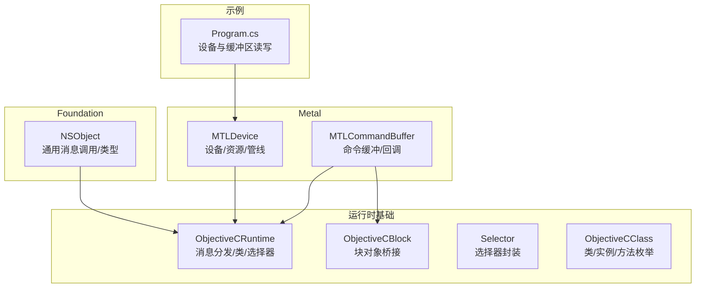
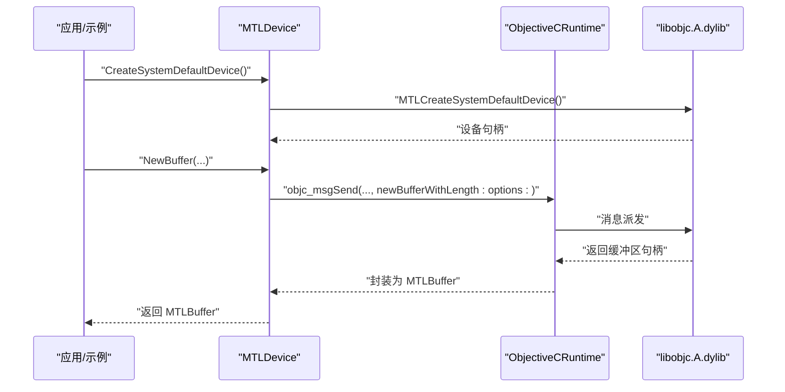
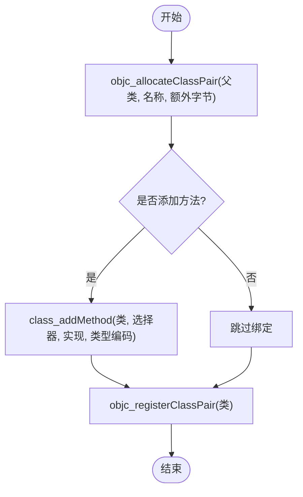
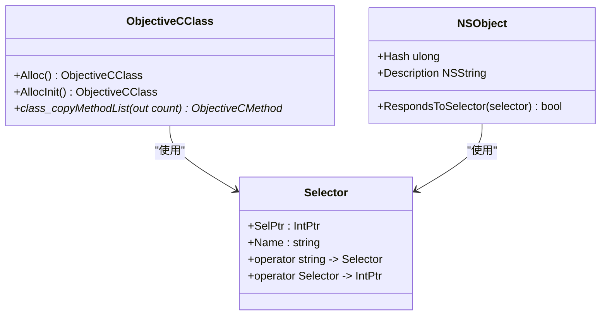
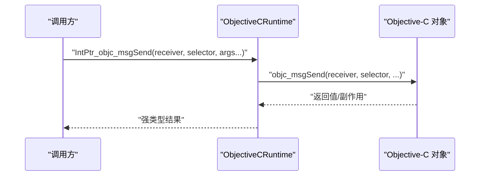
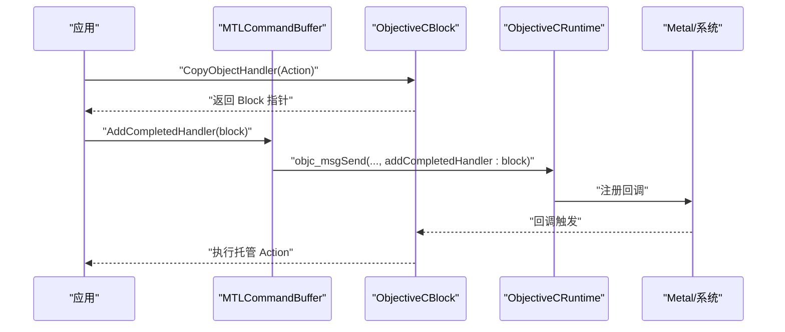
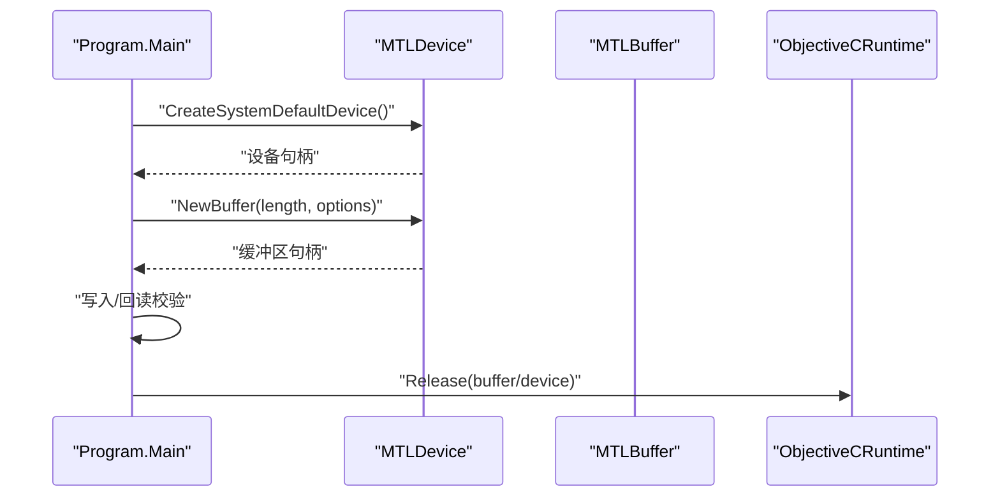
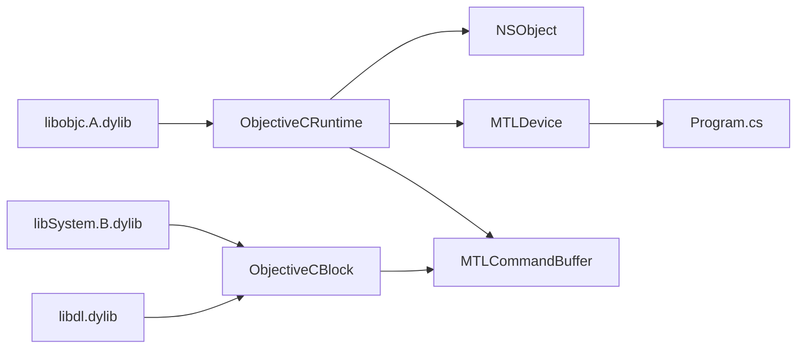

# 扩展点和自定义开发

<cite>
**本文引用的文件**
- [ObjectiveCRuntime.cs](file://src/SharpMetal/ObjectiveCCore/ObjectiveCRuntime.cs)
- [ObjectiveCClass.cs](file://src/SharpMetal/ObjectiveCCore/ObjectiveCClass.cs)
- [Selector.cs](file://src/SharpMetal/ObjectiveCCore/Selector.cs)
- [ObjectiveCBlock.cs](file://src/SharpMetal/ObjectiveCCore/ObjectiveCBlock.cs)
- [NSObject.cs](file://src/SharpMetal/Foundation/NSObject.cs)
- [MTLDevice.cs](file://src/SharpMetal/Metal/MTLDevice.cs)
- [MTLCommandBuffer.cs](file://src/SharpMetal/Metal/MTLCommandBuffer.cs)
- [Program.cs](file://samples/SharpMetal.Sample/Program.cs)
- [README.md](file://README.md)
- [DESIGN.md](file://DESIGN.md)
</cite>

## 目录
1. [简介](#简介)
2. [项目结构](#项目结构)
3. [核心组件](#核心组件)
4. [架构总览](#架构总览)
5. [详细组件分析](#详细组件分析)
6. [依赖关系分析](#依赖关系分析)
7. [性能考量](#性能考量)
8. [故障排查指南](#故障排查指南)
9. [结论](#结论)
10. [附录](#附录)

## 简介
本文件聚焦于如何在 SharpMetal 中通过 Objective-C 运行时机制进行扩展与自定义开发，包括：动态类创建、方法绑定、消息传递、自定义选择器的定义与使用、块对象（block）的处理与回调机制。同时给出插件化与模块化设计建议，覆盖自定义渲染后端、第三方库集成与工具链扩展的实践路径，并总结性能影响与最佳实践。

## 项目结构
SharpMetal 将底层 Objective-C 运行时能力封装在 ObjectiveCCore 命名空间下，向上为 Foundation、Metal、QuartzCore 等高层 API；示例工程位于 samples，构建与验证说明在 docs 与根目录 README/DESIGN 中。

图表来源
- [ObjectiveCRuntime.cs:33-800](file://src/SharpMetal/ObjectiveCCore/ObjectiveCRuntime.cs#L33-L800)
- [ObjectiveCBlock.cs:1-167](file://src/SharpMetal/ObjectiveCCore/ObjectiveCBlock.cs#L1-L167)
- [Selector.cs:1-45](file://src/SharpMetal/ObjectiveCCore/Selector.cs#L1-L45)
- [ObjectiveCClass.cs:1-89](file://src/SharpMetal/ObjectiveCCore/ObjectiveCClass.cs#L1-L89)
- [NSObject.cs:1-92](file://src/SharpMetal/Foundation/NSObject.cs#L1-L92)
- [MTLDevice.cs:187-800](file://src/SharpMetal/Metal/MTLDevice.cs#L187-L800)
- [MTLCommandBuffer.cs:116-200](file://src/SharpMetal/Metal/MTLCommandBuffer.cs#L116-L200)
- [Program.cs:1-49](file://samples/SharpMetal.Sample/Program.cs#L1-L49)

章节来源
- [README.md:1-23](file://README.md#L1-L23)
- [DESIGN.md:1-12](file://DESIGN.md#L1-L12)

## 核心组件
- ObjectiveCRuntime：提供 objc_msgSend 系列重载、类/方法/属性查询、选择器注册与名称获取、内存管理辅助等。
- Selector：封装选择器指针与名称访问，支持字符串到选择器的隐式转换。
- ObjectiveCClass：封装类查找、分配、初始化、方法列表枚举等。
- ObjectiveCBlock：构造最小化的 Objective-C Block 存根，用于向 Metal 回调（如 addFeedbackHandler/addPresentedHandler）安全传入托管回调。
- NSObject：提供通用消息发送入口（respondsToSelector、hash、description 等）。
- MTLDevice/MTLCommandBuffer：高层 Metal API，内部大量通过 ObjectiveCRuntime 调用系统框架。

章节来源
- [ObjectiveCRuntime.cs:33-800](file://src/SharpMetal/ObjectiveCCore/ObjectiveCRuntime.cs#L33-L800)
- [Selector.cs:1-45](file://src/SharpMetal/ObjectiveCCore/Selector.cs#L1-L45)
- [ObjectiveCClass.cs:1-89](file://src/SharpMetal/ObjectiveCCore/ObjectiveCClass.cs#L1-L89)
- [ObjectiveCBlock.cs:1-167](file://src/SharpMetal/ObjectiveCCore/ObjectiveCBlock.cs#L1-L167)
- [NSObject.cs:1-92](file://src/SharpMetal/Foundation/NSObject.cs#L1-L92)
- [MTLDevice.cs:187-800](file://src/SharpMetal/Metal/MTLDevice.cs#L187-L800)
- [MTLCommandBuffer.cs:116-200](file://src/SharpMetal/Metal/MTLCommandBuffer.cs#L116-L200)

## 架构总览
SharpMetal 以“运行时桥接层 + 领域 API”的分层组织实现扩展点：
- 运行时桥接层（ObjectiveCCore）负责与 libobjc.A.dylib 交互，完成消息派发、类/方法/选择器操作、块对象生命周期管理。
- 领域 API（Foundation/Metal/QuartzCore）基于桥接层暴露稳定的 .NET 类型与方法。
- 上层应用通过示例或业务代码调用领域 API，必要时通过 ObjectiveCBlock 注入回调。

图表来源
- [MTLDevice.cs:305-360](file://src/SharpMetal/Metal/MTLDevice.cs#L305-L360)
- [ObjectiveCRuntime.cs:118-800](file://src/SharpMetal/ObjectiveCCore/ObjectiveCRuntime.cs#L118-L800)

## 详细组件分析

### 动态类创建与方法绑定
- 动态类创建：通过 objc_allocateClassPair 创建新类对，再使用 class_addMethod 添加方法实现，最后 objc_registerClassPair 注册。
- 方法绑定：新增的方法可通过 Selector 标识并在后续消息派发中使用。
- 典型用途：在运行时按需扩展系统类行为或创建轻量代理类，避免静态编译期耦合。

图表来源
- [ObjectiveCRuntime.cs:44-51](file://src/SharpMetal/ObjectiveCCore/ObjectiveCRuntime.cs#L44-L51)

章节来源
- [ObjectiveCRuntime.cs:44-51](file://src/SharpMetal/ObjectiveCCore/ObjectiveCRuntime.cs#L44-L51)

### 选择器的定义与使用
- 选择器封装：Selector 提供从字符串到选择器指针的转换与名称读取。
- 使用方式：在 ObjectiveCClass/NSObject 等方法中通过 Selector 作为消息目标，确保运行时分派正确。
- 注意事项：选择器需与目标方法签名一致，否则会导致运行时异常。

图表来源
- [Selector.cs:1-45](file://src/SharpMetal/ObjectiveCCore/Selector.cs#L1-L45)
- [ObjectiveCClass.cs:18-89](file://src/SharpMetal/ObjectiveCCore/ObjectiveCClass.cs#L18-L89)
- [NSObject.cs:48-92](file://src/SharpMetal/Foundation/NSObject.cs#L48-L92)

章节来源
- [Selector.cs:1-45](file://src/SharpMetal/ObjectiveCCore/Selector.cs#L1-L45)
- [ObjectiveCClass.cs:18-89](file://src/SharpMetal/ObjectiveCCore/ObjectiveCClass.cs#L18-L89)
- [NSObject.cs:48-92](file://src/SharpMetal/Foundation/NSObject.cs#L48-L92)

### 消息传递与类型安全
- 消息派发：ObjectiveCRuntime 提供大量 objc_msgSend 重载，覆盖常见参数与返回值类型，减少装箱与手动封送开销。
- 类型安全：通过强类型重载与 struct 包装（如 MTLSize、NSRange），降低误用风险。
- 扩展点：新增系统 API 时，优先补充对应重载以保持调用一致性。

图表来源
- [ObjectiveCRuntime.cs:118-800](file://src/SharpMetal/ObjectiveCCore/ObjectiveCRuntime.cs#L118-L800)

章节来源
- [ObjectiveCRuntime.cs:118-800](file://src/SharpMetal/ObjectiveCCore/ObjectiveCRuntime.cs#L118-L800)

### 块对象处理与回调机制
- 问题背景：直接传递托管函数指针给 Metal 回调（如 addFeedbackHandler/addPresentedHandler）会触发 PAC 故障崩溃。
- 解决方案：ObjectiveCBlock 构造最小化的 Objective-C Block 字面量，封装托管 Action<IntPtr, IntPtr>，并通过 _Block_copy/_Block_release 管理生命周期。
- 使用场景：Metal 命令缓冲/队列/可绘制对象的异步回调。

图表来源
- [ObjectiveCBlock.cs:23-53](file://src/SharpMetal/ObjectiveCCore/ObjectiveCBlock.cs#L23-L53)
- [MTLCommandBuffer.cs:185-193](file://src/SharpMetal/Metal/MTLCommandBuffer.cs#L185-L193)
- [ObjectiveCRuntime.cs:764-767](file://src/SharpMetal/ObjectiveCCore/ObjectiveCRuntime.cs#L764-L767)

章节来源
- [ObjectiveCBlock.cs:1-167](file://src/SharpMetal/ObjectiveCCore/ObjectiveCBlock.cs#L1-L167)
- [MTLCommandBuffer.cs:185-193](file://src/SharpMetal/Metal/MTLCommandBuffer.cs#L185-L193)
- [ObjectiveCRuntime.cs:764-767](file://src/SharpMetal/ObjectiveCCore/ObjectiveCRuntime.cs#L764-L767)

### 插件架构与模块化设计
- 分层解耦：将平台相关逻辑下沉至 ObjectiveCCore，领域 API 保持稳定；插件仅依赖领域 API。
- 可插拔组件：通过工厂/注册表模式在运行时加载模块，利用 ObjectiveCClass/Selector 动态发现与绑定能力。
- 边界清晰：所有原生资源显式所有权，释放由调用方控制，避免隐藏的生命周期耦合。

章节来源
- [DESIGN.md:1-12](file://DESIGN.md#L1-L12)
- [README.md:1-23](file://README.md#L1-L23)

### 自定义渲染后端与第三方库集成
- 自定义后端：通过 ObjectiveCBlock 注入回调，结合 MTLDevice/MTLCommandBuffer 编排命令流；对不支持的特性使用 RespondsToSelector 探测后降级。
- 第三方库集成：借助 dlopen/dlsym 动态加载系统或第三方库符号，配合 ObjectiveCRuntime 的消息派发调用其 C API；注意 ABI 与调用约定。
- 示例参考：ObjectiveCBlock 内部通过 dlopen/dlsym 解析 _NSConcreteStackBlock 等符号，演示了动态符号解析流程。

章节来源
- [ObjectiveCBlock.cs:116-143](file://src/SharpMetal/ObjectiveCCore/ObjectiveCBlock.cs#L116-L143)
- [MTLDevice.cs:196-227](file://src/SharpMetal/Metal/MTLDevice.cs#L196-L227)

### 实际示例：设备与缓冲区读写
- 示例流程：检查平台与 ABI → 创建默认设备 → 分配共享缓冲区 → 写入并回读校验 → 释放原生资源。
- 关键点：使用 ObjectiveCRuntime.Release 显式释放设备与缓冲区，遵循显式所有权模型。

图表来源
- [Program.cs:10-46](file://samples/SharpMetal.Sample/Program.cs#L10-L46)
- [MTLDevice.cs:305-360](file://src/SharpMetal/Metal/MTLDevice.cs#L305-L360)
- [ObjectiveCRuntime.cs:769-777](file://src/SharpMetal/ObjectiveCCore/ObjectiveCRuntime.cs#L769-L777)

章节来源
- [Program.cs:10-46](file://samples/SharpMetal.Sample/Program.cs#L10-L46)
- [MTLDevice.cs:305-360](file://src/SharpMetal/Metal/MTLDevice.cs#L305-L360)
- [ObjectiveCRuntime.cs:769-777](file://src/SharpMetal/ObjectiveCCore/ObjectiveCRuntime.cs#L769-L777)

## 依赖关系分析
- 运行时依赖：libobjc.A.dylib（消息派发、类/方法/选择器）、libSystem.B.dylib（块对象复制/释放）、libdl.dylib（dlopen/dlsym）。
- 模块耦合：Foundation/Metal/QuartzCore 均依赖 ObjectiveCCore；示例依赖 Metal 与 ObjectiveCCore。
- 外部框架：Metal.framework 提供设备/命令/资源等能力。

图表来源
- [ObjectiveCRuntime.cs:33-800](file://src/SharpMetal/ObjectiveCCore/ObjectiveCRuntime.cs#L33-L800)
- [ObjectiveCBlock.cs:116-143](file://src/SharpMetal/ObjectiveCCore/ObjectiveCBlock.cs#L116-L143)
- [MTLDevice.cs:721-800](file://src/SharpMetal/Metal/MTLDevice.cs#L721-L800)
- [Program.cs:1-49](file://samples/SharpMetal.Sample/Program.cs#L1-L49)

章节来源
- [ObjectiveCRuntime.cs:33-800](file://src/SharpMetal/ObjectiveCCore/ObjectiveCRuntime.cs#L33-L800)
- [ObjectiveCBlock.cs:116-143](file://src/SharpMetal/ObjectiveCCore/ObjectiveCBlock.cs#L116-L143)
- [MTLDevice.cs:721-800](file://src/SharpMetal/Metal/MTLDevice.cs#L721-L800)
- [Program.cs:1-49](file://samples/SharpMetal.Sample/Program.cs#L1-L49)

## 性能考量
- 消息派发成本：频繁 objc_msgSend 调用有开销，建议批量构建描述符/命令，减少跨边界次数。
- 块对象生命周期：确保每个 CopyObjectHandler 生成的 Block 都有对应的 Release，避免泄漏；在回调结束后尽快释放。
- 类型封送：尽量使用已有重载与 struct 包装，避免不必要的内存分配与拷贝。
- 特性探测：使用 RespondsToSelector 做能力探测，避免在不支持的平台上走昂贵分支。

[本节为通用指导，不直接分析具体文件]

## 故障排查指南
- 未识别选择器：确认 Selector 名称与目标方法签名一致；必要时先调用 RespondsToSelector 探测。
- 块回调崩溃：不要直接传托管委托给 Metal 回调；使用 ObjectiveCBlock.CopyObjectHandler 包装后再传入。
- 原生资源泄漏：确保对设备、缓冲区、纹理等对象调用 ObjectiveCRuntime.Release；在 finally 中释放。
- 平台限制：非 Apple 平台无法运行 Metal 工作负载；示例会在非 Apple 平台直接退出。

章节来源
- [NSObject.cs:70-79](file://src/SharpMetal/Foundation/NSObject.cs#L70-L79)
- [ObjectiveCBlock.cs:23-53](file://src/SharpMetal/ObjectiveCCore/ObjectiveCBlock.cs#L23-L53)
- [Program.cs:16-20](file://samples/SharpMetal.Sample/Program.cs#L16-L20)
- [Program.cs:41-45](file://samples/SharpMetal.Sample/Program.cs#L41-L45)

## 结论
SharpMetal 通过 ObjectiveCCore 提供了强大的运行时扩展能力：动态类创建、方法绑定、消息派发与块回调桥接，使开发者能够在不修改系统源码的前提下灵活扩展 Metal 功能。结合显式所有权与能力探测，可在保证性能与安全的同时，实现模块化与可插拔的渲染后端与第三方集成。

[本节为总结性内容，不直接分析具体文件]

## 附录
- 快速上手：参考 samples/SharpMetal.Sample 中的 Program.cs，了解设备创建、缓冲区分配与释放的基本流程。
- 构建与验证：遵循 README 与 docs/VERIFICATION.md 的指引，确保在 Apple 主机上运行。
- 设计约束：遵守 DESIGN.md 的平台与所有权边界，禁止隐藏不支持能力的兼容实现。

章节来源
- [README.md:1-23](file://README.md#L1-L23)
- [DESIGN.md:1-12](file://DESIGN.md#L1-L12)
- [Program.cs:10-46](file://samples/SharpMetal.Sample/Program.cs#L10-L46)