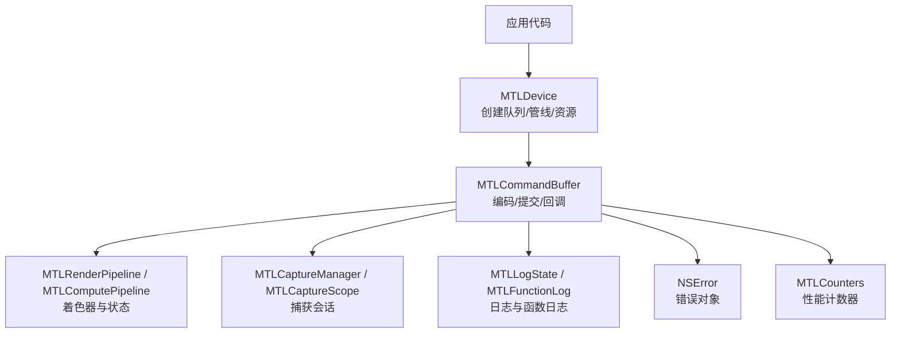
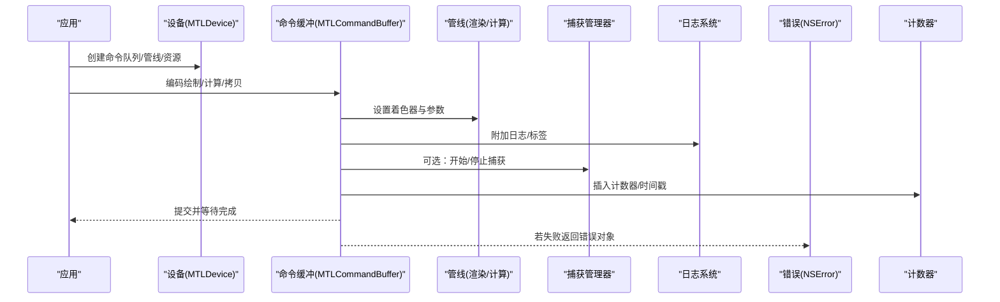
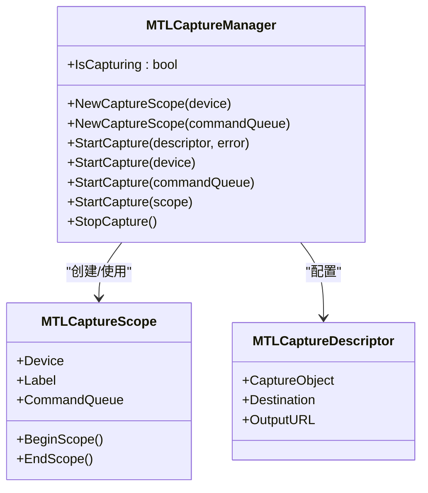
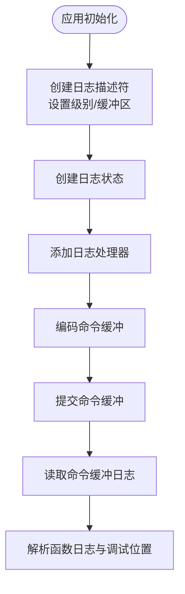
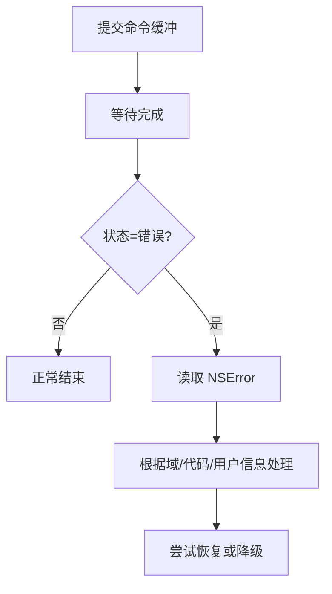
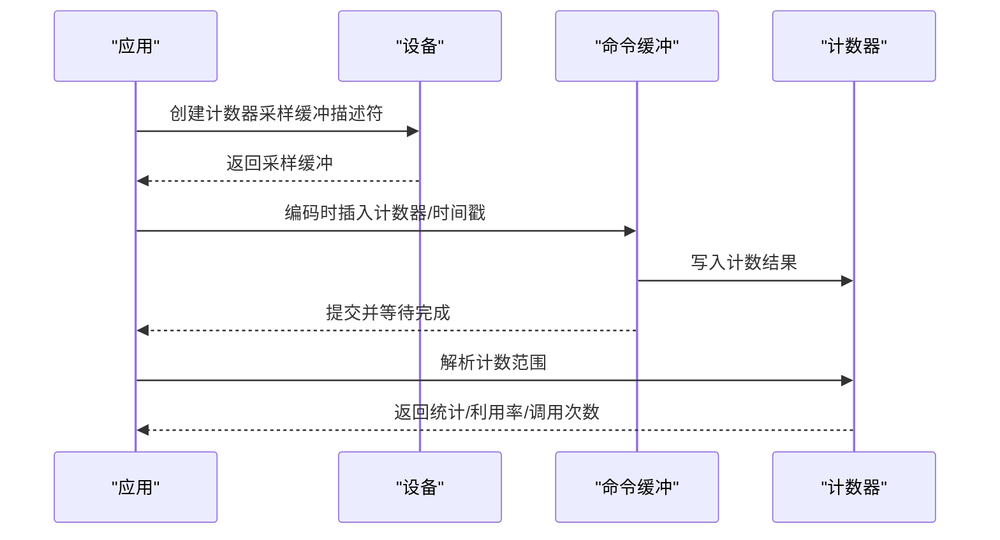
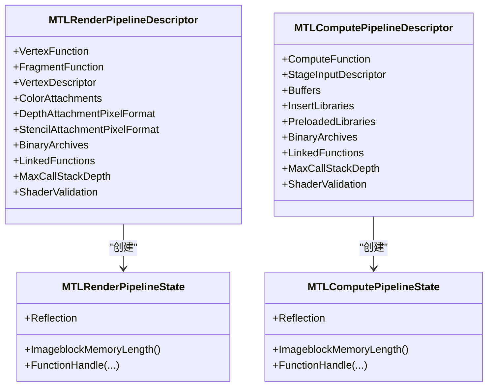
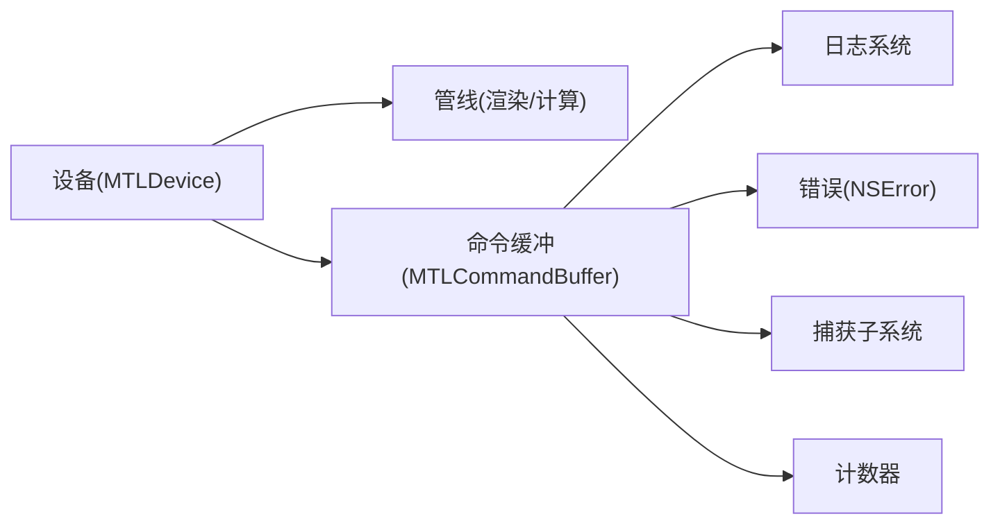

# 调试和故障排除

<cite>
**本文引用的文件**
- [README.md](file://README.md)
- [DESIGN.md](file://DESIGN.md)
- [MTLCaptureManager.cs](file://src/SharpMetal/Metal/MTLCaptureManager.cs)
- [MTLCaptureScope.cs](file://src/SharpMetal/Metal/MTLCaptureScope.cs)
- [NSError.cs](file://src/SharpMetal/Foundation/NSError.cs)
- [MTLFunctionLog.cs](file://src/SharpMetal/Metal/MTLFunctionLog.cs)
- [MTLLogState.cs](file://src/SharpMetal/Metal/MTLLogState.cs)
- [MTLCounters.cs](file://src/SharpMetal/Metal/MTLCounters.cs)
- [MTLDevice.cs](file://src/SharpMetal/Metal/MTLDevice.cs)
- [MTLCommandBuffer.cs](file://src/SharpMetal/Metal/MTLCommandBuffer.cs)
- [MTLRenderPipeline.cs](file://src/SharpMetal/Metal/MTLRenderPipeline.cs)
- [MTLComputePipeline.cs](file://src/SharpMetal/Metal/MTLComputePipeline.cs)
</cite>

## 目录
1. [简介](#简介)
2. [项目结构](#项目结构)
3. [核心组件](#核心组件)
4. [架构总览](#架构总览)
5. [详细组件分析](#详细组件分析)
6. [依赖关系分析](#依赖关系分析)
7. [性能考量](#性能考量)
8. [故障排除指南](#故障排除指南)
9. [结论](#结论)
10. [附录](#附录)

## 简介
本指南面向使用 SharpMetal 的开发者，聚焦于在 Apple 平台上进行 Metal 渲染与计算的调试与故障排除。内容涵盖：
- 使用 Xcode 图形捕获工具（Capture）记录 GPU 执行轨迹
- 着色器与管线验证、日志与函数级调试信息
- 错误处理与异常捕获机制（NSError、命令缓冲区状态与错误）
- 性能分析与瓶颈定位（计数器采样、时间戳、GPU/CPU 时序）
- 常见错误的诊断流程、日志记录最佳实践、崩溃分析与恢复策略
- 实际调试场景与可操作方案

## 项目结构
SharpMetal 提供对 Foundation、Metal、MetalFX、QuartzCore 的低层绑定。调试相关能力主要分布在 Metal 子模块中，包括捕获、日志、命令缓冲、设备、管线等。

**图表来源**
- [MTLDevice.cs:321-424](file://src/SharpMetal/Metal/MTLDevice.cs#L321-L424)
- [MTLCommandBuffer.cs:116-193](file://src/SharpMetal/Metal/MTLCommandBuffer.cs#L116-L193)
- [MTLCaptureManager.cs:58-134](file://src/SharpMetal/Metal/MTLCaptureManager.cs#L58-L134)
- [MTLLogState.cs:20-84](file://src/SharpMetal/Metal/MTLLogState.cs#L20-L84)
- [MTLFunctionLog.cs:11-67](file://src/SharpMetal/Metal/MTLFunctionLog.cs#L11-L67)
- [NSError.cs:5-49](file://src/SharpMetal/Foundation/NSError.cs#L5-L49)
- [MTLCounters.cs:69-135](file://src/SharpMetal/Metal/MTLCounters.cs#L69-L135)

**章节来源**
- [README.md:1-23](file://README.md#L1-L23)
- [DESIGN.md:1-12](file://DESIGN.md#L1-L12)

## 核心组件
- 捕获子系统：通过共享管理器与捕获作用域控制 GPU 行为录制，支持目标输出与设备/队列范围限定。
- 日志系统：全局日志级别与处理器注册；命令缓冲日志容器与函数级调试位置。
- 错误模型：NSError 统一错误描述、领域、用户信息与本地化提示；命令缓冲状态与错误枚举。
- 性能分析：计数器集合与采样缓冲，时间戳采样，CPU/GPU 起止时间。
- 设备与管线：设备能力探测、管线创建与反射信息，着色器验证选项。

**章节来源**
- [MTLCaptureManager.cs:58-134](file://src/SharpMetal/Metal/MTLCaptureManager.cs#L58-L134)
- [MTLCaptureScope.cs:7-39](file://src/SharpMetal/Metal/MTLCaptureScope.cs#L7-L39)
- [MTLLogState.cs:20-84](file://src/SharpMetal/Metal/MTLLogState.cs#L20-L84)
- [MTLFunctionLog.cs:11-67](file://src/SharpMetal/Metal/MTLFunctionLog.cs#L11-L67)
- [NSError.cs:5-49](file://src/SharpMetal/Foundation/NSError.cs#L5-L49)
- [MTLCommandBuffer.cs:9-48](file://src/SharpMetal/Metal/MTLCommandBuffer.cs#L9-L48)
- [MTLCounters.cs:69-135](file://src/SharpMetal/Metal/MTLCounters.cs#L69-L135)
- [MTLDevice.cs:187-324](file://src/SharpMetal/Metal/MTLDevice.cs#L187-L324)
- [MTLRenderPipeline.cs:208-492](file://src/SharpMetal/Metal/MTLRenderPipeline.cs#L208-L492)
- [MTLComputePipeline.cs:25-149](file://src/SharpMetal/Metal/MTLComputePipeline.cs#L25-L149)

## 架构总览
下图展示从应用到 Metal 驱动的关键路径，以及调试与性能采集点。

**图表来源**
- [MTLDevice.cs:321-424](file://src/SharpMetal/Metal/MTLDevice.cs#L321-L424)
- [MTLCommandBuffer.cs:116-193](file://src/SharpMetal/Metal/MTLCommandBuffer.cs#L116-L193)
- [MTLCaptureManager.cs:58-134](file://src/SharpMetal/Metal/MTLCaptureManager.cs#L58-L134)
- [MTLLogState.cs:20-84](file://src/SharpMetal/Metal/MTLLogState.cs#L20-L84)
- [MTLCounters.cs:69-135](file://src/SharpMetal/Metal/MTLCounters.cs#L69-L135)
- [NSError.cs:5-49](file://src/SharpMetal/Foundation/NSError.cs#L5-L49)

## 详细组件分析

### 捕获子系统（Metal Capture）
- 共享管理器：获取全局捕获管理器，查询是否正在捕获，支持多种目标（开发工具、GPU Trace 文档）。
- 捕获作用域：基于设备或命令队列限定捕获范围，支持 Begin/End 标记关键段。
- 启动方式：支持通过描述符（含输出 URL、目标）或设备/队列直接启动；也可通过作用域启动。

**图表来源**
- [MTLCaptureManager.cs:58-134](file://src/SharpMetal/Metal/MTLCaptureManager.cs#L58-L134)
- [MTLCaptureScope.cs:7-39](file://src/SharpMetal/Metal/MTLCaptureScope.cs#L7-L39)
- [MTLCaptureManager.cs:20-55](file://src/SharpMetal/Metal/MTLCaptureManager.cs#L20-L55)

**章节来源**
- [MTLCaptureManager.cs:58-134](file://src/SharpMetal/Metal/MTLCaptureManager.cs#L58-L134)
- [MTLCaptureScope.cs:7-39](file://src/SharpMetal/Metal/MTLCaptureScope.cs#L7-L39)

### 日志系统与函数级调试
- 日志级别：Debug/Info/Notice/Error/Fault 等，可通过描述符配置缓冲区大小与标签。
- 日志处理器：注册回调以接收子系统、分类、级别与消息。
- 命令缓冲日志：提交后可读取日志容器，包含编码器标签、函数、调试位置（文件名、行、列）。

**图表来源**
- [MTLLogState.cs:20-84](file://src/SharpMetal/Metal/MTLLogState.cs#L20-L84)
- [MTLCommandBuffer.cs:116-193](file://src/SharpMetal/Metal/MTLCommandBuffer.cs#L116-L193)
- [MTLFunctionLog.cs:11-67](file://src/SharpMetal/Metal/MTLFunctionLog.cs#L11-L67)

**章节来源**
- [MTLLogState.cs:20-84](file://src/SharpMetal/Metal/MTLLogState.cs#L20-L84)
- [MTLFunctionLog.cs:11-67](file://src/SharpMetal/Metal/MTLFunctionLog.cs#L11-L67)
- [MTLCommandBuffer.cs:116-193](file://src/SharpMetal/Metal/MTLCommandBuffer.cs#L116-L193)

### 错误处理与异常捕获
- NSError：统一错误对象，包含域、代码、用户信息、本地化描述、恢复建议与原因。
- 命令缓冲错误：状态枚举（未入队/已入队/已提交/已调度/已完成/错误），错误类型（内部/超时/缺页/黑名单/权限/内存不足/无效资源/无显存/设备移除/栈溢出）。
- 编码器错误状态：未知/已完成/受影响/待定/故障。

**图表来源**
- [MTLCommandBuffer.cs:9-48](file://src/SharpMetal/Metal/MTLCommandBuffer.cs#L9-L48)
- [MTLCommandBuffer.cs:116-193](file://src/SharpMetal/Metal/MTLCommandBuffer.cs#L116-L193)
- [NSError.cs:5-49](file://src/SharpMetal/Foundation/NSError.cs#L5-L49)

**章节来源**
- [MTLCommandBuffer.cs:9-48](file://src/SharpMetal/Metal/MTLCommandBuffer.cs#L9-L48)
- [MTLCommandBuffer.cs:116-193](file://src/SharpMetal/Metal/MTLCommandBuffer.cs#L116-L193)
- [NSError.cs:5-49](file://src/SharpMetal/Foundation/NSError.cs#L5-L49)

### 性能分析与瓶颈定位
- 计数器采样：通过计数器集合与采样缓冲描述符配置存储模式与样本数；提交后解析指定范围的计数数据。
- 时间戳：设备级时间戳采样；命令缓冲提供 CPU/GPU 起止时间，用于阶段耗时分析。
- 管线反射：渲染/计算管线反射暴露绑定与参数，辅助定位参数错位或绑定问题。

**图表来源**
- [MTLCounters.cs:69-135](file://src/SharpMetal/Metal/MTLCounters.cs#L69-L135)
- [MTLDevice.cs:571-579](file://src/SharpMetal/Metal/MTLDevice.cs#L571-L579)
- [MTLCommandBuffer.cs:116-193](file://src/SharpMetal/Metal/MTLCommandBuffer.cs#L116-L193)

**章节来源**
- [MTLCounters.cs:69-135](file://src/SharpMetal/Metal/MTLCounters.cs#L69-L135)
- [MTLDevice.cs:571-579](file://src/SharpMetal/Metal/MTLDevice.cs#L571-L579)
- [MTLCommandBuffer.cs:116-193](file://src/SharpMetal/Metal/MTLCommandBuffer.cs#L116-L193)

### 着色器与管线调试
- 渲染管线：描述符支持着色器函数、顶点描述、混合、深度/模板格式、瓦片/网格管线、二进制归档、链接函数、调用栈深度、着色器验证等。
- 计算管线：描述符支持计算函数、线程组大小、输入描述、缓冲绑定、库插入、预加载库、二进制归档、链接函数、调用栈深度、着色器验证等。
- 反射：渲染/计算管线反射提供绑定与参数列表，便于校验参数布局与索引。

**图表来源**
- [MTLRenderPipeline.cs:208-492](file://src/SharpMetal/Metal/MTLRenderPipeline.cs#L208-L492)
- [MTLRenderPipeline.cs:530-629](file://src/SharpMetal/Metal/MTLRenderPipeline.cs#L530-L629)
- [MTLComputePipeline.cs:25-149](file://src/SharpMetal/Metal/MTLComputePipeline.cs#L25-L149)
- [MTLComputePipeline.cs:151-235](file://src/SharpMetal/Metal/MTLComputePipeline.cs#L151-L235)

**章节来源**
- [MTLRenderPipeline.cs:208-492](file://src/SharpMetal/Metal/MTLRenderPipeline.cs#L208-L492)
- [MTLRenderPipeline.cs:530-629](file://src/SharpMetal/Metal/MTLRenderPipeline.cs#L530-L629)
- [MTLComputePipeline.cs:25-149](file://src/SharpMetal/Metal/MTLComputePipeline.cs#L25-L149)
- [MTLComputePipeline.cs:151-235](file://src/SharpMetal/Metal/MTLComputePipeline.cs#L151-L235)

## 依赖关系分析
- 捕获子系统依赖设备/队列与作用域，用于限定捕获范围与输出目标。
- 日志系统依赖全局日志状态与命令缓冲日志容器，形成“注册处理器—编码—读取日志”的链路。
- 错误模型贯穿管线创建与命令缓冲生命周期，NSError 作为统一错误载体。
- 性能分析依赖设备能力与计数器集合，结合命令缓冲的时间戳与计数采样。

**图表来源**
- [MTLDevice.cs:187-324](file://src/SharpMetal/Metal/MTLDevice.cs#L187-L324)
- [MTLCommandBuffer.cs:116-193](file://src/SharpMetal/Metal/MTLCommandBuffer.cs#L116-L193)
- [MTLCaptureManager.cs:58-134](file://src/SharpMetal/Metal/MTLCaptureManager.cs#L58-L134)
- [MTLLogState.cs:20-84](file://src/SharpMetal/Metal/MTLLogState.cs#L20-L84)
- [MTLCounters.cs:69-135](file://src/SharpMetal/Metal/MTLCounters.cs#L69-L135)
- [NSError.cs:5-49](file://src/SharpMetal/Foundation/NSError.cs#L5-L49)

**章节来源**
- [MTLDevice.cs:187-324](file://src/SharpMetal/Metal/MTLDevice.cs#L187-L324)
- [MTLCommandBuffer.cs:116-193](file://src/SharpMetal/Metal/MTLCommandBuffer.cs#L116-L193)

## 性能考量
- 合理设置日志缓冲区大小与级别，避免过多日志影响性能。
- 仅在必要时启用捕获，并使用作用域缩小范围以减少开销。
- 使用计数器采样与时间戳进行热点定位，避免全帧频繁采样。
- 利用管线反射校验参数绑定，减少运行时错误导致的回退与重试。
- 关注命令缓冲错误类型，针对内存不足、设备移除等情况实现恢复策略。

[本节为通用指导，不直接分析具体文件]

## 故障排除指南

### 使用 Xcode 图形调试器分析渲染问题
- 启动捕获：通过共享管理器创建捕获作用域，或使用设备/队列直接启动；设置输出目标为开发工具。
- 标注关键段：在重要渲染/计算阶段前后调用 Begin/End 作用域，便于在 Xcode 中快速定位。
- 查看帧详情：在 Xcode 中打开捕获文件，检查绘制调用、纹理、缓冲区、着色器与状态。

**章节来源**
- [MTLCaptureManager.cs:58-134](file://src/SharpMetal/Metal/MTLCaptureManager.cs#L58-L134)
- [MTLCaptureScope.cs:7-39](file://src/SharpMetal/Metal/MTLCaptureScope.cs#L7-L39)

### 着色器调试技术
- 启用着色器验证：在渲染/计算管线描述符中设置验证选项，帮助发现参数与绑定问题。
- 读取函数日志：提交后从命令缓冲日志容器中遍历日志条目，获取编码器标签、函数与调试位置（文件/行/列）。
- 反射辅助：使用管线反射核对绑定与参数顺序，确保与着色器接口一致。

**章节来源**
- [MTLRenderPipeline.cs:208-492](file://src/SharpMetal/Metal/MTLRenderPipeline.cs#L208-L492)
- [MTLComputePipeline.cs:25-149](file://src/SharpMetal/Metal/MTLComputePipeline.cs#L25-L149)
- [MTLFunctionLog.cs:11-67](file://src/SharpMetal/Metal/MTLFunctionLog.cs#L11-L67)

### 错误处理和异常捕获机制
- 捕获 NSError：在管线创建、库加载、命令缓冲相关 API 中检查错误对象，读取域、代码与用户信息。
- 命令缓冲状态机：提交后等待完成，若状态为错误，读取错误对象并分类处理。
- 编码器错误状态：根据未知/已完成/受影响/待定/故障选择不同恢复策略。

**章节来源**
- [NSError.cs:5-49](file://src/SharpMetal/Foundation/NSError.cs#L5-L49)
- [MTLCommandBuffer.cs:9-48](file://src/SharpMetal/Metal/MTLCommandBuffer.cs#L9-L48)
- [MTLCommandBuffer.cs:116-193](file://src/SharpMetal/Metal/MTLCommandBuffer.cs#L116-L193)

### 性能分析和瓶颈定位方法
- 计数器采样：配置计数器集合与采样缓冲，在关键阶段插入采样点，完成后解析计数范围。
- 时间戳：使用设备时间戳与命令缓冲起止时间对比 CPU/GPU 耗时，识别阶段瓶颈。
- 管线反射：核对绑定与参数，避免因配置错误导致的性能回退。

**章节来源**
- [MTLCounters.cs:69-135](file://src/SharpMetal/Metal/MTLCounters.cs#L69-L135)
- [MTLDevice.cs:571-579](file://src/SharpMetal/Metal/MTLDevice.cs#L571-L579)
- [MTLCommandBuffer.cs:116-193](file://src/SharpMetal/Metal/MTLCommandBuffer.cs#L116-L193)

### 常见错误的诊断流程
- 管线创建失败：检查描述符配置、着色器函数、二进制归档与链接函数；读取 NSError 的域与代码。
- 命令缓冲错误：根据错误类型（超时、缺页、内存不足、设备移除等）采取相应恢复措施。
- 渲染异常：通过捕获与日志定位到具体编码器与着色器函数，结合调试位置修复。

**章节来源**
- [MTLRenderPipeline.cs:208-492](file://src/SharpMetal/Metal/MTLRenderPipeline.cs#L208-L492)
- [MTLComputePipeline.cs:25-149](file://src/SharpMetal/Metal/MTLComputePipeline.cs#L25-L149)
- [MTLCommandBuffer.cs:9-48](file://src/SharpMetal/Metal/MTLCommandBuffer.cs#L9-L48)
- [NSError.cs:5-49](file://src/SharpMetal/Foundation/NSError.cs#L5-L49)

### 日志记录最佳实践
- 分级日志：生产环境降低级别，仅保留必要信息；调试环境提高级别并增大缓冲区。
- 结构化标签：为命令缓冲、管线、纹理与缓冲区设置清晰标签，便于在捕获与日志中检索。
- 处理器集中：注册统一日志处理器，集中记录与分析，避免分散输出。

**章节来源**
- [MTLLogState.cs:20-84](file://src/SharpMetal/Metal/MTLLogState.cs#L20-L84)
- [MTLCommandBuffer.cs:116-193](file://src/SharpMetal/Metal/MTLCommandBuffer.cs#L116-L193)

### 崩溃分析和恢复策略
- 设备移除/权限问题：检测命令缓冲错误类型，触发重建资源与重新初始化流程。
- 内存不足：释放非关键资源，降低采样率与日志量，必要时降级渲染质量。
- 栈溢出：限制最大调用栈深度，拆分复杂着色器逻辑，减少递归与深层调用。

**章节来源**
- [MTLCommandBuffer.cs:9-48](file://src/SharpMetal/Metal/MTLCommandBuffer.cs#L9-L48)
- [MTLRenderPipeline.cs:208-492](file://src/SharpMetal/Metal/MTLRenderPipeline.cs#L208-L492)
- [MTLComputePipeline.cs:25-149](file://src/SharpMetal/Metal/MTLComputePipeline.cs#L25-L149)

### 实际调试场景与解决方案
- 场景一：画面闪烁与撕裂
  - 步骤：启用捕获，标注帧边界；检查呈现时机与最小持续时间；核对同步与事件信号。
  - 参考：命令缓冲呈现方法与事件编码。
- 场景二：着色器参数错位
  - 步骤：使用管线反射核对绑定；读取函数日志与调试位置；修正参数布局。
  - 参考：渲染/计算管线反射与函数日志。
- 场景三：性能骤降
  - 步骤：插入计数器采样与时间戳；解析利用率与调用次数；优化热点阶段。
  - 参考：计数器采样与时间戳采样。

**章节来源**
- [MTLCommandBuffer.cs:116-193](file://src/SharpMetal/Metal/MTLCommandBuffer.cs#L116-L193)
- [MTLRenderPipeline.cs:530-629](file://src/SharpMetal/Metal/MTLRenderPipeline.cs#L530-L629)
- [MTLComputePipeline.cs:151-235](file://src/SharpMetal/Metal/MTLComputePipeline.cs#L151-L235)
- [MTLCounters.cs:69-135](file://src/SharpMetal/Metal/MTLCounters.cs#L69-L135)

## 结论
通过捕获、日志、错误模型与性能分析的综合运用，可以在 SharpMetal 项目中高效定位渲染与计算问题。建议：
- 在开发阶段广泛使用捕获与日志，生产环境谨慎开启。
- 建立统一的错误处理与恢复流程，提升鲁棒性。
- 持续使用计数器与时间戳进行性能回归监控。
- 借助管线反射与函数日志，确保着色器与参数一致性。

[本节为总结性内容，不直接分析具体文件]

## 附录
- 构建与运行：遵循仓库说明，使用 .NET SDK 与平台框架；参考 README 与 DESIGN 文档了解构建与依赖管理。
- 示例工程：从 samples/SharpMetal.Sample 起步，逐步集成捕获、日志与性能分析。

**章节来源**
- [README.md:1-23](file://README.md#L1-L23)
- [DESIGN.md:1-12](file://DESIGN.md#L1-L12)