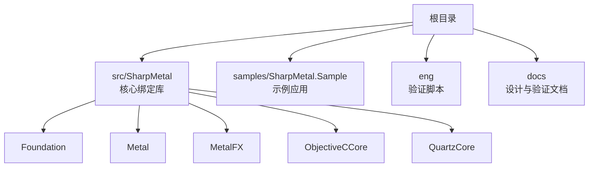
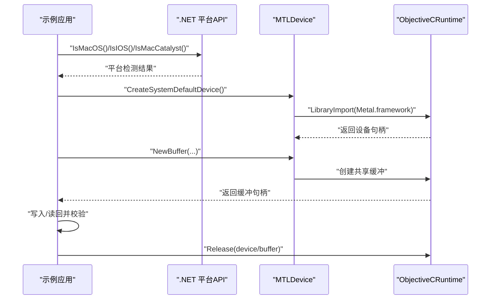
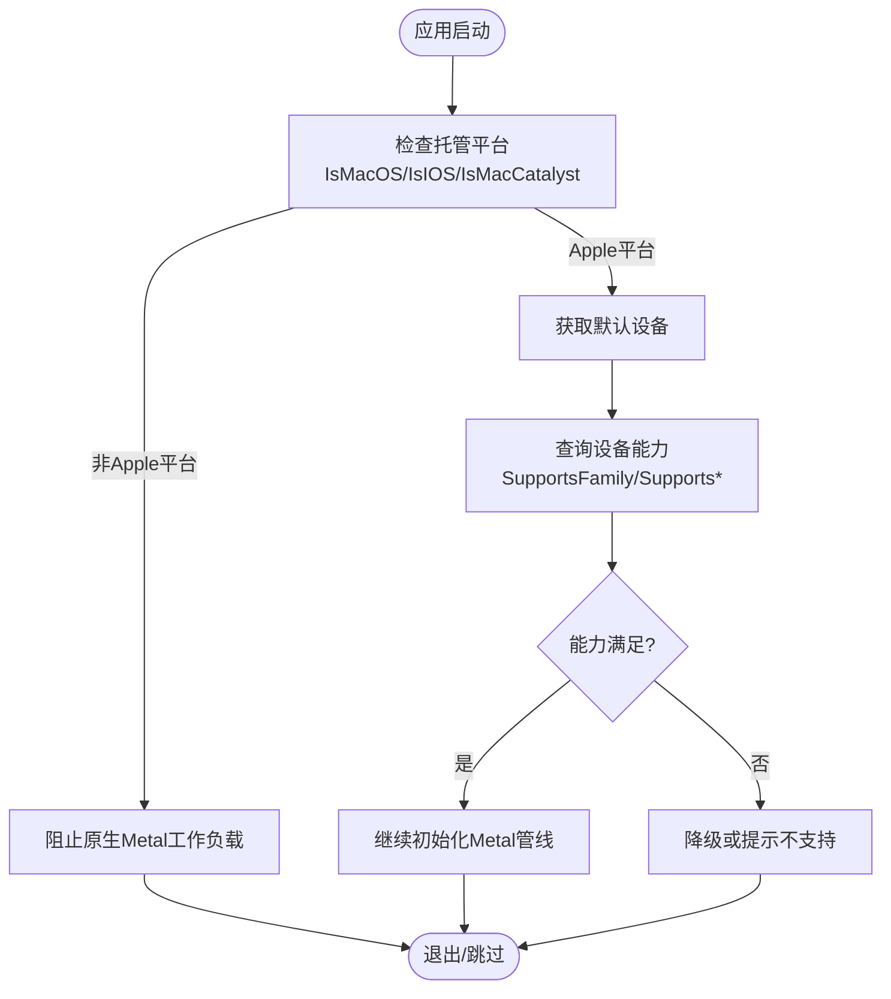
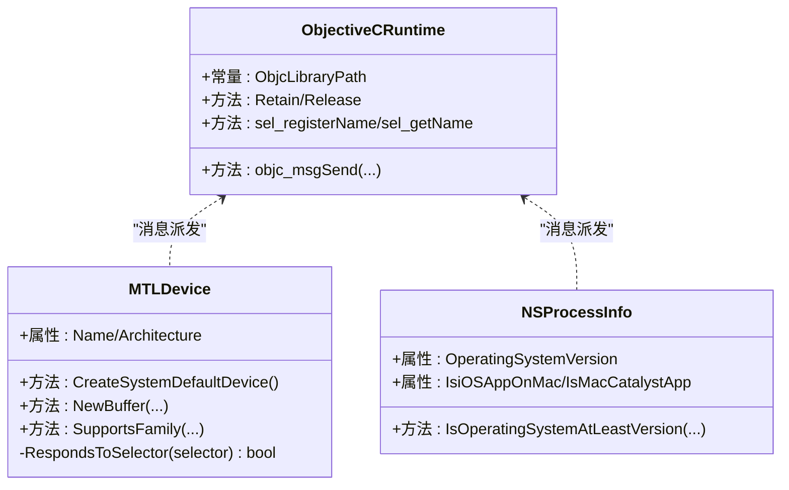
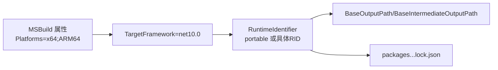
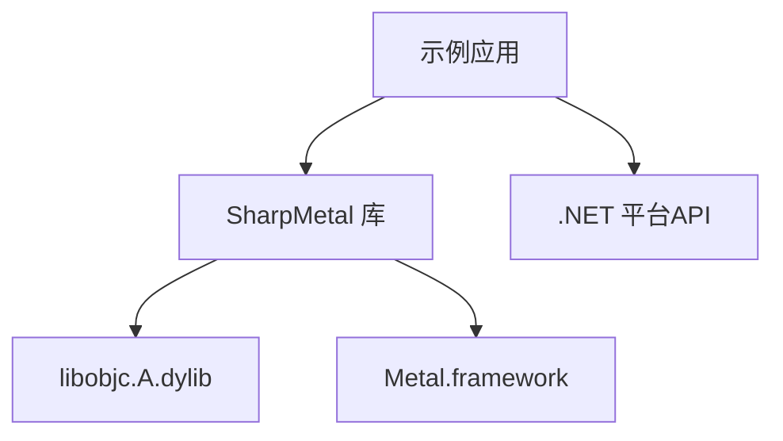

# 跨平台兼容性

<cite>
**本文引用的文件**
- [README.md](file://README.md)
- [DESIGN.md](file://DESIGN.md)
- [Directory.Build.props](file://Directory.Build.props)
- [SharpMetal.product.props](file://SharpMetal.product.props)
- [global.json](file://global.json)
- [src/SharpMetal/SharpMetal.csproj](file://src/SharpMetal/SharpMetal.csproj)
- [src/SharpMetal/ObjectiveCCore/ObjectiveCRuntime.cs](file://src/SharpMetal/ObjectiveCCore/ObjectiveCRuntime.cs)
- [src/SharpMetal/Foundation/NSProcessInfo.cs](file://src/SharpMetal/Foundation/NSProcessInfo.cs)
- [src/SharpMetal/Metal/MTLDevice.cs](file://src/SharpMetal/Metal/MTLDevice.cs)
- [samples/SharpMetal.Sample/Program.cs](file://samples/SharpMetal.Sample/Program.cs)
- [samples/SharpMetal.Sample/SharpMetal.Sample.csproj](file://samples/SharpMetal.Sample/SharpMetal.Sample.csproj)
</cite>

## 目录
1. [简介](#简介)
2. [项目结构](#项目结构)
3. [核心组件](#核心组件)
4. [架构总览](#架构总览)
5. [详细组件分析](#详细组件分析)
6. [依赖关系分析](#依赖关系分析)
7. [性能与部署考虑](#性能与部署考虑)
8. [故障排查指南](#故障排查指南)
9. [结论](#结论)
10. [附录](#附录)

## 简介
本指南聚焦 SharpMetal 在 Apple 平台（iOS、macOS、tvOS）上的跨平台兼容性，覆盖条件编译、平台检测 API、运行时特性检查、ABI 与架构支持（x64、ARM64）、模拟器与真机差异、调试环境配置、发布包优化以及多平台项目的组织与构建最佳实践。SharpMetal 提供对 Objective-C 运行时与 Metal/MetalFX/QuartzCore 的低层绑定，托管侧布局可移植，但原生执行需要 Apple 宿主系统与系统框架。

## 项目结构
- src/SharpMetal：核心绑定库，包含 Foundation、Metal、MetalFX、ObjectiveCCore、QuartzCore 等子模块。
- samples/SharpMetal.Sample：示例应用，演示设备获取、共享缓冲读写与资源释放。
- eng/docs：验证脚本与设计说明。
- 根级 MSBuild 属性文件统一输出路径、锁定还原、RID 与平台策略。

**图表来源**
- [src/SharpMetal/SharpMetal.csproj:1-47](file://src/SharpMetal/SharpMetal.csproj#L1-L47)
- [samples/SharpMetal.Sample/SharpMetal.Sample.csproj:1-6](file://samples/SharpMetal.Sample/SharpMetal.Sample.csproj#L1-L6)

**章节来源**
- [README.md:1-23](file://README.md#L1-L23)
- [DESIGN.md:1-12](file://DESIGN.md#L1-L12)
- [Directory.Build.props:1-25](file://Directory.Build.props#L1-L25)

## 核心组件
- ObjectiveC 运行时桥接：通过 LibraryImport 直接调用 libobjc.A.dylib，提供消息发送、选择器注册、内存管理原语等。
- 设备与能力探测：MTLDevice 暴露大量 supportsFamily/supports* 能力查询；NSProcessInfo 提供操作系统版本、运行环境（iOS on Mac、Mac Catalyst）等信息。
- 平台检测与 ABI 校验：示例程序使用 .NET 的 OperatingSystem API 进行平台判断，并在启动时校验托管结构与原生 ABI 一致性。

**章节来源**
- [src/SharpMetal/ObjectiveCCore/ObjectiveCRuntime.cs:33-800](file://src/SharpMetal/ObjectiveCCore/ObjectiveCRuntime.cs#L33-L800)
- [src/SharpMetal/Metal/MTLDevice.cs:187-800](file://src/SharpMetal/Metal/MTLDevice.cs#L187-L800)
- [src/SharpMetal/Foundation/NSProcessInfo.cs:25-148](file://src/SharpMetal/Foundation/NSProcessInfo.cs#L25-L148)
- [samples/SharpMetal.Sample/Program.cs:10-49](file://samples/SharpMetal.Sample/Program.cs#L10-L49)

## 架构总览
SharpMetal 以“托管类型 + 原生指针”为核心模型，所有关键对象均持有 NativePtr，并通过 ObjectiveCRuntime 进行消息派发。设备能力与平台信息通过运行时查询获得，避免编译期硬编码分支。

**图表来源**
- [samples/SharpMetal.Sample/Program.cs:10-49](file://samples/SharpMetal.Sample/Program.cs#L10-L49)
- [src/SharpMetal/Metal/MTLDevice.cs:305-319](file://src/SharpMetal/Metal/MTLDevice.cs#L305-L319)
- [src/SharpMetal/ObjectiveCCore/ObjectiveCRuntime.cs:33-800](file://src/SharpMetal/ObjectiveCCore/ObjectiveCRuntime.cs#L33-L800)

## 详细组件分析

### 平台检测与运行时特性检查
- 托管侧平台检测：示例使用 OperatingSystem.IsMacOS/IsIOS/IsMacCatalyst 快速判定是否可在当前进程执行 Metal 工作负载。
- 运行时特性检查：
  - MTLDevice.SupportsFamily / Supports* 系列方法用于查询 GPU 家族与功能集。
  - NSProcessInfo 提供操作系统版本、运行环境标志（如 iOS 应用在 Mac 上运行、Mac Catalyst）。
- 响应式选择器检查：MTLDevice 内部封装 RespondsToSelector 以避免在不支持的平台上调用未实现的选择器导致崩溃。

**图表来源**
- [samples/SharpMetal.Sample/Program.cs:10-49](file://samples/SharpMetal.Sample/Program.cs#L10-L49)
- [src/SharpMetal/Metal/MTLDevice.cs:193-227](file://src/SharpMetal/Metal/MTLDevice.cs#L193-L227)
- [src/SharpMetal/Foundation/NSProcessInfo.cs:51-82](file://src/SharpMetal/Foundation/NSProcessInfo.cs#L51-L82)

**章节来源**
- [samples/SharpMetal.Sample/Program.cs:10-49](file://samples/SharpMetal.Sample/Program.cs#L10-L49)
- [src/SharpMetal/Metal/MTLDevice.cs:193-227](file://src/SharpMetal/Metal/MTLDevice.cs#L193-L227)
- [src/SharpMetal/Foundation/NSProcessInfo.cs:51-82](file://src/SharpMetal/Foundation/NSProcessInfo.cs#L51-L82)

### ABI 与结构体布局
- 示例在启动时校验托管结构体大小与原生一致（例如 MTLSize），确保跨语言互操作安全。
- ObjectiveCRuntime 通过精确的 LibraryImport 声明与重载，保证参数与返回值按原生 ABI 传递。

**图表来源**
- [src/SharpMetal/ObjectiveCCore/ObjectiveCRuntime.cs:33-800](file://src/SharpMetal/ObjectiveCCore/ObjectiveCRuntime.cs#L33-L800)
- [src/SharpMetal/Metal/MTLDevice.cs:187-800](file://src/SharpMetal/Metal/MTLDevice.cs#L187-L800)
- [src/SharpMetal/Foundation/NSProcessInfo.cs:25-148](file://src/SharpMetal/Foundation/NSProcessInfo.cs#L25-L148)

**章节来源**
- [samples/SharpMetal.Sample/Program.cs:10-19](file://samples/SharpMetal.Sample/Program.cs#L10-L19)
- [src/SharpMetal/ObjectiveCCore/ObjectiveCRuntime.cs:33-800](file://src/SharpMetal/ObjectiveCCore/ObjectiveCRuntime.cs#L33-L800)

### 架构支持与构建配置
- 目标框架：net10.0。
- 平台：x64、ARM64。
- 输出与中间产物隔离：基于 StackReferenceMode、Platform、RID 的多维输出路径。
- NuGet 锁定：启用 RestoreLockedMode，锁定文件命名区分 Source/Package 与 RID/portable。
- SDK 固定：global.json 指定 .NET SDK 版本与回滚策略。

**图表来源**
- [src/SharpMetal/SharpMetal.csproj:1-47](file://src/SharpMetal/SharpMetal.csproj#L1-L47)
- [Directory.Build.props:1-25](file://Directory.Build.props#L1-L25)
- [global.json:1-8](file://global.json#L1-L8)

**章节来源**
- [src/SharpMetal/SharpMetal.csproj:1-47](file://src/SharpMetal/SharpMetal.csproj#L1-L47)
- [Directory.Build.props:1-25](file://Directory.Build.props#L1-L25)
- [global.json:1-8](file://global.json#L1-L8)

### 模拟器与真机行为差异
- 设备能力差异：不同硬件/系统版本的 GPU 家族与特性不同，应通过 SupportsFamily/Supports* 动态适配。
- 运行环境识别：NSProcessInfo 可识别 iOS 应用在 Mac 上运行或 Mac Catalyst，便于差异化逻辑。
- 建议：在初始化阶段收集设备能力与环境信息，再决定渲染/计算管线配置与降级策略。

**章节来源**
- [src/SharpMetal/Foundation/NSProcessInfo.cs:51-82](file://src/SharpMetal/Foundation/NSProcessInfo.cs#L51-L82)
- [src/SharpMetal/Metal/MTLDevice.cs:456-464](file://src/SharpMetal/Metal/MTLDevice.cs#L456-L464)

### 调试环境配置与发布包优化
- 调试：Debug 配置开启完整符号与禁用优化；Release 配置启用优化。
- 确定性构建：Deterministic=true，CI 下启用 CI 构建模式。
- 包内容：将许可证与 README 打包进 NuGet，便于分发与合规。
- 本地开发：通过 stack.local.props 映射源路径，避免提交机器相关路径。

**章节来源**
- [src/SharpMetal/SharpMetal.csproj:14-32](file://src/SharpMetal/SharpMetal.csproj#L14-L32)
- [src/SharpMetal/SharpMetal.csproj:34-45](file://src/SharpMetal/SharpMetal.csproj#L34-L45)
- [Directory.Build.props:8-22](file://Directory.Build.props#L8-L22)
- [DESIGN.md:1-12](file://DESIGN.md#L1-L12)

## 依赖关系分析
- 运行时依赖：libobjc.A.dylib（Objective-C 运行时）、Metal.framework（Metal 设备与管线）。
- 平台限制：仅在 Apple 宿主上可用；非 Apple 平台会阻断原生 Metal 工作负载。
- 构建依赖：.NET SDK 10；NuGet 锁定文件确保依赖一致性。

**图表来源**
- [samples/SharpMetal.Sample/Program.cs:1-49](file://samples/SharpMetal.Sample/Program.cs#L1-L49)
- [src/SharpMetal/ObjectiveCCore/ObjectiveCRuntime.cs:33-800](file://src/SharpMetal/ObjectiveCCore/ObjectiveCRuntime.cs#L33-L800)
- [src/SharpMetal/Metal/MTLDevice.cs:721-721](file://src/SharpMetal/Metal/MTLDevice.cs#L721-L721)

**章节来源**
- [README.md:1-23](file://README.md#L1-L23)
- [DESIGN.md:1-12](file://DESIGN.md#L1-L12)

## 性能与部署考虑
- 能力优先：优先使用设备能力查询结果选择最优管线与特性开关，避免不必要的降级路径。
- 资源管理：显式释放原生资源（Release），减少内存占用与潜在泄漏。
- 构建优化：Release 配置启用优化；利用确定性构建提升可重复性。
- 包分发：使用 Package 模式与锁定文件，确保消费方获得一致的依赖版本。

[本节为通用指导，不直接分析具体文件]

## 故障排查指南
- 平台错误：在非 Apple 平台运行会直接阻断 Metal 工作负载；请确认目标平台为 macOS/iOS/Mac Catalyst。
- 设备为空：CreateSystemDefaultDevice 返回空指针表示无可用 Metal 设备；检查系统版本与驱动。
- 缓冲分配失败：NewBuffer 返回空或 Contents 为空；检查资源选项与系统内存压力。
- ABI 不匹配：托管结构体大小不一致将抛出异常；重新核对目标架构与编译器设置。
- 选择器未实现：在未实现的设备上调用可选 API 会导致崩溃；请使用 RespondsToSelector 或 Supports* 前置检查。

**章节来源**
- [samples/SharpMetal.Sample/Program.cs:10-49](file://samples/SharpMetal.Sample/Program.cs#L10-L49)
- [src/SharpMetal/Metal/MTLDevice.cs:193-227](file://src/SharpMetal/Metal/MTLDevice.cs#L193-L227)

## 结论
SharpMetal 通过运行时能力检测与严格的 ABI 校验，在 Apple 平台上实现了稳定且可移植的 Metal 绑定。建议在项目初始化阶段集中完成平台与设备能力探测，据此选择合适的能力子集与降级策略；构建与发布遵循锁定与确定性原则，确保跨团队与 CI 的一致性。对于 tvOS 的支持，需结合运行时能力检测与平台判断进行适配，因为代码中未见 tvOS 专用分支，应以设备能力为准。

[本节为总结性内容，不直接分析具体文件]

## 附录
- 多平台项目组织建议
  - 将平台无关逻辑放入共享库，平台特定逻辑通过运行时能力检测分支。
  - 使用统一的 MSBuild 属性控制输出路径与锁定文件，避免平台间污染。
  - 在示例或测试中覆盖主要平台与设备能力组合，尽早发现兼容性问题。
- 构建命令参考
  - 使用仓库提供的验证流程与文档进行构建、测试与打包。
  - 本地开发可通过 stack.local.props 映射源路径，仅引入所需依赖。

[本节为通用指导，不直接分析具体文件]