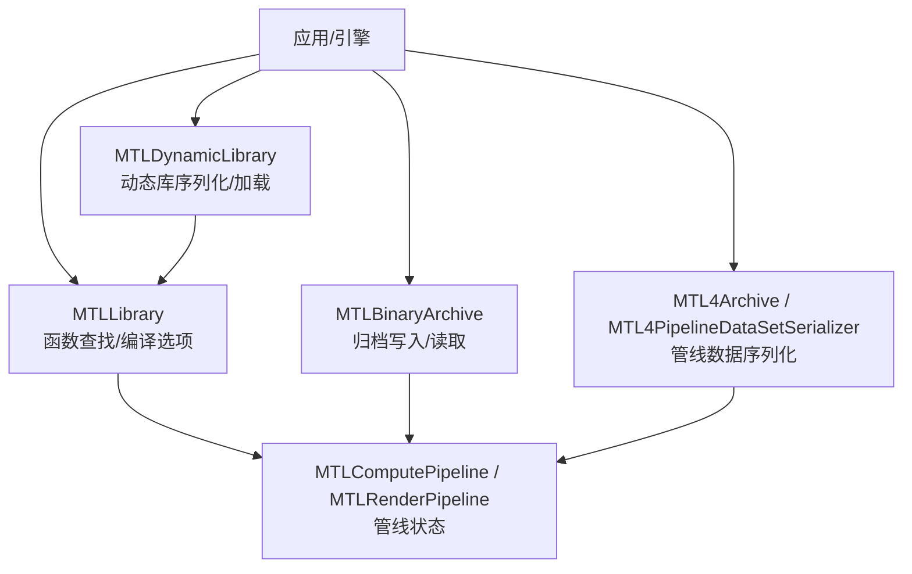
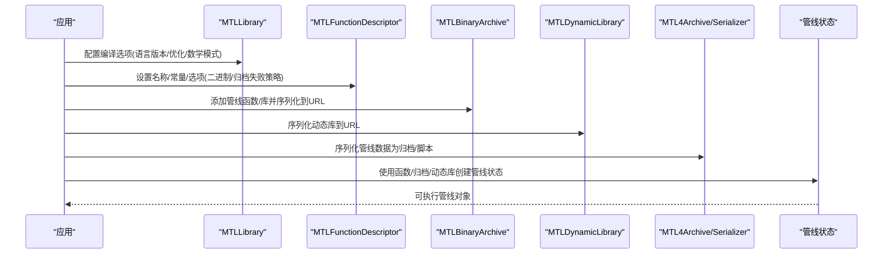
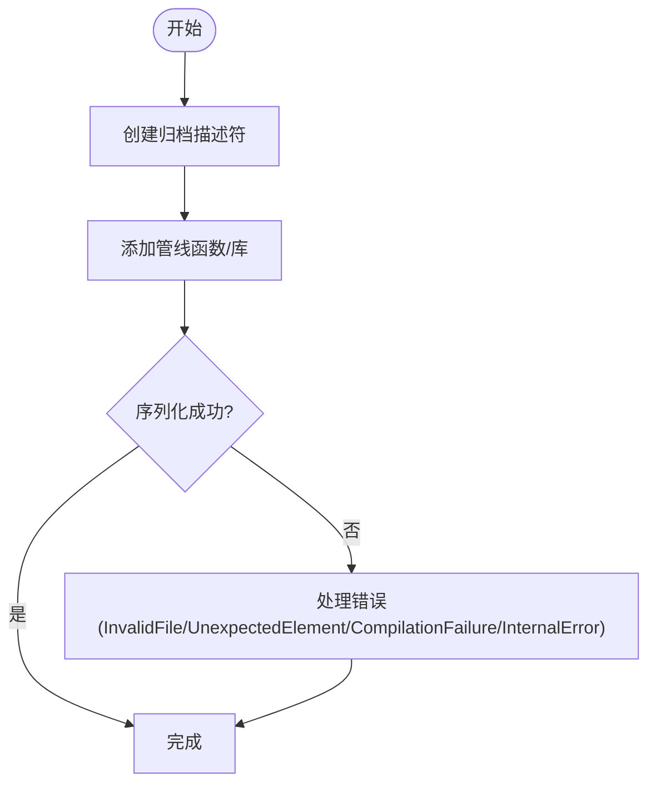
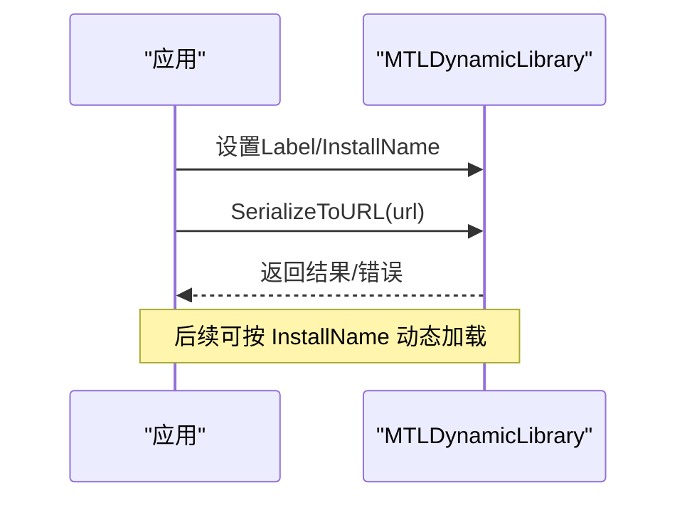
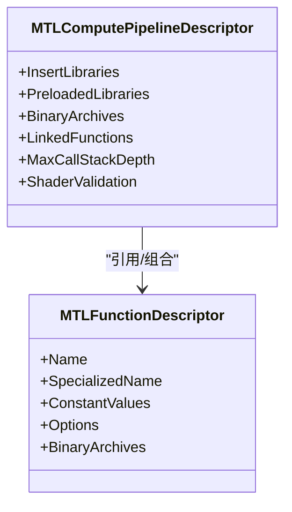
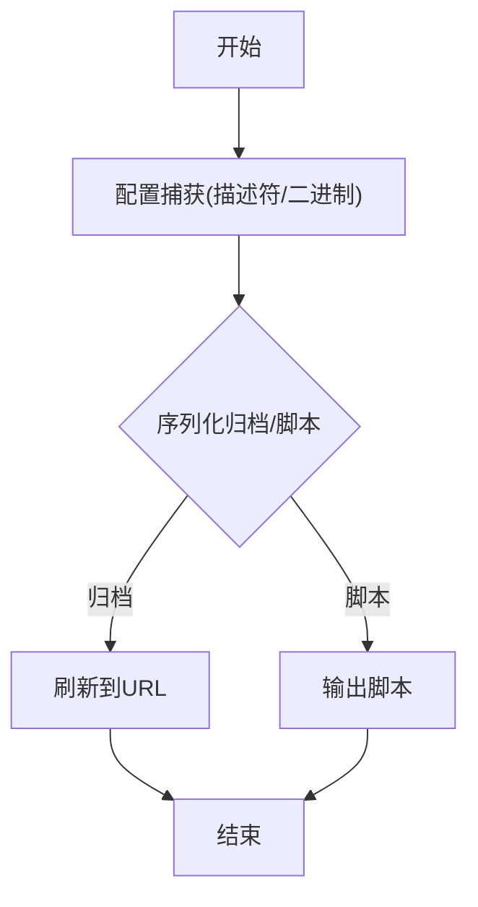
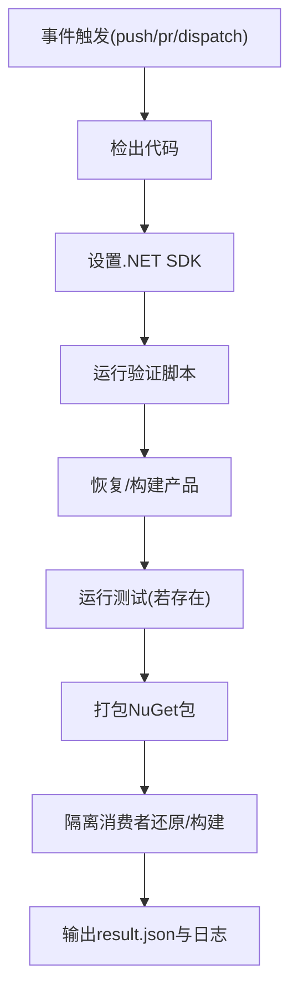
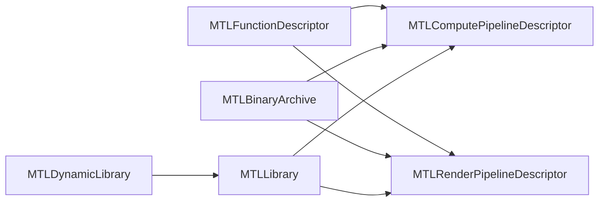

# 二进制归档与版本管理

<cite>
**本文引用的文件**
- [MTLBinaryArchive.cs](file://src/SharpMetal/Metal/MTLBinaryArchive.cs)
- [MTLDynamicLibrary.cs](file://src/SharpMetal/Metal/MTLDynamicLibrary.cs)
- [MTLLibrary.cs](file://src/SharpMetal/Metal/MTLLibrary.cs)
- [MTLFunctionDescriptor.cs](file://src/SharpMetal/Metal/MTLFunctionDescriptor.cs)
- [MTL4Archive.cs](file://src/SharpMetal/Metal/MTL4Archive.cs)
- [MTLComputePipeline.cs](file://src/SharpMetal/Metal/MTLComputePipeline.cs)
- [MTLDevice.cs](file://src/SharpMetal/Metal/MTLDevice.cs)
- [verify.yml](file://.github/workflows/verify.yml)
- [Verify.ps1](file://eng/Verify.ps1)
- [README.md](file://README.md)
</cite>

## 目录
1. [简介](#简介)
2. [项目结构](#项目结构)
3. [核心组件](#核心组件)
4. [架构总览](#架构总览)
5. [详细组件分析](#详细组件分析)
6. [依赖关系分析](#依赖关系分析)
7. [性能考量](#性能考量)
8. [故障排查指南](#故障排查指南)
9. [结论](#结论)
10. [附录](#附录)

## 简介
本文件围绕 SharpMetal 中 Metal 着色器库的二进制化、归档与版本管理进行系统化说明，覆盖以下主题：
- 二进制化过程与归档创建（MTLBinaryArchive、MTL4Archive）
- 动态库加载与运行时优化（MTLDynamicLibrary、编译选项）
- 版本兼容性与向后兼容策略（语言版本、GPU 家族、管线选项）
- 迁移策略与冲突解决（依赖解析、安装名、预加载库）
- 大型项目中资源管理与 CI/CD 集成（构建、打包、验证流水线）

## 项目结构
仓库采用分层组织：
- src/SharpMetal/Metal：Metal API 绑定，包含二进制归档、动态库、函数与管线描述符等核心类型
- .github/workflows：CI 工作流定义
- eng：本地验证脚本
- docs/samples：文档与示例

图表来源
- [MTLLibrary.cs:221-399](file://src/SharpMetal/Metal/MTLLibrary.cs#L221-L399)
- [MTLBinaryArchive.cs:15-95](file://src/SharpMetal/Metal/MTLBinaryArchive.cs#L15-L95)
- [MTLDynamicLibrary.cs:16-42](file://src/SharpMetal/Metal/MTLDynamicLibrary.cs#L16-L42)
- [MTL4Archive.cs:12-101](file://src/SharpMetal/Metal/MTL4Archive.cs#L12-L101)
- [MTLComputePipeline.cs:25-149](file://src/SharpMetal/Metal/MTLComputePipeline.cs#L25-L149)

章节来源
- [README.md:12-16](file://README.md#L12-L16)

## 核心组件
- MTLBinaryArchive：用于将计算/渲染/网格/瓦片管线函数或 stitched library 添加到归档并序列化到 URL。提供错误码与设备信息。
- MTLDynamicLibrary：表示可序列化的动态库，支持设置标签、获取设备与安装名，以及序列化到 URL。
- MTLLibrary：提供编译选项（语言版本、数学模式、优化级别、符号可见性、日志等）、函数查找与实例化、交集函数创建等。
- MTLFunctionDescriptor：函数描述符，支持名称、特殊化名称、常量值、选项（如 CompileToBinary、StoreFunctionInMetalScript、FailOnBinaryArchiveMiss）及二进制归档集合。
- MTL4Archive / MTL4PipelineDataSetSerializer：针对管线数据的序列化能力，支持生成归档或脚本。
- MTLComputePipeline / MTLRenderPipeline：管线描述符与状态，支持插入/预加载库、二进制归档、链接函数、最大调用栈深度、校验开关等。
- MTLDevice：设备能力枚举（GPU 家族、位置等），为版本兼容性判断提供基础。

章节来源
- [MTLBinaryArchive.cs:6-95](file://src/SharpMetal/Metal/MTLBinaryArchive.cs#L6-L95)
- [MTLDynamicLibrary.cs:6-42](file://src/SharpMetal/Metal/MTLDynamicLibrary.cs#L6-L42)
- [MTLLibrary.cs:24-77, 221-399:24-77](file://src/SharpMetal/Metal/MTLLibrary.cs#L24-L77)
- [MTLFunctionDescriptor.cs:6-66](file://src/SharpMetal/Metal/MTLFunctionDescriptor.cs#L6-L66)
- [MTL4Archive.cs:6-101](file://src/SharpMetal/Metal/MTL4Archive.cs#L6-L101)
- [MTLComputePipeline.cs:25-149](file://src/SharpMetal/Metal/MTLComputePipeline.cs#L25-L149)
- [MTLDevice.cs:16-34](file://src/SharpMetal/Metal/MTLDevice.cs#L16-L34)

## 架构总览
下图展示从源码到二进制归档与动态库的端到端流程，包括编译、归档、序列化与运行时加载。

图表来源
- [MTLLibrary.cs:221-399](file://src/SharpMetal/Metal/MTLLibrary.cs#L221-L399)
- [MTLFunctionDescriptor.cs:14-66](file://src/SharpMetal/Metal/MTLFunctionDescriptor.cs#L14-L66)
- [MTLBinaryArchive.cs:15-95](file://src/SharpMetal/Metal/MTLBinaryArchive.cs#L15-L95)
- [MTLDynamicLibrary.cs:16-42](file://src/SharpMetal/Metal/MTLDynamicLibrary.cs#L16-L42)
- [MTL4Archive.cs:12-101](file://src/SharpMetal/Metal/MTL4Archive.cs#L12-L101)
- [MTLComputePipeline.cs:25-149](file://src/SharpMetal/Metal/MTLComputePipeline.cs#L25-L149)

## 详细组件分析

### 二进制归档（MTLBinaryArchive）
- 功能要点
  - 支持添加计算/渲染/网格/瓦片管线函数与 stitched library
  - 支持序列化到 NSURL
  - 提供错误枚举（无效文件、意外元素、编译失败、内部错误）
  - 暴露设备属性，便于在目标设备上验证兼容性
- 典型用法
  - 构建描述符 -> 添加函数/库 -> 序列化到路径
  - 在运行时通过函数描述符中的 BinaryArchives 指定归档以加速启动

图表来源
- [MTLBinaryArchive.cs:15-95](file://src/SharpMetal/Metal/MTLBinaryArchive.cs#L15-L95)

章节来源
- [MTLBinaryArchive.cs:6-95](file://src/SharpMetal/Metal/MTLBinaryArchive.cs#L6-L95)

### 动态库（MTLDynamicLibrary）
- 功能要点
  - 支持设置标签、获取设备与安装名
  - 支持序列化到 URL，便于按需加载与热更新
  - 错误枚举涵盖无效文件、编译失败、未解析安装名、依赖加载失败、不支持
- 典型用法
  - 构建动态库 -> 设置安装名 -> 序列化 -> 运行时按安装名加载

图表来源
- [MTLDynamicLibrary.cs:16-42](file://src/SharpMetal/Metal/MTLDynamicLibrary.cs#L16-L42)

章节来源
- [MTLDynamicLibrary.cs:6-42](file://src/SharpMetal/Metal/MTLDynamicLibrary.cs#L6-L42)

### 函数与管线描述符（MTLFunctionDescriptor / MTLComputePipelineDescriptor）
- 关键选项
  - 函数选项：CompileToBinary、StoreFunctionInMetalScript、FailOnBinaryArchiveMiss
  - 管线描述符：InsertLibraries、PreloadedLibraries、BinaryArchives、LinkedFunctions、MaxCallStackDepth、ShaderValidation
- 作用
  - 控制编译产物形式（二进制/脚本）、归档命中失败行为、依赖注入与链接、调用栈深度限制、校验开关

图表来源
- [MTLFunctionDescriptor.cs:14-66](file://src/SharpMetal/Metal/MTLFunctionDescriptor.cs#L14-L66)
- [MTLComputePipeline.cs:25-149](file://src/SharpMetal/Metal/MTLComputePipeline.cs#L25-L149)

章节来源
- [MTLFunctionDescriptor.cs:6-66](file://src/SharpMetal/Metal/MTLFunctionDescriptor.cs#L6-L66)
- [MTLComputePipeline.cs:25-149](file://src/SharpMetal/Metal/MTLComputePipeline.cs#L25-L149)

### 管线数据序列化（MTL4Archive / MTL4PipelineDataSetSerializer）
- 能力
  - 根据配置捕获描述符/二进制
  - 序列化归档并刷新到 URL
  - 生成管线脚本
- 用途
  - 离线构建管线缓存，减少运行时首次编译开销

图表来源
- [MTL4Archive.cs:12-101](file://src/SharpMetal/Metal/MTL4Archive.cs#L12-L101)

章节来源
- [MTL4Archive.cs:6-101](file://src/SharpMetal/Metal/MTL4Archive.cs#L6-L101)

### 版本兼容性与向后兼容策略
- 语言版本
  - 通过 MTLLanguageVersion 控制编译器版本，确保跨平台/系统一致性
- GPU 家族
  - 通过 MTLGPUFamily 识别目标 GPU 能力，选择合适特性集
- 管线选项
  - FailOnBinaryArchiveMiss 控制归档缺失时的行为，避免静默回退导致不一致
- 建议
  - 在构建期固定语言版本与优化级别
  - 在运行期依据设备能力选择不同管线/归档
  - 对新增字段/选项采用可选默认值，保持向后兼容

章节来源
- [MTLLibrary.cs:24-36](file://src/SharpMetal/Metal/MTLLibrary.cs#L24-L36)
- [MTLDevice.cs:16-34](file://src/SharpMetal/Metal/MTLDevice.cs#L16-L34)
- [MTLFunctionDescriptor.cs:6-12](file://src/SharpMetal/Metal/MTLFunctionDescriptor.cs#L6-L12)

### 迁移策略与冲突解决
- 依赖解析
  - 使用 InsertLibraries/PreloadedLibraries 显式声明依赖，避免隐式解析冲突
  - 使用 LinkedFunctions 精确链接所需函数，降低符号冲突风险
- 安装名
  - 通过 InstallName 标识动态库，结合 FailOnBinaryArchiveMiss 保证加载确定性
- 迁移步骤
  - 逐步引入新特性，保留旧路径作为降级方案
  - 在 CI 中对多 GPU 家族/语言版本矩阵进行回归验证

章节来源
- [MTLComputePipeline.cs:71-99](file://src/SharpMetal/Metal/MTLComputePipeline.cs#L71-L99)
- [MTLLibrary.cs:263-303](file://src/SharpMetal/Metal/MTLLibrary.cs#L263-L303)
- [MTLDynamicLibrary.cs:22-35](file://src/SharpMetal/Metal/MTLDynamicLibrary.cs#L22-L35)

### 动态库加载、热更新与运行时编译优化
- 动态库加载
  - 序列化动态库到 URL，运行时按安装名加载，实现模块级热更新
- 运行时编译优化
  - 启用 FastMathEnabled、调整 MathMode/MathFloatingPointFunctions
  - 设置 OptimizationLevel（Size/Default）平衡体积与性能
  - 开启 Logging 辅助诊断
- 建议
  - 将常用管线预编译为二进制归档，减少首帧延迟
  - 对频繁更新的着色器使用动态库，配合安装名进行增量替换

章节来源
- [MTLLibrary.cs:239-315](file://src/SharpMetal/Metal/MTLLibrary.cs#L239-L315)
- [MTLDynamicLibrary.cs:22-42](file://src/SharpMetal/Metal/MTLDynamicLibrary.cs#L22-L42)

### 大型项目中着色器资源管理
- 资源分层
  - 公共库：通用算法与工具函数，封装为动态库或静态库
  - 业务管线：按场景/设备分组的管线与归档
- 依赖管理
  - 使用 PreloadedLibraries/InsertLibraries 明确依赖顺序
  - 使用 LinkedFunctions 锁定链接范围，避免符号污染
- 冲突解决
  - 统一安装名命名规范，避免重复
  - 使用 BinaryArchives 与 FailOnBinaryArchiveMiss 确保一致性
- 缓存策略
  - 离线生成管线归档，部署时随应用分发
  - 运行时检查归档版本与设备能力，必要时回退

章节来源
- [MTLComputePipeline.cs:71-99](file://src/SharpMetal/Metal/MTLComputePipeline.cs#L71-L99)
- [MTLFunctionDescriptor.cs:40-66](file://src/SharpMetal/Metal/MTLFunctionDescriptor.cs#L40-L66)

### CI/CD 集成与自动化构建
- GitHub Actions
  - 在 push/pull_request 触发 Windows 托管环境下的构建与包验证
- 本地验证脚本
  - 执行 restore/build/test/pack，并构造隔离消费者验证包可用性
  - 输出验证日志与结果 JSON，便于审计与回溯

图表来源
- [verify.yml:1-26](file://.github/workflows/verify.yml#L1-L26)
- [Verify.ps1:1-67](file://eng/Verify.ps1#L1-L67)

章节来源
- [verify.yml:1-26](file://.github/workflows/verify.yml#L1-L26)
- [Verify.ps1:1-67](file://eng/Verify.ps1#L1-L67)

## 依赖关系分析
- 组件耦合
  - MTLFunctionDescriptor 与管线描述符强相关，决定编译与链接行为
  - MTLBinaryArchive 与管线状态创建紧密协作，影响首帧性能
  - MTLDynamicLibrary 与 MTLLibrary 通过安装名与依赖列表解耦
- 外部依赖
  - 依赖 Apple 框架与 libobjc，需宿主环境支持
- 潜在循环
  - 通过明确的依赖注入（InsertLibraries/PreloadedLibraries）避免隐式循环

图表来源
- [MTLFunctionDescriptor.cs:14-66](file://src/SharpMetal/Metal/MTLFunctionDescriptor.cs#L14-L66)
- [MTLBinaryArchive.cs:15-95](file://src/SharpMetal/Metal/MTLBinaryArchive.cs#L15-L95)
- [MTLDynamicLibrary.cs:16-42](file://src/SharpMetal/Metal/MTLDynamicLibrary.cs#L16-L42)
- [MTLLibrary.cs:221-399](file://src/SharpMetal/Metal/MTLLibrary.cs#L221-L399)
- [MTLComputePipeline.cs:25-149](file://src/SharpMetal/Metal/MTLComputePipeline.cs#L25-L149)

章节来源
- [MTLComputePipeline.cs:25-149](file://src/SharpMetal/Metal/MTLComputePipeline.cs#L25-L149)
- [MTLLibrary.cs:221-399](file://src/SharpMetal/Metal/MTLLibrary.cs#L221-L399)

## 性能考量
- 首帧延迟
  - 使用 BinaryArchives 与 StoreFunctionInMetalScript 减少运行时编译
  - 预加载常用库（PreloadedLibraries）降低首次链接成本
- 体积与速度权衡
  - OptimizationLevel=Size 减小体积；Default 侧重速度
  - FastMathEnabled 与 MathMode=Fast 提升数值计算性能
- 调试与诊断
  - 启用 Logging 输出编译与链接信息，定位瓶颈
- 内存与栈
  - MaxCallStackDepth 控制递归深度，防止栈溢出

章节来源
- [MTLLibrary.cs:239-315](file://src/SharpMetal/Metal/MTLLibrary.cs#L239-L315)
- [MTLComputePipeline.cs:95-105](file://src/SharpMetal/Metal/MTLComputePipeline.cs#L95-L105)

## 故障排查指南
- 常见错误
  - 无效文件/意外元素：检查归档路径与内容完整性
  - 编译失败：核对语言版本、数学模式与宏定义
  - 未解析安装名/依赖加载失败：确认动态库安装名与依赖链
  - 归档缺失失败：根据 FailOnBinaryArchiveMiss 决定是否允许回退
- 排查步骤
  - 启用 Logging 查看编译/链接日志
  - 使用 MTL4PipelineDataSetSerializer 生成脚本，对比差异
  - 在 CI 中复现问题，收集 result.json 与日志

章节来源
- [MTLBinaryArchive.cs:6-13](file://src/SharpMetal/Metal/MTLBinaryArchive.cs#L6-L13)
- [MTLDynamicLibrary.cs:6-14](file://src/SharpMetal/Metal/MTLDynamicLibrary.cs#L6-L14)
- [MTLLibrary.cs:69-77](file://src/SharpMetal/Metal/MTLLibrary.cs#L69-L77)
- [MTLFunctionDescriptor.cs:6-12](file://src/SharpMetal/Metal/MTLFunctionDescriptor.cs#L6-L12)

## 结论
SharpMetal 提供了完整的 Metal 着色器二进制化与归档能力，结合动态库与管线数据序列化，可实现高效的运行时加载与热更新。通过语言版本、GPU 家族与管线选项的组合，能够建立稳健的版本兼容与迁移策略。借助 CI/CD 自动化，可在多配置下持续验证构建与包质量，保障大型项目中着色器资源的稳定交付。

## 附录
- 快速实践清单
  - 固定语言版本与优化级别
  - 使用 BinaryArchives 预编译常用管线
  - 动态库使用唯一安装名，按模块热更新
  - 在 CI 中执行完整构建、测试、打包与隔离消费验证
- 参考路径
  - 构建与验证：[verify.yml](file://.github/workflows/verify.yml), [Verify.ps1](file://eng/Verify.ps1)
  - 核心类型：[MTLLibrary.cs](file://src/SharpMetal/Metal/MTLLibrary.cs), [MTLBinaryArchive.cs](file://src/SharpMetal/Metal/MTLBinaryArchive.cs), [MTLDynamicLibrary.cs](file://src/SharpMetal/Metal/MTLDynamicLibrary.cs), [MTLFunctionDescriptor.cs](file://src/SharpMetal/Metal/MTLFunctionDescriptor.cs), [MTL4Archive.cs](file://src/SharpMetal/Metal/MTL4Archive.cs), [MTLComputePipeline.cs](file://src/SharpMetal/Metal/MTLComputePipeline.cs), [MTLDevice.cs](file://src/SharpMetal/Metal/MTLDevice.cs)