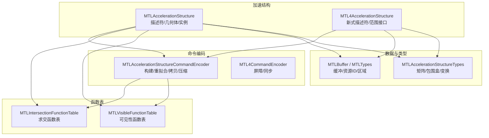
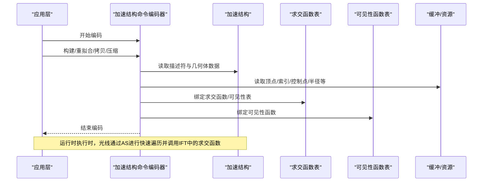
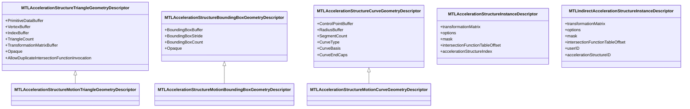
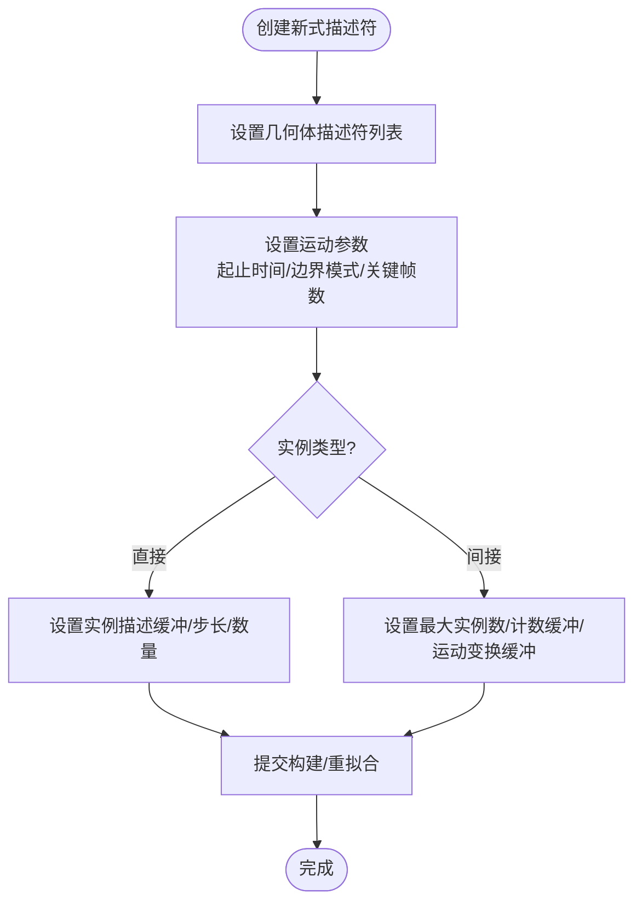
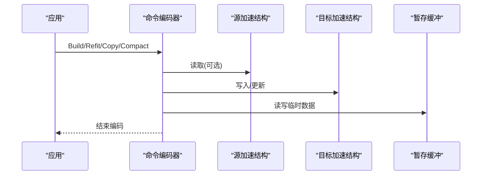
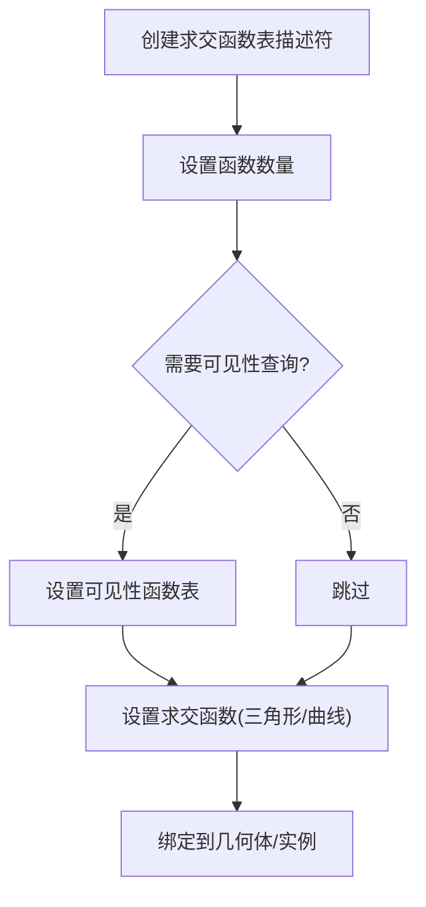
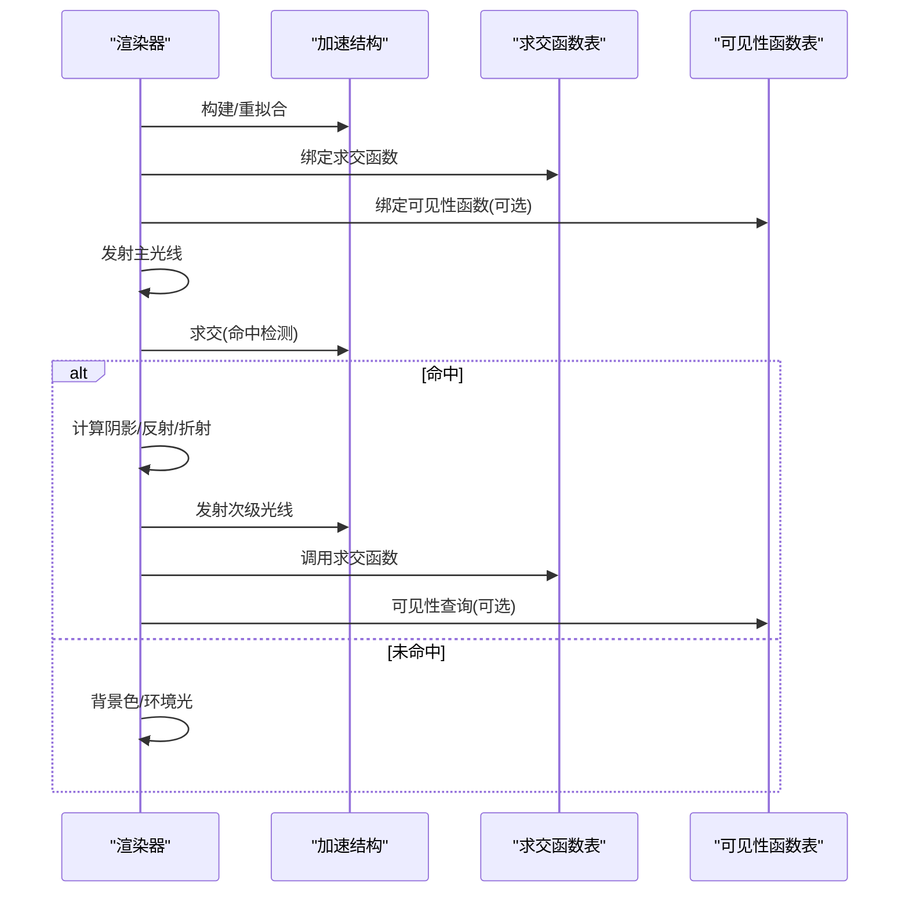
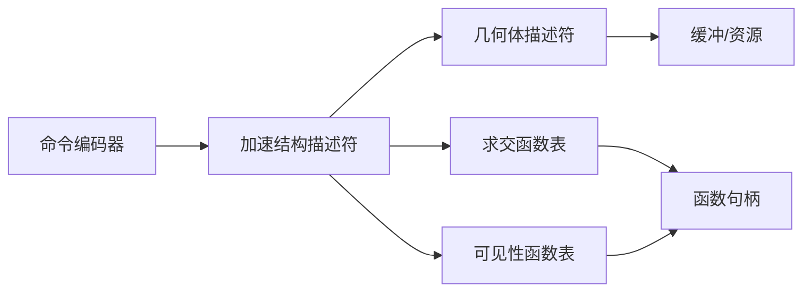

# 光线追踪与加速结构

<cite>
**本文引用的文件**
- [MTLAccelerationStructure.cs](file://src/SharpMetal/Metal/MTLAccelerationStructure.cs)
- [MTL4AccelerationStructure.cs](file://src/SharpMetal/Metal/MTL4AccelerationStructure.cs)
- [MTLAccelerationStructureCommandEncoder.cs](file://src/SharpMetal/Metal/MTLAccelerationStructureCommandEncoder.cs)
- [MTLIntersectionFunctionTable.cs](file://src/SharpMetal/Metal/MTLIntersectionFunctionTable.cs)
- [MTLVisibleFunctionTable.cs](file://src/SharpMetal/Metal/MTLVisibleFunctionTable.cs)
- [MTLAccelerationStructureTypes.cs](file://src/SharpMetal/Metal/MTLAccelerationStructureTypes.cs)
- [MTLBuffer.cs](file://src/SharpMetal/Metal/MTLBuffer.cs)
- [MTLTypes.cs](file://src/SharpMetal/Metal/MTLTypes.cs)
- [README.md](file://README.md)
</cite>

## 目录
1. [简介](#简介)
2. [项目结构](#项目结构)
3. [核心组件](#核心组件)
4. [架构总览](#架构总览)
5. [详细组件分析](#详细组件分析)
6. [依赖关系分析](#依赖关系分析)
7. [性能考量](#性能考量)
8. [故障排查指南](#故障排查指南)
9. [结论](#结论)
10. [附录](#附录)

## 简介
本技术文档围绕 SharpMetal 中 Metal 光线追踪与加速结构的绑定实现，系统阐述加速结构的构建流程、几何体类型（三角形、包围盒、曲线）的配置方法、实例化技术（含运动模糊与间接实例化）、求交函数表与可见性查询的编码方式，以及完整的渲染管线示例（阴影、反射/折射）。同时给出性能优化策略与硬件限制注意事项，帮助开发者在 .NET 环境下高效使用 Metal 的光线追踪能力。

## 项目结构
本项目将 Metal 相关 API 以 C# 结构体与枚举暴露，重点涉及：
- 加速结构与描述符：静态/动态几何体、实例描述、运动关键帧等
- 命令编码器：构建/重拟合/拷贝/压缩加速结构
- 函数表：求交函数表与可见性函数表
- 基础类型：矩阵、包围盒、变换等

图表来源
- [MTLAccelerationStructure.cs:7-137](file://src/SharpMetal/Metal/MTLAccelerationStructure.cs#L7-L137)
- [MTL4AccelerationStructure.cs:7-798](file://src/SharpMetal/Metal/MTL4AccelerationStructure.cs#L7-L798)
- [MTLAccelerationStructureCommandEncoder.cs:6-141](file://src/SharpMetal/Metal/MTLAccelerationStructureCommandEncoder.cs#L6-L141)
- [MTLIntersectionFunctionTable.cs:7-176](file://src/SharpMetal/Metal/MTLIntersectionFunctionTable.cs#L7-L176)
- [MTLVisibleFunctionTable.cs:6-104](file://src/SharpMetal/Metal/MTLVisibleFunctionTable.cs#L6-L104)
- [MTLBuffer.cs:6-115](file://src/SharpMetal/Metal/MTLBuffer.cs#L6-L115)
- [MTLAccelerationStructureTypes.cs:7-45](file://src/SharpMetal/Metal/MTLAccelerationStructureTypes.cs#L7-L45)
- [MTLTypes.cs:104-107](file://src/SharpMetal/Metal/MTLTypes.cs#L104-L107)

章节来源
- [README.md:1-23](file://README.md#L1-L23)

## 核心组件
- 加速结构描述符与几何体
  - 三角形、包围盒、曲线及其运动版本，提供顶点/索引/控制点/半径等数据源配置，支持逐图元数据、步长、元素大小、变换矩阵布局等
  - 实例描述支持默认、用户ID、运动、间接及间接运动等多种模式
- 命令编码器
  - 构建/重拟合/拷贝/压缩加速结构；写入紧凑尺寸；栅栏与计数器采样
- 函数表
  - 求交函数表：可设置透明/不透明三角形与曲线的求交函数、可见性函数表、用户数据等
  - 可见性函数表：为可见性查询提供函数映射
- 基础类型
  - 矩阵、轴对齐包围盒、分量变换、四元数等

章节来源
- [MTLAccelerationStructure.cs:7-137](file://src/SharpMetal/Metal/MTLAccelerationStructure.cs#L7-L137)
- [MTLAccelerationStructure.cs:138-800](file://src/SharpMetal/Metal/MTLAccelerationStructure.cs#L138-L800)
- [MTL4AccelerationStructure.cs:7-798](file://src/SharpMetal/Metal/MTL4AccelerationStructure.cs#L7-L798)
- [MTLAccelerationStructureCommandEncoder.cs:6-141](file://src/SharpMetal/Metal/MTLAccelerationStructureCommandEncoder.cs#L6-L141)
- [MTLIntersectionFunctionTable.cs:7-176](file://src/SharpMetal/Metal/MTLIntersectionFunctionTable.cs#L7-L176)
- [MTLVisibleFunctionTable.cs:6-104](file://src/SharpMetal/Metal/MTLVisibleFunctionTable.cs#L6-L104)
- [MTLAccelerationStructureTypes.cs:7-45](file://src/SharpMetal/Metal/MTLAccelerationStructureTypes.cs#L7-L45)
- [MTLTypes.cs:104-107](file://src/SharpMetal/Metal/MTLTypes.cs#L104-L107)

## 架构总览
下图展示从几何体到加速结构构建、再到光线求交与可见性查询的整体数据流与控制流。

图表来源
- [MTLAccelerationStructureCommandEncoder.cs:50-83](file://src/SharpMetal/Metal/MTLAccelerationStructureCommandEncoder.cs#L50-L83)
- [MTLAccelerationStructure.cs:138-800](file://src/SharpMetal/Metal/MTLAccelerationStructure.cs#L138-L800)
- [MTLIntersectionFunctionTable.cs:100-148](file://src/SharpMetal/Metal/MTLIntersectionFunctionTable.cs#L100-L148)
- [MTLVisibleFunctionTable.cs:76-84](file://src/SharpMetal/Metal/MTLVisibleFunctionTable.cs#L76-L84)
- [MTLBuffer.cs:42-48](file://src/SharpMetal/Metal/MTLBuffer.cs#L42-L48)

## 详细组件分析

### 加速结构几何体与实例
- 三角形几何体
  - 支持顶点缓冲、索引缓冲、三角形计数、变换矩阵缓冲与布局
  - 支持逐图元数据缓冲、步长、元素大小、透明度与重复求交调用开关
- 包围盒几何体
  - 支持轴对齐包围盒缓冲、步长与数量
- 曲线几何体
  - 控制点缓冲、半径缓冲、段数、端盖类型、基类型（如贝塞尔、B样条等）
- 运动几何体
  - 多关键帧顶点/包围盒/控制点缓冲，时间区间与边界模式
- 实例描述
  - 默认/用户ID/运动/间接/间接运动五种模式
  - 包含变换矩阵、选项掩码、遮罩、求交函数表偏移、关联的加速结构ID或资源ID

图表来源
- [MTLAccelerationStructure.cs:243-410](file://src/SharpMetal/Metal/MTLAccelerationStructure.cs#L243-L410)
- [MTLAccelerationStructure.cs:412-523](file://src/SharpMetal/Metal/MTLAccelerationStructure.cs#L412-L523)
- [MTLAccelerationStructure.cs:525-684](file://src/SharpMetal/Metal/MTLAccelerationStructure.cs#L525-L684)
- [MTLAccelerationStructure.cs:686-789](file://src/SharpMetal/Metal/MTLAccelerationStructure.cs#L686-L789)
- [MTLAccelerationStructure.cs:791-800](file://src/SharpMetal/Metal/MTLAccelerationStructure.cs#L791-L800)
- [MTLAccelerationStructure.cs:74-136](file://src/SharpMetal/Metal/MTLAccelerationStructure.cs#L74-L136)

章节来源
- [MTLAccelerationStructure.cs:74-136](file://src/SharpMetal/Metal/MTLAccelerationStructure.cs#L74-L136)
- [MTLAccelerationStructure.cs:243-800](file://src/SharpMetal/Metal/MTLAccelerationStructure.cs#L243-L800)

### 新式描述符与范围接口（MTL4）
- 新式描述符统一使用范围对象表示缓冲与偏移，便于更细粒度的内存管理
- 支持运动关键帧计数、起止时间与边界模式
- 实例描述符支持直接/间接两种模式，并可指定最大实例数与运动变换计数缓冲

图表来源
- [MTL4AccelerationStructure.cs:86-148](file://src/SharpMetal/Metal/MTL4AccelerationStructure.cs#L86-L148)
- [MTL4AccelerationStructure.cs:618-700](file://src/SharpMetal/Metal/MTL4AccelerationStructure.cs#L618-L700)
- [MTL4AccelerationStructure.cs:702-798](file://src/SharpMetal/Metal/MTL4AccelerationStructure.cs#L702-L798)

章节来源
- [MTL4AccelerationStructure.cs:7-148](file://src/SharpMetal/Metal/MTL4AccelerationStructure.cs#L7-L148)
- [MTL4AccelerationStructure.cs:618-798](file://src/SharpMetal/Metal/MTL4AccelerationStructure.cs#L618-L798)

### 命令编码器与构建流程
- 构建/重拟合/拷贝/压缩
  - 构建：输入目标加速结构、描述符、暂存缓冲与偏移
  - 重拟合：基于源加速结构与描述符生成目标加速结构，支持选项标志
  - 拷贝：复制现有加速结构
  - 压缩：写入紧凑尺寸或原地压缩
- 调试与同步
  - 插入调试标记、分组、栅栏更新与等待、计数器采样

图表来源
- [MTLAccelerationStructureCommandEncoder.cs:50-83](file://src/SharpMetal/Metal/MTLAccelerationStructureCommandEncoder.cs#L50-L83)
- [MTLAccelerationStructureCommandEncoder.cs:85-118](file://src/SharpMetal/Metal/MTLAccelerationStructureCommandEncoder.cs#L85-L118)

章节来源
- [MTLAccelerationStructureCommandEncoder.cs:6-141](file://src/SharpMetal/Metal/MTLAccelerationStructureCommandEncoder.cs#L6-L141)

### 求交函数表与可见性查询
- 求交函数表
  - 支持设置透明/不透明三角形与曲线的求交函数
  - 支持设置可见性函数表、用户数据、扩展限制等签名位
  - 支持批量设置函数与缓冲区
- 可见性函数表
  - 用于可见性查询的函数映射，支持批量设置

图表来源
- [MTLIntersectionFunctionTable.cs:30-148](file://src/SharpMetal/Metal/MTLIntersectionFunctionTable.cs#L30-L148)
- [MTLVisibleFunctionTable.cs:6-84](file://src/SharpMetal/Metal/MTLVisibleFunctionTable.cs#L6-L84)

章节来源
- [MTLIntersectionFunctionTable.cs:7-176](file://src/SharpMetal/Metal/MTLIntersectionFunctionTable.cs#L7-L176)
- [MTLVisibleFunctionTable.cs:6-104](file://src/SharpMetal/Metal/MTLVisibleFunctionTable.cs#L6-L104)

### 完整渲染管线示例（阴影、反射/折射）
以下示例说明如何在渲染管线中使用加速结构与函数表实现常见效果：
- 阴影生成
  - 构建场景加速结构，绑定求交函数表
  - 对每个光源方向发射阴影射线，命中即遮挡
- 反射/折射
  - 主光线命中后计算反射/折射方向
  - 递归或迭代发射次级光线，结合材质属性（透射率、反射率）合成颜色
- 可见性查询
  - 使用可见性函数表进行快速剔除或统计

图表来源
- [MTLAccelerationStructureCommandEncoder.cs:50-83](file://src/SharpMetal/Metal/MTLAccelerationStructureCommandEncoder.cs#L50-L83)
- [MTLIntersectionFunctionTable.cs:120-148](file://src/SharpMetal/Metal/MTLIntersectionFunctionTable.cs#L120-L148)
- [MTLVisibleFunctionTable.cs:76-84](file://src/SharpMetal/Metal/MTLVisibleFunctionTable.cs#L76-L84)

章节来源
- [MTLAccelerationStructureCommandEncoder.cs:50-83](file://src/SharpMetal/Metal/MTLAccelerationStructureCommandEncoder.cs#L50-L83)
- [MTLIntersectionFunctionTable.cs:120-148](file://src/SharpMetal/Metal/MTLIntersectionFunctionTable.cs#L120-L148)
- [MTLVisibleFunctionTable.cs:76-84](file://src/SharpMetal/Metal/MTLVisibleFunctionTable.cs#L76-L84)

## 依赖关系分析
- 组件耦合
  - 命令编码器依赖加速结构描述符与几何体描述符，并通过缓冲访问数据
  - 求交函数表与可见性函数表被几何体/实例引用，形成“描述符→函数表”的绑定关系
- 外部依赖
  - 缓冲与资源ID作为底层数据载体，贯穿构建与执行阶段
- 潜在循环依赖
  - 当前绑定以单向依赖为主，未见显式循环

图表来源
- [MTLAccelerationStructureCommandEncoder.cs:50-83](file://src/SharpMetal/Metal/MTLAccelerationStructureCommandEncoder.cs#L50-L83)
- [MTLAccelerationStructure.cs:138-800](file://src/SharpMetal/Metal/MTLAccelerationStructure.cs#L138-L800)
- [MTLIntersectionFunctionTable.cs:100-148](file://src/SharpMetal/Metal/MTLIntersectionFunctionTable.cs#L100-L148)
- [MTLVisibleFunctionTable.cs:76-84](file://src/SharpMetal/Metal/MTLVisibleFunctionTable.cs#L76-L84)
- [MTLBuffer.cs:42-48](file://src/SharpMetal/Metal/MTLBuffer.cs#L42-L48)

章节来源
- [MTLAccelerationStructureCommandEncoder.cs:50-83](file://src/SharpMetal/Metal/MTLAccelerationStructureCommandEncoder.cs#L50-L83)
- [MTLAccelerationStructure.cs:138-800](file://src/SharpMetal/Metal/MTLAccelerationStructure.cs#L138-L800)
- [MTLIntersectionFunctionTable.cs:100-148](file://src/SharpMetal/Metal/MTLIntersectionFunctionTable.cs#L100-L148)
- [MTLVisibleFunctionTable.cs:76-84](file://src/SharpMetal/Metal/MTLVisibleFunctionTable.cs#L76-L84)
- [MTLBuffer.cs:42-48](file://src/SharpMetal/Metal/MTLBuffer.cs#L42-L48)

## 性能考量
- 构建与重拟合
  - 优先使用重拟合而非重建，减少构建成本
  - 合理设置暂存缓冲大小与偏移，避免频繁分配
- 几何体与实例
  - 使用合适的几何体类型（三角形/包围盒/曲线），减少不必要的复杂求交
  - 实例化时利用间接实例与运动实例，降低CPU侧开销
- 函数表
  - 批量设置函数与缓冲区，减少API调用次数
  - 合理使用可见性函数表进行剔除，降低求交压力
- 内存与缓存
  - 使用范围接口（MTL4）精确控制内存访问
  - 选择合适的存储模式与缓存策略，减少CPU-GPU同步
- 同步与测量
  - 使用栅栏与计数器采样定位瓶颈，调整管线阶段

[本节为通用指导，不直接分析具体文件]

## 故障排查指南
- 构建失败
  - 检查描述符与几何体数据是否完整（顶点/索引/控制点/半径）
  - 确认缓冲长度与偏移正确，步长与元素大小匹配
- 求交异常
  - 验证求交函数表已正确绑定，函数索引有效
  - 检查可见性函数表是否必要且已设置
- 性能退化
  - 评估是否过度使用曲线或高复杂度几何体
  - 检查实例数量与运动关键帧数量是否过大
- 同步问题
  - 确保在构建/重拟合前后正确使用栅栏与等待
  - 使用计数器采样定位热点阶段

章节来源
- [MTLAccelerationStructureCommandEncoder.cs:50-118](file://src/SharpMetal/Metal/MTLAccelerationStructureCommandEncoder.cs#L50-L118)
- [MTLIntersectionFunctionTable.cs:100-148](file://src/SharpMetal/Metal/MTLIntersectionFunctionTable.cs#L100-L148)
- [MTLVisibleFunctionTable.cs:76-84](file://src/SharpMetal/Metal/MTLVisibleFunctionTable.cs#L76-L84)

## 结论
SharpMetal 提供了完整的 Metal 光线追踪与加速结构绑定，覆盖几何体配置、实例化、运动模糊、函数表与可见性查询、命令编码与同步等关键环节。通过合理利用描述符、函数表与命令编码器，可以在 .NET 环境中高效实现阴影、反射/折射等高级渲染效果。建议在实践中关注构建成本、内存管理与同步策略，以获得稳定且高性能的光线追踪体验。

[本节为总结，不直接分析具体文件]

## 附录
- 常用数据结构
  - 矩阵与变换：列主序/行主序、分量变换、四元数
  - 包围盒：最小/最大坐标
  - 资源ID：GPU资源标识
- 参考路径
  - 几何体与实例：[MTLAccelerationStructure.cs](file://src/SharpMetal/Metal/MTLAccelerationStructure.cs)
  - 新式描述符：[MTL4AccelerationStructure.cs](file://src/SharpMetal/Metal/MTL4AccelerationStructure.cs)
  - 命令编码器：[MTLAccelerationStructureCommandEncoder.cs](file://src/SharpMetal/Metal/MTLAccelerationStructureCommandEncoder.cs)
  - 函数表：[MTLIntersectionFunctionTable.cs](file://src/SharpMetal/Metal/MTLIntersectionFunctionTable.cs)、[MTLVisibleFunctionTable.cs](file://src/SharpMetal/Metal/MTLVisibleFunctionTable.cs)
  - 基础类型：[MTLAccelerationStructureTypes.cs](file://src/SharpMetal/Metal/MTLAccelerationStructureTypes.cs)、[MTLTypes.cs](file://src/SharpMetal/Metal/MTLTypes.cs)、[MTLBuffer.cs](file://src/SharpMetal/Metal/MTLBuffer.cs)

[本节为附录，不直接分析具体文件]