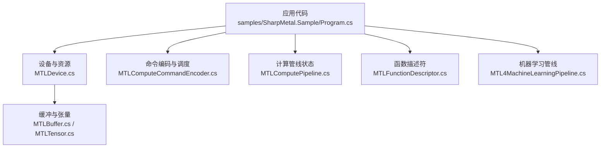
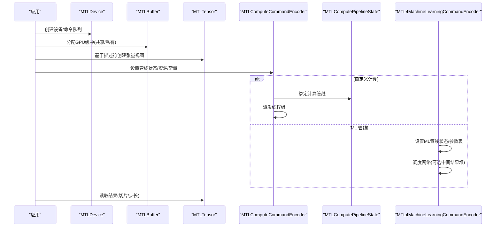
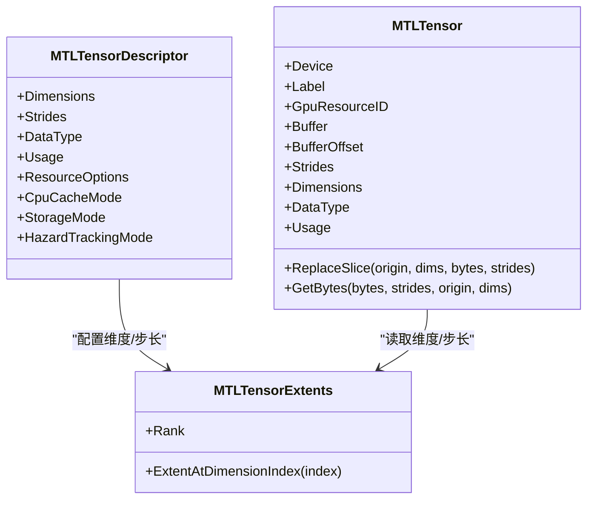
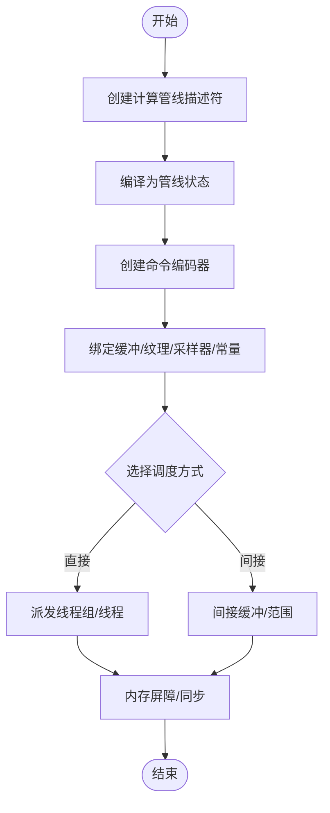
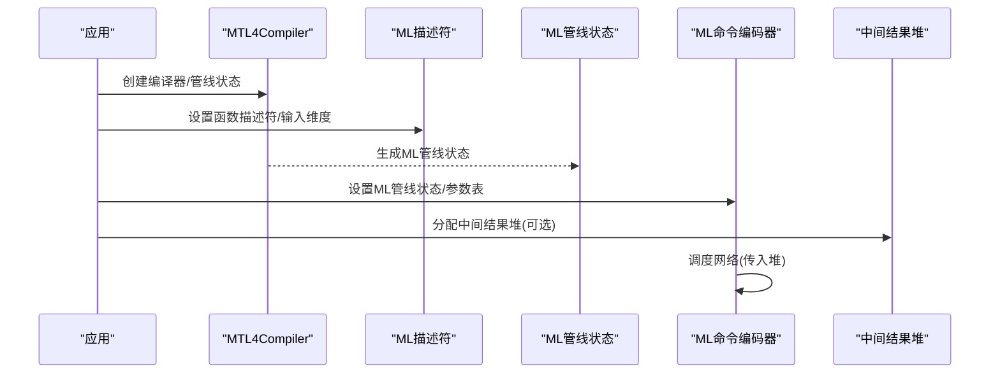
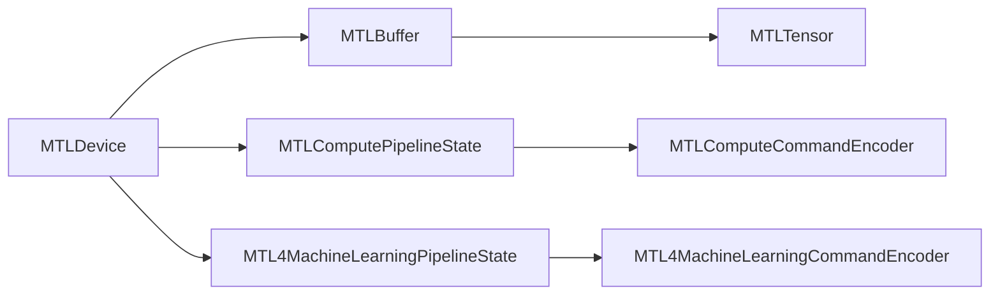
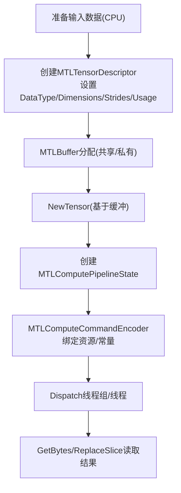
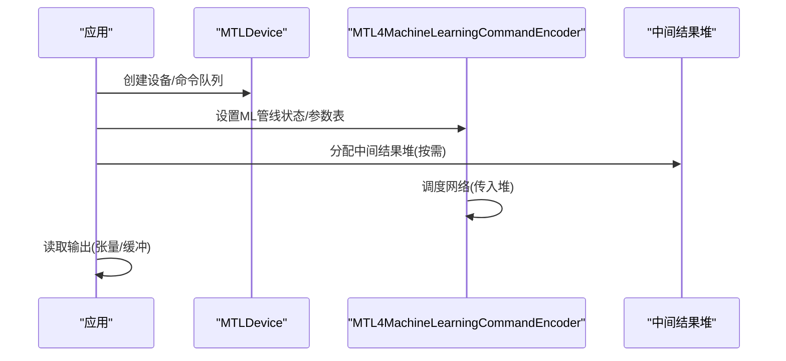

# 机器学习管道集成

<cite>
**本文引用的文件**
- [README.md](file://README.md)
- [DESIGN.md](file://DESIGN.md)
- [Program.cs](file://samples/SharpMetal.Sample/Program.cs)
- [MTLDevice.cs](file://src/SharpMetal/Metal/MTLDevice.cs)
- [MTLBuffer.cs](file://src/SharpMetal/Metal/MTLBuffer.cs)
- [MTLComputeCommandEncoder.cs](file://src/SharpMetal/Metal/MTLComputeCommandEncoder.cs)
- [MTLComputePipeline.cs](file://src/SharpMetal/Metal/MTLComputePipeline.cs)
- [MTLFunctionDescriptor.cs](file://src/SharpMetal/Metal/MTLFunctionDescriptor.cs)
- [MTLTensor.cs](file://src/SharpMetal/Metal/MTLTensor.cs)
- [MTL4MachineLearningPipeline.cs](file://src/SharpMetal/Metal/MTL4MachineLearningPipeline.cs)
</cite>

## 目录
1. [简介](#简介)
2. [项目结构](#项目结构)
3. [核心组件](#核心组件)
4. [架构总览](#架构总览)
5. [详细组件分析](#详细组件分析)
6. [依赖关系分析](#依赖关系分析)
7. [性能考量](#性能考量)
8. [故障排查指南](#故障排查指南)
9. [结论](#结论)
10. [附录：端到端流程与示例指引](#附录：端到端流程与示例指引)

## 简介
本指南面向在 .NET 环境下使用 SharpMetal 进行机器学习管道集成的开发者，重点说明如何在 Metal 平台上结合自定义计算与张量处理，构建高效的 GPU 加速推理/训练流水线。内容涵盖：
- Metal Performance Shaders（MPS）与自定义计算的协作方式
- 张量数据格式、内存布局与缓冲区管理
- 模型加载、预处理、推理与后处理的端到端流程
- 批处理优化与内存管理策略
- 图像分类、目标检测等典型场景的落地思路
- 与 Core ML 框架的集成要点与性能权衡

## 项目结构
SharpMetal 提供对 Apple 平台 Metal、Foundation、QuartzCore 等系统框架的低层绑定，并通过 ObjectiveC 运行时桥接原生对象。仓库包含：
- src/SharpMetal：核心绑定实现（设备、缓冲、纹理、命令编码、计算管线、张量、ML 管线等）
- samples/SharpMetal.Sample：最小可运行示例，演示设备获取、共享缓冲读写
- docs/：设计与验证文档
- eng/：自动化验证脚本

**图表来源**
- [Program.cs:10-45](file://samples/SharpMetal.Sample/Program.cs#L10-L45)
- [MTLDevice.cs:306-319](file://src/SharpMetal/Metal/MTLDevice.cs#L306-L319)
- [MTLBuffer.cs:65-73](file://src/SharpMetal/Metal/MTLBuffer.cs#L65-L73)
- [MTLComputeCommandEncoder.cs:60-183](file://src/SharpMetal/Metal/MTLComputeCommandEncoder.cs#L60-L183)
- [MTLComputePipeline.cs:25-149](file://src/SharpMetal/Metal/MTLComputePipeline.cs#L25-L149)
- [MTLFunctionDescriptor.cs:14-66](file://src/SharpMetal/Metal/MTLFunctionDescriptor.cs#L14-L66)
- [MTL4MachineLearningPipeline.cs:6-125](file://src/SharpMetal/Metal/MTL4MachineLearningPipeline.cs#L6-L125)

**章节来源**
- [README.md:1-23](file://README.md#L1-L23)
- [DESIGN.md:1-12](file://DESIGN.md#L1-L12)

## 核心组件
- 设备与命令队列：通过 MTLDevice 创建默认设备与命令队列，作为所有 GPU 资源的根入口。
- 缓冲与张量：MTLBuffer 承载连续字节序列；MTLTensor 以维度、步长、数据类型描述多维数据视图，便于 ML 算子消费。
- 计算管线：MTLComputePipelineDescriptor/State 封装着色器函数与执行参数；MTLComputeCommandEncoder 负责设置资源、派发线程组。
- 函数描述符：MTLFunctionDescriptor 指定函数名、常量值、选项与二进制归档，用于编译/链接阶段。
- 机器学习管线：MTL4MachineLearningPipeline* 系列提供 ML 专用管线描述、反射、状态与编码器，支持中间结果堆分配与网络调度。

**章节来源**
- [MTLDevice.cs:306-319](file://src/SharpMetal/Metal/MTLDevice.cs#L306-L319)
- [MTLBuffer.cs:65-73](file://src/SharpMetal/Metal/MTLBuffer.cs#L65-L73)
- [MTLTensor.cs:67-198](file://src/SharpMetal/Metal/MTLTensor.cs#L67-L198)
- [MTLComputePipeline.cs:25-237](file://src/SharpMetal/Metal/MTLComputePipeline.cs#L25-L237)
- [MTLComputeCommandEncoder.cs:60-183](file://src/SharpMetal/Metal/MTLComputeCommandEncoder.cs#L60-L183)
- [MTLFunctionDescriptor.cs:14-66](file://src/SharpMetal/Metal/MTLFunctionDescriptor.cs#L14-L66)
- [MTL4MachineLearningPipeline.cs:6-125](file://src/SharpMetal/Metal/MTL4MachineLearningPipeline.cs#L6-L125)

## 架构总览
下图展示从应用到 GPU 执行的端到端路径，包括张量准备、计算管线或 ML 管线调度、以及结果回读。

**图表来源**
- [MTLDevice.cs:306-319](file://src/SharpMetal/Metal/MTLDevice.cs#L306-L319)
- [MTLBuffer.cs:65-73](file://src/SharpMetal/Metal/MTLBuffer.cs#L65-L73)
- [MTLTensor.cs:174-182](file://src/SharpMetal/Metal/MTLTensor.cs#L174-L182)
- [MTLComputeCommandEncoder.cs:60-183](file://src/SharpMetal/Metal/MTLComputeCommandEncoder.cs#L60-L183)
- [MTL4MachineLearningPipeline.cs:107-120](file://src/SharpMetal/Metal/MTL4MachineLearningPipeline.cs#L107-L120)

## 详细组件分析

### 张量与内存布局
- 数据类型：支持 Float32/Float16/BFloat16/Int8/UInt8/Int16/UInt16/Int32/UInt32/Int4/UInt4 等，适配不同精度与量化需求。
- 维度与步长：MTLTensorExtents 描述 rank 与各维 extent；MTLTensorDescriptor 同时配置 Dimensions、Strides、DataType、Usage、ResourceOptions、CpuCacheMode、StorageMode、HazardTrackingMode。
- 访问接口：MTLTensor 暴露 Device、Label、GpuResourceID、Buffer、BufferOffset、Strides、Dimensions、DataType、Usage，并提供 ReplaceSlice/GetBytes 进行局部写入与读取。
- 内存模式：通过 StorageMode/CPU Cache Mode 控制 CPU/GPU 可见性与缓存行为；Usage 标记 Compute/Render/MachineLearning 用途，驱动底层优化。

**图表来源**
- [MTLTensor.cs:6-198](file://src/SharpMetal/Metal/MTLTensor.cs#L6-L198)

**章节来源**
- [MTLTensor.cs:6-198](file://src/SharpMetal/Metal/MTLTensor.cs#L6-L198)

### 计算管线与命令编码
- 管线描述：MTLComputePipelineDescriptor 设置 ComputeFunction、StageInputDescriptor、Buffers、InsertLibraries、PreloadedLibraries、BinaryArchives、LinkedFunctions、MaxCallStackDepth、ShaderValidation 等。
- 管线状态：MTLComputePipelineState 提供最大线程数、执行宽度、静态线程组内存、反射信息、函数句柄等。
- 命令编码：MTLComputeCommandEncoder 支持 SetComputePipelineState、SetBuffer/SetTextures/SamplerState、DispatchThreadgroups/DispatchThreads、MemoryBarrier、UseHeap 等，覆盖完整的数据绑定与调度流程。

**图表来源**
- [MTLComputePipeline.cs:25-237](file://src/SharpMetal/Metal/MTLComputePipeline.cs#L25-L237)
- [MTLComputeCommandEncoder.cs:60-183](file://src/SharpMetal/Metal/MTLComputeCommandEncoder.cs#L60-L183)

**章节来源**
- [MTLComputePipeline.cs:25-237](file://src/SharpMetal/Metal/MTLComputePipeline.cs#L25-L237)
- [MTLComputeCommandEncoder.cs:60-183](file://src/SharpMetal/Metal/MTLComputeCommandEncoder.cs#L60-L183)

### 机器学习管线（ML Pipeline）
- 描述符：MTL4MachineLearningPipelineDescriptor 提供 Label、MachineLearningFunctionDescriptor、输入维度设置（按 buffer index 或 NSArray+Range）、Reset。
- 反射：MTL4MachineLearningPipelineReflection 暴露 Bindings，便于动态探测输入输出布局。
- 状态：MTL4MachineLearningPipelineState 提供 Label、Device、Reflection、IntermediatesHeapSize，用于评估中间结果内存需求。
- 编码器：MTL4MachineLearningCommandEncoder 支持 SetPipelineState、SetArgumentTable、DispatchNetworkWithIntermediatesHeap(heap)，将网络调度与中间结果堆解耦，提升吞吐与内存复用。

**图表来源**
- [MTL4MachineLearningPipeline.cs:6-125](file://src/SharpMetal/Metal/MTL4MachineLearningPipeline.cs#L6-L125)

**章节来源**
- [MTL4MachineLearningPipeline.cs:6-125](file://src/SharpMetal/Metal/MTL4MachineLearningPipeline.cs#L6-L125)

### 函数描述与编译选项
- MTLFunctionDescriptor 支持 Name、SpecializedName、ConstantValues、Options（如 CompileToBinary、StoreFunctionInMetalScript、FailOnBinaryArchiveMiss）、BinaryArchives，便于预编译与归档复用。
- 结合 MTLComputePipelineState 的附加二进制函数能力，可实现模块化管线与增量更新。

**章节来源**
- [MTLFunctionDescriptor.cs:14-66](file://src/SharpMetal/Metal/MTLFunctionDescriptor.cs#L14-L66)
- [MTLComputePipeline.cs:198-206](file://src/SharpMetal/Metal/MTLComputePipeline.cs#L198-L206)

## 依赖关系分析
- 设备是资源与命令的根：所有 Buffer/Tensor/Pipeline/Queue 均依附于 MTLDevice。
- 张量依赖缓冲：MTLBuffer.NewTensor 可将连续内存解释为多维张量视图，降低拷贝开销。
- 命令编码器依赖管线状态：必须先设置管线状态再绑定资源并派发。
- ML 管线与计算管线并行存在：ML 管线适合高层网络调度，计算管线适合自定义算子或混合工作流。

**图表来源**
- [MTLDevice.cs:306-319](file://src/SharpMetal/Metal/MTLDevice.cs#L306-L319)
- [MTLBuffer.cs:65-73](file://src/SharpMetal/Metal/MTLBuffer.cs#L65-L73)
- [MTLComputeCommandEncoder.cs:60-183](file://src/SharpMetal/Metal/MTLComputeCommandEncoder.cs#L60-L183)
- [MTL4MachineLearningPipeline.cs:107-120](file://src/SharpMetal/Metal/MTL4MachineLearningPipeline.cs#L107-L120)

**章节来源**
- [MTLDevice.cs:306-319](file://src/SharpMetal/Metal/MTLDevice.cs#L306-L319)
- [MTLBuffer.cs:65-73](file://src/SharpMetal/Metal/MTLBuffer.cs#L65-L73)
- [MTLComputeCommandEncoder.cs:60-183](file://src/SharpMetal/Metal/MTLComputeCommandEncoder.cs#L60-L183)
- [MTL4MachineLearningPipeline.cs:107-120](file://src/SharpMetal/Metal/MTL4MachineLearningPipeline.cs#L107-L120)

## 性能考量
- 内存布局与对齐
  - 使用 MTLTensorDescriptor 精确设置 Strides，避免隐式转置带来的额外拷贝。
  - 根据 Usage 选择 StorageMode/CPU Cache Mode，减少 CPU-GPU 同步与缓存抖动。
- 批处理优化
  - 将多张样本合并为 batch 维，利用更大的线程组与更高的访存合并度。
  - 使用间接派发或间接命令缓冲批量调度，降低命令提交开销。
- 中间结果堆
  - 对 ML 管线，合理估算 IntermediatesHeapSize，复用 MTLHeap 减少频繁分配。
- 管线复用
  - 预编译管线与二进制归档，启用 BinaryArchives 与 PreloadedLibraries，缩短启动时延。
- 同步与屏障
  - 合理使用 MemoryBarrier/WaitForFence，避免不必要的同步点。
- 设备能力探测
  - 查询 MaxThreadsPerThreadgroup、RecommendedMaxWorkingSetSize、SupportsFamily 等，动态调整线程块大小与工作集规模。

[本节为通用性能建议，不直接引用具体代码行]

## 故障排查指南
- 平台限制
  - 示例程序在非 Apple 平台会阻止原生 Metal 负载执行，需确保运行环境为 macOS/iOS/macCatalyst。
- 设备与缓冲
  - 检查设备指针是否有效；共享缓冲分配失败时需回退或重试。
- 张量与缓冲一致性
  - 使用 GetBytes/ReplaceSlice 时务必匹配 Strides 与 SliceOrigin/SliceDimensions，避免越界或错位。
- 管线与函数
  - 函数名/常量值/二进制归档必须与编译产物一致；开启 FailOnBinaryArchiveMiss 可在缺失时快速失败。
- 同步问题
  - 若出现脏读/写竞争，增加 MemoryBarrier 或使用 Fence 明确顺序。

**章节来源**
- [Program.cs:16-45](file://samples/SharpMetal.Sample/Program.cs#L16-L45)
- [MTLBuffer.cs:65-73](file://src/SharpMetal/Metal/MTLBuffer.cs#L65-L73)
- [MTLTensor.cs:174-182](file://src/SharpMetal/Metal/MTLTensor.cs#L174-L182)
- [MTLFunctionDescriptor.cs:6-66](file://src/SharpMetal/Metal/MTLFunctionDescriptor.cs#L6-L66)
- [MTLComputeCommandEncoder.cs:195-243](file://src/SharpMetal/Metal/MTLComputeCommandEncoder.cs#L195-L243)

## 结论
SharpMetal 提供了完整的 Metal 低层绑定，使 .NET 应用能够高效地编排 GPU 计算与机器学习任务。通过 MTLTensor 的灵活维度/步长建模、MTLComputePipeline 的细粒度控制，以及 MTL4MachineLearningPipeline 的高层网络调度，开发者可以构建兼顾性能与可维护性的 ML 管道。结合合理的批处理、内存管理与同步策略，可在图像分类、目标检测等场景中取得稳定且高效的推理/训练表现。

[本节为总结性内容，不直接引用具体代码行]

## 附录：端到端流程与示例指引

### 端到端流程（自定义计算 + 张量）

**图表来源**
- [MTLTensor.cs:67-198](file://src/SharpMetal/Metal/MTLTensor.cs#L67-L198)
- [MTLBuffer.cs:65-73](file://src/SharpMetal/Metal/MTLBuffer.cs#L65-L73)
- [MTLComputePipeline.cs:25-237](file://src/SharpMetal/Metal/MTLComputePipeline.cs#L25-L237)
- [MTLComputeCommandEncoder.cs:60-183](file://src/SharpMetal/Metal/MTLComputeCommandEncoder.cs#L60-L183)

### 端到端流程（ML 管线）

**图表来源**
- [MTL4MachineLearningPipeline.cs:107-120](file://src/SharpMetal/Metal/MTL4MachineLearningPipeline.cs#L107-L120)

### 与 Core ML 的集成要点
- 在本仓库中，未直接发现 Core ML 框架的绑定或调用。实际工程中，通常通过以下方式集成：
  - 使用 Core ML 导出模型（.mlmodel/.mlpackage），在 iOS/macOS 上通过 Core ML API 加载与推理。
  - 将 Core ML 的输出转换为 MTLTensor/MTLBuffer，交由 SharpMetal 进行后续自定义计算或渲染。
  - 或将自定义计算结果喂入 Core ML 模型的预处理/后处理阶段。
- 性能权衡：
  - Core ML 提供高度优化的内核与自动选择后端（ANE/Metal/Neural Engine），适合标准模型快速落地。
  - 自定义 Metal 计算在特殊算子、混合精度、非标准形状下更具灵活性，但需要更多工程投入。

[本节为概念性说明，不直接引用具体代码行]

### 实际应用场景指引
- 图像分类
  - 预处理：将图像像素载入 MTLBuffer，构造 MTLTensor（NCHW/NHWC 取决于模型），必要时做归一化/裁剪。
  - 推理：优先尝试 ML 管线；若模型不支持或需融合自定义步骤，采用计算管线。
  - 后处理：GetBytes 读取 logits/probabilities，进行 softmax/top-k 等。
- 目标检测
  - 预处理：缩放、归一化、通道转换。
  - 推理：输出通常为边界框坐标、置信度、类别；可使用自定义计算进行 NMS。
  - 可视化：将检测结果映射至纹理/缓冲，进入渲染管线显示。

[本节为实践建议，不直接引用具体代码行]