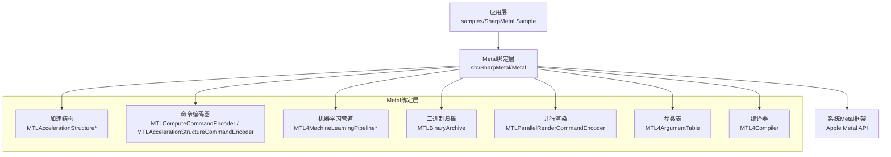
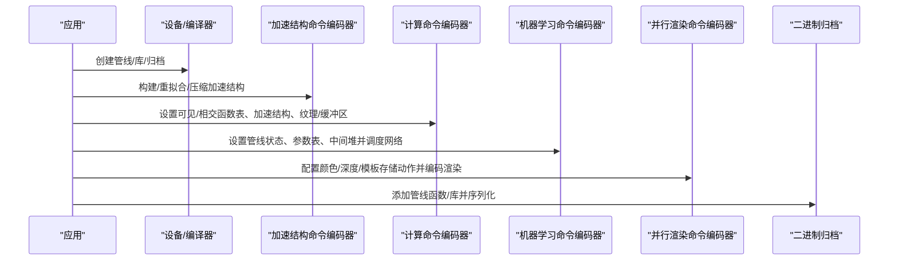
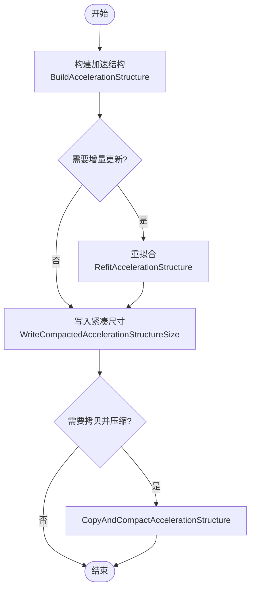
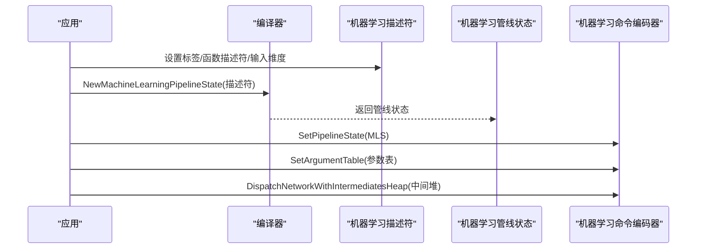
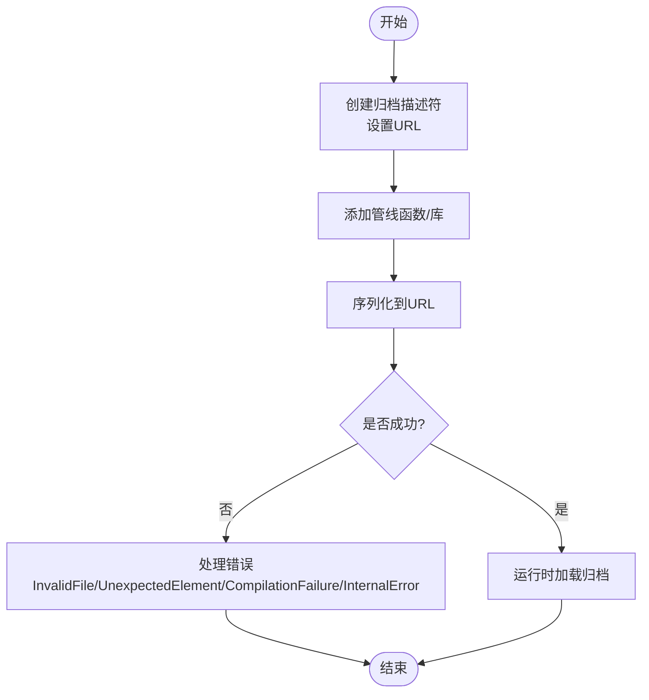
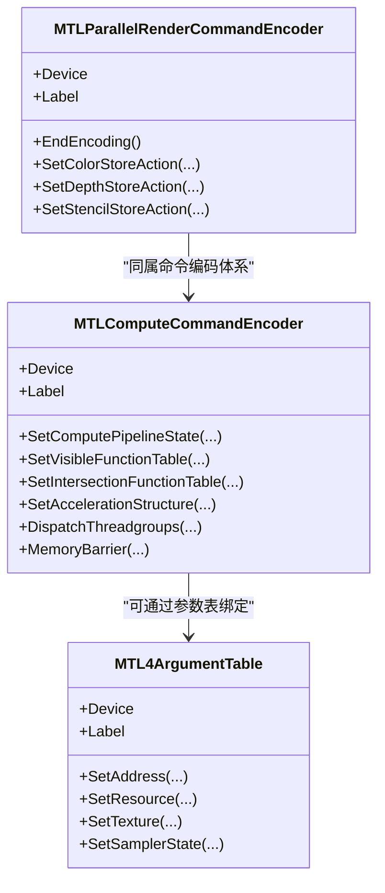
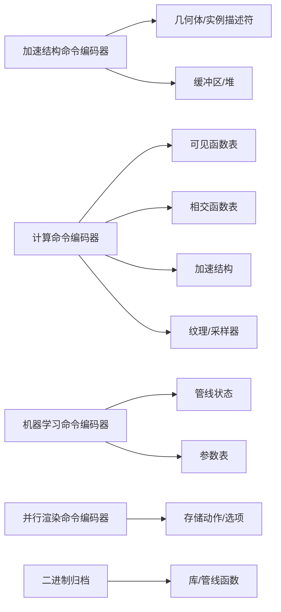

# 高级Metal特性

<cite>
**本文引用的文件**
- [MTL4AccelerationStructure.cs](file://src/SharpMetal/Metal/MTL4AccelerationStructure.cs)
- [MTLAccelerationStructure.cs](file://src/SharpMetal/Metal/MTLAccelerationStructure.cs)
- [MTLAccelerationStructureCommandEncoder.cs](file://src/SharpMetal/Metal/MTLAccelerationStructureCommandEncoder.cs)
- [MTLComputeCommandEncoder.cs](file://src/SharpMetal/Metal/MTLComputeCommandEncoder.cs)
- [MTL4MachineLearningPipeline.cs](file://src/SharpMetal/Metal/MTL4MachineLearningPipeline.cs)
- [MTLBinaryArchive.cs](file://src/SharpMetal/Metal/MTLBinaryArchive.cs)
- [MTLParallelRenderCommandEncoder.cs](file://src/SharpMetal/Metal/MTLParallelRenderCommandEncoder.cs)
- [MTL4ArgumentTable.cs](file://src/SharpMetal/Metal/MTL4ArgumentTable.cs)
- [MTLBuffer.cs](file://src/SharpMetal/Metal/MTLBuffer.cs)
- [MTL4Compiler.cs](file://src/SharpMetal/Metal/MTL4Compiler.cs)
- [Program.cs](file://samples/SharpMetal.Sample/Program.cs)
</cite>

## 目录
1. [简介](#简介)
2. [项目结构](#项目结构)
3. [核心组件](#核心组件)
4. [架构总览](#架构总览)
5. [详细组件分析](#详细组件分析)
6. [依赖关系分析](#依赖关系分析)
7. [性能考量](#性能考量)
8. [故障排查指南](#故障排查指南)
9. [结论](#结论)
10. [附录](#附录)

## 简介
本文件面向希望在Apple平台使用Metal进行高级图形与计算开发的工程师，聚焦以下主题：
- 光线追踪加速结构的构建、更新与优化（几何体描述符、实例化、运动学支持）
- 机器学习管道的集成方式、模型加载与执行流程
- 二进制归档的创建、版本管理与跨平台兼容性考虑
- 并行渲染与计算着色器优化
- 复杂场景实现示例与性能调优建议

内容基于仓库中提供的Metal绑定接口与示例代码进行分析与总结。

## 项目结构
该仓库为SharpMetal库及其最小示例工程。关键目录与职责：
- src/SharpMetal/Metal：对Metal API的C#绑定封装，包含加速结构、命令编码器、管线状态、参数表、编译器、二进制归档等
- samples/SharpMetal.Sample：最小可运行示例，验证设备与共享缓冲读写
- Foundation/ObjectiveCCore：基础类型与Objective-C运行时桥接

图表来源
- [MTLAccelerationStructure.cs:1-1634](file://src/SharpMetal/Metal/MTLAccelerationStructure.cs#L1-L1634)
- [MTLAccelerationStructureCommandEncoder.cs:1-234](file://src/SharpMetal/Metal/MTLAccelerationStructureCommandEncoder.cs#L1-L234)
- [MTLComputeCommandEncoder.cs:1-298](file://src/SharpMetal/Metal/MTLComputeCommandEncoder.cs#L1-L298)
- [MTL4MachineLearningPipeline.cs:1-127](file://src/SharpMetal/Metal/MTL4MachineLearningPipeline.cs#L1-L127)
- [MTLBinaryArchive.cs:1-97](file://src/SharpMetal/Metal/MTLBinaryArchive.cs#L1-L97)
- [MTLParallelRenderCommandEncoder.cs:1-92](file://src/SharpMetal/Metal/MTLParallelRenderCommandEncoder.cs#L1-L92)
- [MTL4ArgumentTable.cs:1-113](file://src/SharpMetal/Metal/MTL4ArgumentTable.cs#L1-L113)
- [MTL4Compiler.cs:1-165](file://src/SharpMetal/Metal/MTL4Compiler.cs#L1-L165)

章节来源
- [Program.cs:1-49](file://samples/SharpMetal.Sample/Program.cs#L1-L49)

## 核心组件
- 加速结构与光线追踪
  - 几何体描述符：三角形、包围盒、曲线及对应运动学变体
  - 实例化描述符：直接实例化、用户ID实例化、间接实例化、运动实例化
  - 构建与更新：构建、重拟合、拷贝与压缩、紧凑尺寸写入
- 机器学习管道
  - 描述符、反射、管线状态、命令编码器与网络调度
- 二进制归档
  - 管线函数与库的序列化、反序列化与错误处理
- 并行渲染与计算
  - 并行渲染命令编码器、计算命令编码器、内存屏障与资源使用声明
- 参数表与编译器
  - 参数表用于批量绑定GPU地址或资源ID；编译器提供动态链接、管线创建与任务管理

章节来源
- [MTL4AccelerationStructure.cs:1-798](file://src/SharpMetal/Metal/MTL4AccelerationStructure.cs#L1-L798)
- [MTLAccelerationStructure.cs:1-1634](file://src/SharpMetal/Metal/MTLAccelerationStructure.cs#L1-L1634)
- [MTLAccelerationStructureCommandEncoder.cs:1-234](file://src/SharpMetal/Metal/MTLAccelerationStructureCommandEncoder.cs#L1-L234)
- [MTLComputeCommandEncoder.cs:1-298](file://src/SharpMetal/Metal/MTLComputeCommandEncoder.cs#L1-L298)
- [MTL4MachineLearningPipeline.cs:1-127](file://src/SharpMetal/Metal/MTL4MachineLearningPipeline.cs#L1-L127)
- [MTLBinaryArchive.cs:1-97](file://src/SharpMetal/Metal/MTLBinaryArchive.cs#L1-L97)
- [MTLParallelRenderCommandEncoder.cs:1-92](file://src/SharpMetal/Metal/MTLParallelRenderCommandEncoder.cs#L1-L92)
- [MTL4ArgumentTable.cs:1-113](file://src/SharpMetal/Metal/MTL4ArgumentTable.cs#L1-L113)
- [MTL4Compiler.cs:1-165](file://src/SharpMetal/Metal/MTL4Compiler.cs#L1-L165)

## 架构总览
下图展示了从应用到Metal驱动的关键调用路径，涵盖光线追踪构建、机器学习执行、并行渲染与二进制归档。

图表来源
- [MTLAccelerationStructureCommandEncoder.cs:50-83](file://src/SharpMetal/Metal/MTLAccelerationStructureCommandEncoder.cs#L50-L83)
- [MTLComputeCommandEncoder.cs:105-128](file://src/SharpMetal/Metal/MTLComputeCommandEncoder.cs#L105-L128)
- [MTL4MachineLearningPipeline.cs:107-120](file://src/SharpMetal/Metal/MTL4MachineLearningPipeline.cs#L107-L120)
- [MTLParallelRenderCommandEncoder.cs:46-74](file://src/SharpMetal/Metal/MTLParallelRenderCommandEncoder.cs#L46-L74)
- [MTLBinaryArchive.cs:50-83](file://src/SharpMetal/Metal/MTLBinaryArchive.cs#L50-L83)

## 详细组件分析

### 光线追踪加速结构（Ray Tracing）
- 几何体描述符
  - 三角形几何体：顶点缓冲、索引缓冲、三角形数量、变换矩阵缓冲与布局
  - 包围盒几何体：包围盒缓冲、步长、数量
  - 曲线几何体：控制点缓冲、半径缓冲、段数、曲线类型/基/端盖
  - 运动学变体：多帧顶点/包围盒缓冲、运动变换缓冲、时间范围与边界模式
- 实例化技术
  - 直接实例化：实例描述缓冲、步长、数量、描述符类型
  - 用户ID实例化：在描述结构中携带用户ID
  - 间接实例化：通过缓冲中的最大实例数与计数缓冲动态控制
  - 运动实例化：运动变换缓冲、类型、步长、时间范围与边界模式
- 构建与优化
  - 构建：指定目标加速结构、描述符、暂存缓冲与偏移
  - 重拟合：源加速结构、描述符、目标加速结构、暂存缓冲与选项
  - 拷贝与压缩：复制并压缩至目标加速结构
  - 紧凑尺寸写入：将压缩后的大小写回缓冲，便于后续分配
  - 使用资源/堆：显式声明资源与堆的使用，辅助驱动优化

图表来源
- [MTLAccelerationStructureCommandEncoder.cs:50-83](file://src/SharpMetal/Metal/MTLAccelerationStructureCommandEncoder.cs#L50-L83)

章节来源
- [MTL4AccelerationStructure.cs:20-798](file://src/SharpMetal/Metal/MTL4AccelerationStructure.cs#L20-L798)
- [MTLAccelerationStructure.cs:7-136](file://src/SharpMetal/Metal/MTLAccelerationStructure.cs#L7-L136)
- [MTLAccelerationStructureCommandEncoder.cs:50-83](file://src/SharpMetal/Metal/MTLAccelerationStructureCommandEncoder.cs#L50-L83)

### 机器学习管道集成
- 描述符与反射
  - 机器学习函数描述符、输入维度设置与查询、重置
  - 反射提供绑定信息
- 管线状态与命令编码器
  - 管线状态包含设备、反射与中间堆大小
  - 命令编码器设置管线状态、参数表，并通过中间堆调度网络执行
- 典型流程
  - 创建描述符并设置函数描述符与输入维度
  - 通过编译器创建管线状态
  - 在命令编码器中设置参数表与中间堆，调度执行

图表来源
- [MTL4MachineLearningPipeline.cs:16-46](file://src/SharpMetal/Metal/MTL4MachineLearningPipeline.cs#L16-L46)
- [MTL4MachineLearningPipeline.cs:77-120](file://src/SharpMetal/Metal/MTL4MachineLearningPipeline.cs#L77-L120)
- [MTL4Compiler.cs:145-148](file://src/SharpMetal/Metal/MTL4Compiler.cs#L145-L148)

章节来源
- [MTL4MachineLearningPipeline.cs:1-127](file://src/SharpMetal/Metal/MTL4MachineLearningPipeline.cs#L1-L127)
- [MTL4Compiler.cs:145-148](file://src/SharpMetal/Metal/MTL4Compiler.cs#L145-L148)

### 二进制归档：创建、版本管理与跨平台兼容
- 创建与序列化
  - 通过描述符设置URL
  - 添加计算/渲染/网格/瓦片管线函数或库
  - 序列化到URL
- 错误处理
  - 错误枚举包括无效文件、意外元素、编译失败、内部错误
- 版本管理与兼容
  - 通过序列化归档保存管线函数集合，可在不同运行期加载
  - 结合编译器动态链接能力，支持运行时选择与替换
  - 跨平台限制：示例程序检查宿主平台（macOS/iOS/Mac Catalyst），非Apple平台会阻止原生Metal工作负载

图表来源
- [MTLBinaryArchive.cs:15-83](file://src/SharpMetal/Metal/MTLBinaryArchive.cs#L15-L83)
- [Program.cs:16-20](file://samples/SharpMetal.Sample/Program.cs#L16-L20)

章节来源
- [MTLBinaryArchive.cs:1-97](file://src/SharpMetal/Metal/MTLBinaryArchive.cs#L1-L97)
- [Program.cs:16-20](file://samples/SharpMetal.Sample/Program.cs#L16-L20)

### 并行渲染与计算着色器优化
- 并行渲染命令编码器
  - 提供设备、标签、渲染命令编码器访问
  - 支持颜色/深度/模板存储动作与选项设置
  - 调试分组与标记
- 计算命令编码器
  - 设置管线状态、缓冲区/纹理/采样器绑定
  - 设置可见/相交函数表与加速结构
  - 线程组/线程分发、间接分发、内存屏障、计数器采样
  - 使用资源/堆、执行间接命令缓冲
- 参数表
  - 配置最大绑定数量、初始化绑定、属性步长支持
  - 设置GPU地址或资源ID、纹理与采样器状态

图表来源
- [MTLParallelRenderCommandEncoder.cs:16-74](file://src/SharpMetal/Metal/MTLParallelRenderCommandEncoder.cs#L16-L74)
- [MTLComputeCommandEncoder.cs:60-128](file://src/SharpMetal/Metal/MTLComputeCommandEncoder.cs#L60-L128)
- [MTL4ArgumentTable.cs:14-110](file://src/SharpMetal/Metal/MTL4ArgumentTable.cs#L14-L110)

章节来源
- [MTLParallelRenderCommandEncoder.cs:1-92](file://src/SharpMetal/Metal/MTLParallelRenderCommandEncoder.cs#L1-L92)
- [MTLComputeCommandEncoder.cs:1-298](file://src/SharpMetal/Metal/MTLComputeCommandEncoder.cs#L1-L298)
- [MTL4ArgumentTable.cs:1-113](file://src/SharpMetal/Metal/MTL4ArgumentTable.cs#L1-L113)

### 复杂场景实现示例与最佳实践
- 场景概述
  - 构建包含三角形与曲线的加速结构，使用运动学数据驱动动画
  - 在计算阶段更新实例位置与可见性，使用间接实例化减少CPU开销
  - 通过机器学习管道执行预处理或后处理（如降噪、超分）
  - 使用并行渲染编码器组织多通道渲染，减少主线程阻塞
  - 使用二进制归档缓存管线函数，提升启动与切换速度
- 实现要点
  - 几何体描述符：合理设置顶点格式、步长与索引类型，避免不必要的数据拷贝
  - 实例化：优先使用间接实例化与用户ID，便于GPU侧筛选与标识
  - 运动学：设置正确的运动时间范围与边界模式，避免插值异常
  - 构建/重拟合：根据场景变化频率选择构建或重拟合，配合紧凑尺寸写入优化内存
  - 机器学习：明确输入维度与中间堆大小，确保内存对齐与复用
  - 并行渲染：按通道拆分渲染任务，设置合适的存储动作与选项
  - 二进制归档：将稳定管线函数归档，运行时按需加载，减少编译时延

章节来源
- [MTL4AccelerationStructure.cs:86-798](file://src/SharpMetal/Metal/MTL4AccelerationStructure.cs#L86-L798)
- [MTLAccelerationStructureCommandEncoder.cs:50-83](file://src/SharpMetal/Metal/MTLAccelerationStructureCommandEncoder.cs#L50-L83)
- [MTL4MachineLearningPipeline.cs:16-120](file://src/SharpMetal/Metal/MTL4MachineLearningPipeline.cs#L16-L120)
- [MTLBinaryArchive.cs:50-83](file://src/SharpMetal/Metal/MTLBinaryArchive.cs#L50-L83)

## 依赖关系分析
- 组件耦合
  - 加速结构命令编码器依赖描述符与缓冲区/堆，用于构建与更新
  - 计算命令编码器依赖函数表、加速结构与纹理/缓冲区，用于光线追踪与通用计算
  - 机器学习命令编码器依赖管线状态与参数表，用于网络调度
  - 并行渲染命令编码器与计算命令编码器同属命令编码体系，协同完成渲染与计算
  - 二进制归档依赖管线描述符与库，用于序列化与加载
- 外部依赖
  - Objective-C运行时用于方法调用与对象生命周期管理
  - Apple Metal框架提供底层实现

图表来源
- [MTLAccelerationStructureCommandEncoder.cs:50-113](file://src/SharpMetal/Metal/MTLAccelerationStructureCommandEncoder.cs#L50-L113)
- [MTLComputeCommandEncoder.cs:105-158](file://src/SharpMetal/Metal/MTLComputeCommandEncoder.cs#L105-L158)
- [MTL4MachineLearningPipeline.cs:107-120](file://src/SharpMetal/Metal/MTL4MachineLearningPipeline.cs#L107-L120)
- [MTLParallelRenderCommandEncoder.cs:46-74](file://src/SharpMetal/Metal/MTLParallelRenderCommandEncoder.cs#L46-L74)
- [MTLBinaryArchive.cs:50-83](file://src/SharpMetal/Metal/MTLBinaryArchive.cs#L50-L83)

章节来源
- [MTLAccelerationStructureCommandEncoder.cs:1-234](file://src/SharpMetal/Metal/MTLAccelerationStructureCommandEncoder.cs#L1-L234)
- [MTLComputeCommandEncoder.cs:1-298](file://src/SharpMetal/Metal/MTLComputeCommandEncoder.cs#L1-L298)
- [MTL4MachineLearningPipeline.cs:1-127](file://src/SharpMetal/Metal/MTL4MachineLearningPipeline.cs#L1-L127)
- [MTLParallelRenderCommandEncoder.cs:1-92](file://src/SharpMetal/Metal/MTLParallelRenderCommandEncoder.cs#L1-L92)
- [MTLBinaryArchive.cs:1-97](file://src/SharpMetal/Metal/MTLBinaryArchive.cs#L1-L97)

## 性能考量
- 加速结构
  - 使用“优先快速构建”或“优先快速相交”等用法标志，根据场景需求权衡构建时间与查询性能
  - 合理使用重拟合与紧凑尺寸写入，降低内存占用与重建成本
  - 运动学数据集中管理，减少频繁缓冲更新
- 计算与并行渲染
  - 使用间接分发与间接命令缓冲，减少CPU开销
  - 合理设置内存屏障与资源使用声明，避免不必要的同步
  - 利用并行渲染编码器拆分渲染通道，提高吞吐
- 机器学习
  - 精确设置输入维度与中间堆大小，避免溢出与浪费
  - 复用管线状态与参数表，减少创建与绑定开销
- 二进制归档
  - 将稳定管线函数归档，减少运行时编译延迟
  - 结合动态链接与查找归档，实现模块化与版本管理

[本节为通用指导，不直接分析具体文件]

## 故障排查指南
- 平台限制
  - 示例程序在非Apple平台会阻止原生Metal工作负载，需确保运行环境满足要求
- 设备与缓冲
  - 设备获取失败或缓冲内容为空，检查设备创建与缓冲分配返回值
- 归档错误
  - 序列化失败时检查错误枚举，定位无效文件、意外元素、编译失败或内部错误
- 管线与函数
  - 管线状态创建失败时检查描述符与动态链接参数
- 资源与内存
  - 使用资源/堆前确认其生命周期与所有权，避免悬空指针

章节来源
- [Program.cs:16-38](file://samples/SharpMetal.Sample/Program.cs#L16-L38)
- [MTLBinaryArchive.cs:6-13](file://src/SharpMetal/Metal/MTLBinaryArchive.cs#L6-L13)
- [MTL4Compiler.cs:100-148](file://src/SharpMetal/Metal/MTL4Compiler.cs#L100-L148)

## 结论
本仓库提供了完整的Metal高级特性绑定，覆盖光线追踪加速结构、机器学习管道、二进制归档、并行渲染与计算优化等关键能力。通过合理的描述符配置、实例化策略、构建与更新流程、以及归档与动态链接机制，开发者可以在复杂场景中实现高性能的光线追踪与机器学习集成渲染。建议在开发过程中结合性能分析与工具链，持续优化数据结构、内存使用与命令编码效率。

[本节为总结，不直接分析具体文件]

## 附录
- 术语对照
  - 加速结构：用于加速光线与几何体求交的层次化数据结构
  - 重拟合：在少量几何体变化时增量更新加速结构
  - 紧凑尺寸：压缩后的加速结构所需内存大小
  - 间接实例化：通过GPU侧缓冲动态控制实例数量与参数
  - 机器学习管道：用于执行神经网络推理的专用管线
  - 二进制归档：序列化管线函数与库以支持跨运行期加载
  - 并行渲染：将渲染任务拆分为多个子通道并行编码

[本节为概念说明，不直接分析具体文件]