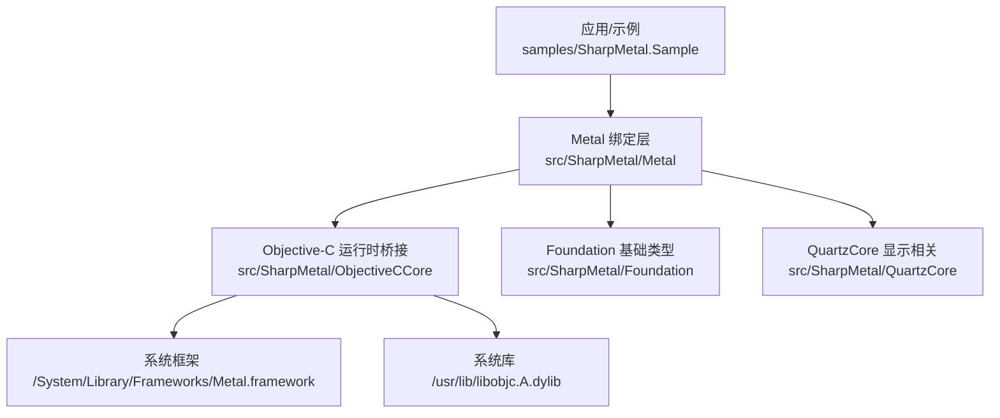
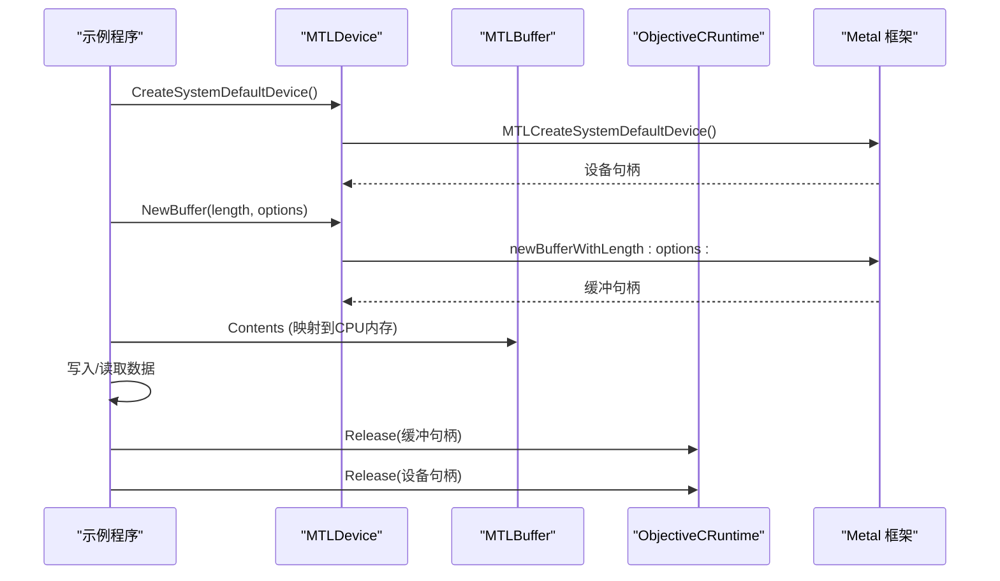
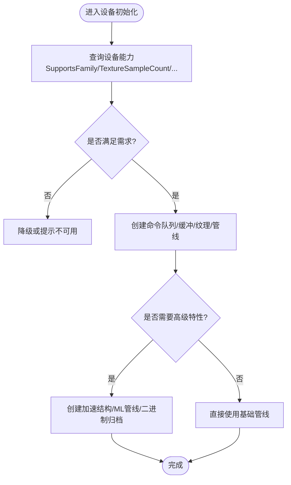
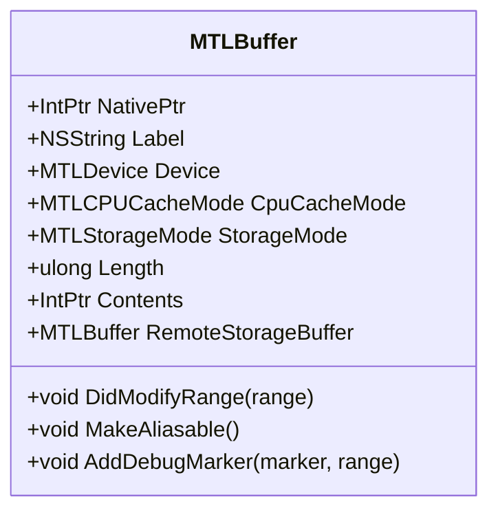
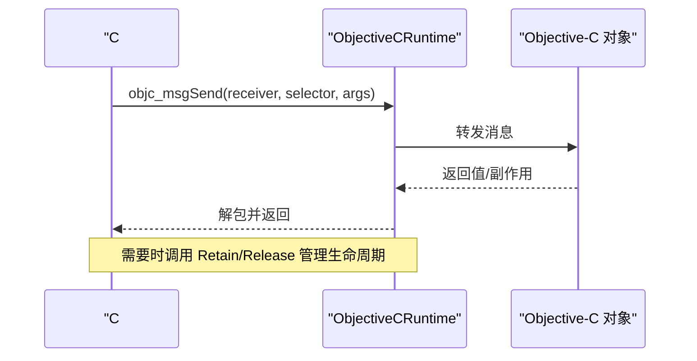
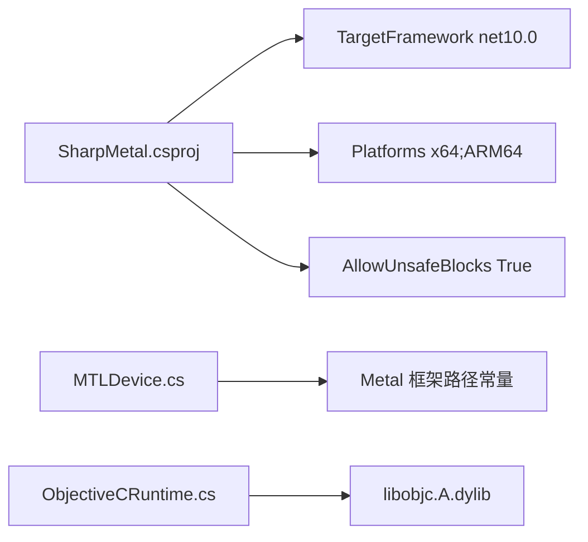
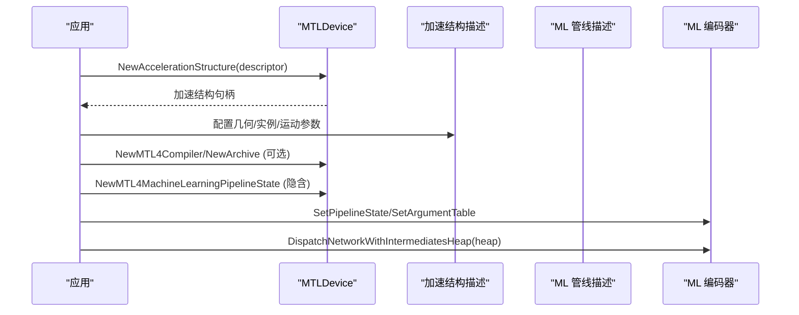

# 高级主题

<cite>
**本文引用的文件**
- [README.md](file://README.md)
- [DESIGN.md](file://DESIGN.md)
- [AGENTS.md](file://AGENTS.md)
- [SharpMetal.csproj](file://src/SharpMetal/SharpMetal.csproj)
- [Program.cs](file://samples/SharpMetal.Sample/Program.cs)
- [ObjectiveCRuntime.cs](file://src/SharpMetal/ObjectiveCCore/ObjectiveCRuntime.cs)
- [NSError.cs](file://src/SharpMetal/Foundation/NSError.cs)
- [MTLDevice.cs](file://src/SharpMetal/Metal/MTLDevice.cs)
- [MTLBuffer.cs](file://src/SharpMetal/Metal/MTLBuffer.cs)
- [MTL4AccelerationStructure.cs](file://src/SharpMetal/Metal/MTL4AccelerationStructure.cs)
- [MTL4MachineLearningPipeline.cs](file://src/SharpMetal/Metal/MTL4MachineLearningPipeline.cs)
- [VERIFICATION.md](file://docs/VERIFICATION.md)
</cite>

## 目录
1. [简介](#简介)
2. [项目结构](#项目结构)
3. [核心组件](#核心组件)
4. [架构总览](#架构总览)
5. [详细组件分析](#详细组件分析)
6. [依赖关系分析](#依赖关系分析)
7. [性能考量与优化](#性能考量与优化)
8. [内存管理与资源生命周期](#内存管理与资源生命周期)
9. [错误处理与调试技术](#错误处理与调试技术)
10. [加速结构与机器学习管道](#加速结构与机器学习管道)
11. [二进制归档与管线数据序列化](#二进制归档与管线数据序列化)
12. [跨平台兼容性与部署策略](#跨平台兼容性与部署策略)
13. [性能基准测试方法与工具使用指南](#性能基准测试方法与工具使用指南)
14. [常见问题与故障排除](#常见问题与故障排除)
15. [扩展点与自定义开发最佳实践](#扩展点与自定义开发最佳实践)
16. [结论](#结论)

## 简介
本文件面向高级用户与维护者，围绕 SharpMetal 在 .NET 10 上的 Objective-C 与 Metal 绑定，系统阐述性能优化、内存管理、错误处理与调试、加速结构、机器学习管道、二进制归档、跨平台兼容性与部署策略、基准测试方法以及扩展与定制实践。内容基于仓库源码与设计文档，强调可重建、可验证与可追溯的工程原则。

## 项目结构
- src/SharpMetal：运行时绑定库，包含 Foundation、ObjectiveCCore、Metal、QuartzCore、MetalFX 等子模块。
- samples/SharpMetal.Sample：最小可运行示例，演示设备创建、共享缓冲读写与原生资源释放。
- docs/：设计说明与验证流程（构建、打包、平台限定）。
- eng/：本地 CI 入口脚本。
- 根配置：global.json、Directory.Build.*、产品属性文件等。

图表来源
- [Program.cs:1-49](file://samples/SharpMetal.Sample/Program.cs#L1-L49)
- [MTLDevice.cs:721-721](file://src/SharpMetal/Metal/MTLDevice.cs#L721-L721)
- [ObjectiveCRuntime.cs:35-35](file://src/SharpMetal/ObjectiveCCore/ObjectiveCRuntime.cs#L35-L35)

章节来源
- [README.md:12-16](file://README.md#L12-L16)
- [DESIGN.md:1-12](file://DESIGN.md#L1-L12)

## 核心组件
- MTLDevice：设备能力查询、命令队列/缓冲区/纹理/管线状态创建、加速结构与 ML 管线支持探测、二进制归档创建等。
- MTLBuffer：GPU/CPU 共享内存、别名化、范围修改通知、远程视图、调试标记等。
- ObjectiveCRuntime：底层 objc_msgSend 重载集合、Retain/Release、选择器封装、结构体封送。
- NSError：错误域、代码、用户信息、本地化描述与恢复建议。
- 加速结构（MTL4*）：几何描述、实例描述、运动学参数、三角形/曲线/包围盒等。
- 机器学习管道（MTL4MachineLearning*）：函数描述、输入维度、反射、中间堆大小、编码器调度。

章节来源
- [MTLDevice.cs:187-721](file://src/SharpMetal/Metal/MTLDevice.cs#L187-L721)
- [MTLBuffer.cs:6-113](file://src/SharpMetal/Metal/MTLBuffer.cs#L6-L113)
- [ObjectiveCRuntime.cs:33-800](file://src/SharpMetal/ObjectiveCCore/ObjectiveCRuntime.cs#L33-L800)
- [NSError.cs:5-49](file://src/SharpMetal/Foundation/NSError.cs#L5-L49)
- [MTL4AccelerationStructure.cs:7-797](file://src/SharpMetal/Metal/MTL4AccelerationStructure.cs#L7-L797)
- [MTL4MachineLearningPipeline.cs:6-125](file://src/SharpMetal/Metal/MTL4MachineLearningPipeline.cs#L6-L125)

## 架构总览
SharpMetal 通过轻量托管包装暴露 Metal API，所有原生对象以指针形式存在并由调用方显式持有与释放；Objective-C 消息发送由 ObjectiveCRuntime 统一提供；设备能力与特性通过 respondsToSelector 动态探测，避免在不支持的平台上崩溃。

图表来源
- [Program.cs:21-45](file://samples/SharpMetal.Sample/Program.cs#L21-L45)
- [MTLDevice.cs:305-319](file://src/SharpMetal/Metal/MTLDevice.cs#L305-L319)
- [MTLDevice.cs:356-359](file://src/SharpMetal/Metal/MTLDevice.cs#L356-L359)
- [ObjectiveCRuntime.cs:769-777](file://src/SharpMetal/ObjectiveCCore/ObjectiveCRuntime.cs#L769-L777)

## 详细组件分析

### MTLDevice 能力与资源创建
- 能力探测：如 SupportsFamily、SupportsTextureSampleCount、supportsRasterizationRateMap 等，用于按设备能力分支。
- 资源创建：NewCommandQueue、NewBuffer、NewTexture、NewDepthStencilState、NewLibrary、NewRenderPipelineState、NewComputePipelineState 等。
- 高级特性：NewBinaryArchive、NewAccelerationStructure、NewMTL4* 系列（编译器、归档、计数器堆、流水线数据集序列化）、TensorSizeAndAlign/NewTensor。

图表来源
- [MTLDevice.cs:456-484](file://src/SharpMetal/Metal/MTLDevice.cs#L456-L484)
- [MTLDevice.cs:606-719](file://src/SharpMetal/Metal/MTLDevice.cs#L606-L719)

章节来源
- [MTLDevice.cs:187-721](file://src/SharpMetal/Metal/MTLDevice.cs#L187-L721)

### MTLBuffer 内存与同步
- 存储模式与缓存模式：StorageMode、CpuCacheMode 决定 CPU/GPU 访问语义。
- 同步与可见性：DidModifyRange 通知 GPU 数据更新；Contents 获取映射指针进行读写。
- 复用与别名：MakeAliasable、IsAliasable、RemoteStorageBuffer 用于跨设备/进程共享。
- 调试：AddDebugMarker/RemoveAllDebugMarkers 辅助诊断。

图表来源
- [MTLBuffer.cs:6-113](file://src/SharpMetal/Metal/MTLBuffer.cs#L6-L113)

章节来源
- [MTLBuffer.cs:6-113](file://src/SharpMetal/Metal/MTLBuffer.cs#L6-L113)

### ObjectiveCRuntime 消息发送与所有权
- 大量 objc_msgSend 重载覆盖不同签名与返回类型，确保零拷贝/低开销调用。
- Retain/Release 显式管理引用计数，遵循“谁创建谁释放”的契约。
- Selector 与类型安全：通过静态 Selector 与强类型重载减少误用。

图表来源
- [ObjectiveCRuntime.cs:118-800](file://src/SharpMetal/ObjectiveCCore/ObjectiveCRuntime.cs#L118-L800)
- [ObjectiveCRuntime.cs:769-777](file://src/SharpMetal/ObjectiveCCore/ObjectiveCRuntime.cs#L769-L777)

章节来源
- [ObjectiveCRuntime.cs:33-800](file://src/SharpMetal/ObjectiveCCore/ObjectiveCRuntime.cs#L33-L800)

### NSError 错误模型
- 错误域、代码、用户信息字典、本地化描述与恢复选项，便于上层统一捕获与展示。
- 多数 API 通过 ref NSError 输出错误，调用方需检查并处理。

章节来源
- [NSError.cs:5-49](file://src/SharpMetal/Foundation/NSError.cs#L5-L49)

## 依赖关系分析
- 运行时目标：net10.0，允许不安全块，x64/ARM64 平台。
- 外部依赖：Metal 框架路径固定为 /System/Library/Frameworks/Metal.framework/Metal；Objective-C 运行时位于 /usr/lib/libobjc.A.dylib。
- 构建产物：库输出名称 SharpMetal，版本来自 StackPackageVersion。

图表来源
- [SharpMetal.csproj:1-47](file://src/SharpMetal/SharpMetal.csproj#L1-L47)
- [MTLDevice.cs:721-721](file://src/SharpMetal/Metal/MTLDevice.cs#L721-L721)
- [ObjectiveCRuntime.cs:35-35](file://src/SharpMetal/ObjectiveCCore/ObjectiveCRuntime.cs#L35-L35)

章节来源
- [SharpMetal.csproj:1-47](file://src/SharpMetal/SharpMetal.csproj#L1-L47)
- [DESIGN.md:1-12](file://DESIGN.md#L1-L12)

## 性能考量与优化
- 设备能力分支：优先使用 SupportsFamily/SupportsTextureSampleCount/SupportsRasterizationRateMap 等能力检测，避免在不支持的特性上走慢路径。
- 缓冲与纹理对齐：使用 MinimumLinearTextureAlignmentForPixelFormat/MinimumTextureBufferAlignmentForPixelFormat 计算对齐，减少重排与复制。
- 并行编译：ShouldMaximizeConcurrentCompilation 与 MaximumConcurrentCompilationTaskCount 控制着色器编译并发度，平衡启动时间与吞吐。
- 间接命令缓冲：NewIndirectCommandBuffer 降低 CPU 侧提交开销，适合大规模绘制/计算批次。
- 稀疏纹理与分块：SparseTileSize/SparseTileSizeInBytes 与 ConvertSparsePixelRegions/Tiles 用于大纹理按需加载与带宽优化。
- 计数器采样：CounterSamplingPoint 与 QueryTimestampFrequency 用于细粒度性能剖析。
- 资源池化：TextureViewPool、Heap 分配减少频繁分配/释放开销。

[本节为通用指导，不直接分析具体文件]

## 内存管理与资源生命周期
- 显式所有权：所有原生对象以 IntPtr 表示，调用方负责 Retain/Release；示例中在 finally 块中释放设备与缓冲。
- 共享缓冲：使用 ResourceStorageModeShared 使 CPU/GPU 共享同一内存区域，注意 DidModifyRange 同步。
- 别名与远程视图：MakeAliasable/RemoteStorageBuffer 用于跨设备/进程共享，需保证生命周期一致。
- 堆与放置：HeapBufferSizeAndAlign/HeapTextureSizeAndAlign 配合 Heap 实现集中分配与碎片控制。
- 垃圾回收边界：托管 GC 不接管原生资源，务必在确定不再使用时释放，避免泄漏。

章节来源
- [Program.cs:21-45](file://samples/SharpMetal.Sample/Program.cs#L21-L45)
- [MTLDevice.cs:341-369](file://src/SharpMetal/Metal/MTLDevice.cs#L341-L369)
- [MTLBuffer.cs:44-83](file://src/SharpMetal/Metal/MTLBuffer.cs#L44-L83)
- [ObjectiveCRuntime.cs:769-777](file://src/SharpMetal/ObjectiveCCore/ObjectiveCRuntime.cs#L769-L777)

## 错误处理与调试技术
- 错误传播：API 通过 ref NSError 输出错误，调用方应检查并记录 Domain/Code/UserInfo/LocalizedDescription。
- 平台限制：非 Apple 平台会明确拒绝执行，示例输出 BLOCKED_PLATFORM，避免静默失败。
- 调试标记：AddDebugMarker/RemoveAllDebugMarkers 为缓冲添加标注，便于抓帧工具定位问题。
- 日志状态：NewLogState 可用于 Metal 日志采集与分析。
- 断言与校验：ABI 尺寸校验（如 MTLSize 大小）可在早期发现绑定不一致。

章节来源
- [Program.cs:12-19](file://samples/SharpMetal.Sample/Program.cs#L12-L19)
- [NSError.cs:13-25](file://src/SharpMetal/Foundation/NSError.cs#L13-L25)
- [MTLBuffer.cs:75-83](file://src/SharpMetal/Metal/MTLBuffer.cs#L75-L83)
- [MTLDevice.cs:321-324](file://src/SharpMetal/Metal/MTLDevice.cs#L321-L324)

## 加速结构与机器学习管道
- 加速结构：
  - 几何描述：三角形、曲线、包围盒、运动学变体，支持顶点/索引/变换矩阵缓冲与格式/步长设置。
  - 实例描述：批量实例、动态实例计数、运动变换缓冲与布局。
  - 构建与查询：通过 Device.NewAccelerationStructure/AccelerationStructureSizes 获取所需空间与构建参数。
- 机器学习管道：
  - 描述符：设置 MachineLearningFunctionDescriptor 与输入维度（单维或数组范围）。
  - 反射：Bindings 暴露绑定信息，IntermediatesHeapSize 预估中间结果堆大小。
  - 编码与调度：SetPipelineState/SetArgumentTable/DispatchNetworkWithIntermediatesHeap 完成网络执行。

图表来源
- [MTLDevice.cs:611-684](file://src/SharpMetal/Metal/MTLDevice.cs#L611-L684)
- [MTL4AccelerationStructure.cs:7-797](file://src/SharpMetal/Metal/MTL4AccelerationStructure.cs#L7-L797)
- [MTL4MachineLearningPipeline.cs:6-125](file://src/SharpMetal/Metal/MTL4MachineLearningPipeline.cs#L6-L125)

章节来源
- [MTL4AccelerationStructure.cs:7-797](file://src/SharpMetal/Metal/MTL4AccelerationStructure.cs#L7-L797)
- [MTL4MachineLearningPipeline.cs:6-125](file://src/SharpMetal/Metal/MTL4MachineLearningPipeline.cs#L6-L125)

## 二进制归档与管线数据序列化
- 二进制归档：Device.NewBinaryArchive 创建归档，用于离线编译与缓存管线状态，提升启动速度。
- 管线数据集序列化：NewPipelineDataSetSerializer 支持将管线相关数据序列化为可分发资产。
- 反序列化与加载：结合 Library/FunctionHandle 与 Binary Archive 在运行时快速恢复管线。

章节来源
- [MTLDevice.cs:606-609](file://src/SharpMetal/Metal/MTLDevice.cs#L606-L609)
- [MTLDevice.cs:681-684](file://src/SharpMetal/Metal/MTLDevice.cs#L681-L684)

## 跨平台兼容性与部署策略
- 平台检测：示例在非 Apple 平台直接返回 BLOCKED_PLATFORM，避免尝试原生调用导致崩溃。
- 目标平台：x64/ARM64，要求 Apple 主机与系统框架；Linux/Android/iOS 原生执行标记为未验证。
- 构建与打包：遵循 docs/VERIFICATION.md 的命令，Source/Package 模式隔离，锁定 NuGet 依赖。
- 部署：产物为库与包，消费者通过 NuGet 或本地源引入；保持 stack.local.props 仅含本地路径且不提交。

章节来源
- [Program.cs:16-19](file://samples/SharpMetal.Sample/Program.cs#L16-L19)
- [SharpMetal.csproj:1-12](file://src/SharpMetal/SharpMetal.csproj#L1-L12)
- [VERIFICATION.md:9-28](file://docs/VERIFICATION.md#L9-L28)
- [VERIFICATION.md:57-64](file://docs/VERIFICATION.md#L57-L64)

## 性能基准测试方法与工具使用指南
- 时间戳采样：QueryTimestampFrequency 与 SampleTimestamps 用于 CPU/GPU 时间测量。
- 计数器采样：CounterSamplingPoint 指定采样点（阶段边界、绘制/派发/平铺/Blit），结合 CounterSampleBuffer 收集指标。
- 间接命令缓冲：通过 IndirectCommandBuffer 减少 CPU 提交开销，适合大规模批处理场景。
- 资源池与堆：使用 TextureViewPool、Heap 减少分配抖动；合理设置 SparseTileSize 与对齐。
- 验证流程：使用 docs/VERIFICATION.md 中的命令在不同配置下运行示例，记录输出与日志，对比 Release/Debug 差异。

章节来源
- [MTLDevice.cs:571-579](file://src/SharpMetal/Metal/MTLDevice.cs#L571-L579)
- [MTLDevice.cs:506-509](file://src/SharpMetal/Metal/MTLDevice.cs#L506-L509)
- [VERIFICATION.md:9-28](file://docs/VERIFICATION.md#L9-L28)

## 常见问题与故障排除
- ABI 不匹配：示例对 MTLSize 大小进行断言，若失败需检查绑定生成与目标平台一致性。
- 无可用设备：CreateSystemDefaultDevice 返回空指针时，确认运行环境为 Apple 平台且 Metal 可用。
- 共享缓冲失败：NewBuffer 返回空或 Contents 为空，检查长度与存储模式是否正确。
- 平台限制：非 Apple 平台会阻止原生执行，需在 macOS/iOS/Catalyst 上运行完整工作负载。
- 错误信息：通过 NSError 的 Domain/Code/UserInfo/LocalizedDescription 定位问题原因。

章节来源
- [Program.cs:12-31](file://samples/SharpMetal.Sample/Program.cs#L12-L31)
- [NSError.cs:13-25](file://src/SharpMetal/Foundation/NSError.cs#L13-L25)

## 扩展点与自定义开发最佳实践
- 新增绑定：遵循现有命名与风格，使用 ObjectiveCClass 与 Selector 封装消息发送；保持单一实现路径，避免兼容 shim。
- 能力探测：对所有平台特定 API 使用 respondsToSelector 保护，避免在未实现设备上崩溃。
- 资源生命周期：严格遵循“谁创建谁释放”，在 finally 或作用域结束时释放原生指针。
- 构建与验证：遵循 AGENTS.md 与 DESIGN.md 的规则，保持 Source/Package 模式隔离，提交锁文件与模板配置。
- 文档与证据：变更需附带构建/运行证据，遵循 VERIFICATION.md 的流程，保留必要日志与产物路径。

章节来源
- [AGENTS.md:9-19](file://AGENTS.md#L9-L19)
- [DESIGN.md:1-12](file://DESIGN.md#L1-L12)
- [VERIFICATION.md:72-98](file://docs/VERIFICATION.md#L72-L98)

## 结论
SharpMetal 提供了面向 .NET 10 的低层 Objective-C 与 Metal 绑定，强调显式原生所有权、能力探测与严格的跨平台边界。通过设备能力分支、资源池化、间接命令缓冲、计数器采样与二进制归档等手段，可实现高性能图形与计算管线。遵循工程规范与验证流程，可确保构建可重建、行为可验证、问题可追溯。对于加速结构与机器学习管道，建议结合几何/实例描述与 ML 管线描述，充分利用中间堆与反射信息进行优化。部署与发布应严格区分 Source/Package 模式，并在匹配的 Apple 主机上进行最终验证。